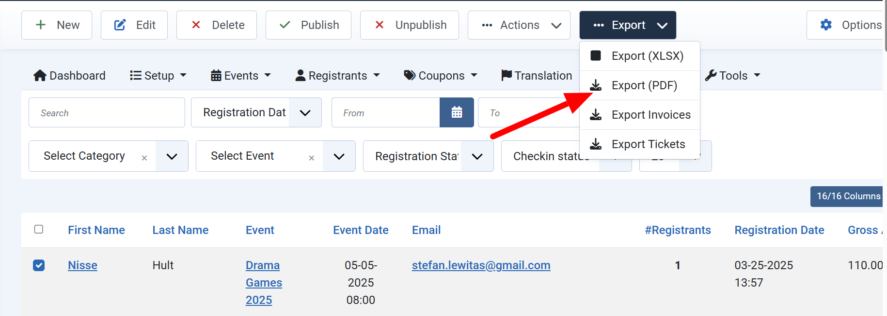

Use **Actions -> Export PDF** in the toolbar to create a PDF list of registrants. As with [Export Registrants](/registrants-management/export-registrants), you can filter by event or status, or select individual records before exporting.

## Customized PDF Layout

Due to limitation of PDF, the exported PDF file could not contains any fields. It only contains some very basic fields and you might want to customize it to meet your need. In this case, you will need to modify the layout file in **components/com_eventbooking/themes/default/common/registrants_pdf.php**

Once the change is done and works for your need, please move that modified file to administrator/templates/isis/html/com_eventbooking/common folder so that the change won't be lost when you update to future releases of the extension

If you use this feature from frontend registrants management, the modified file need to be copied to PATH_TO_TEMPLATE/html/com_eventbooking/common folder, too (PATH_TO_TEMPLATE is path to the template uses for frontend of your site)