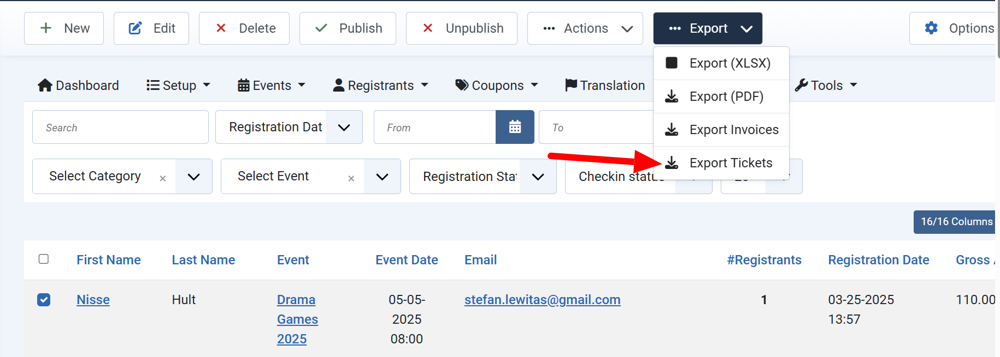

If you use **Tickets PDF**, you can export tickets for all registrants or a filtered set. On the registrants management screen, filter by event or status, or select individual records. Then click **Actions -> Export Tickets** in the toolbar.

Events Booking combines the tickets into a single PDF, with one ticket per page.

