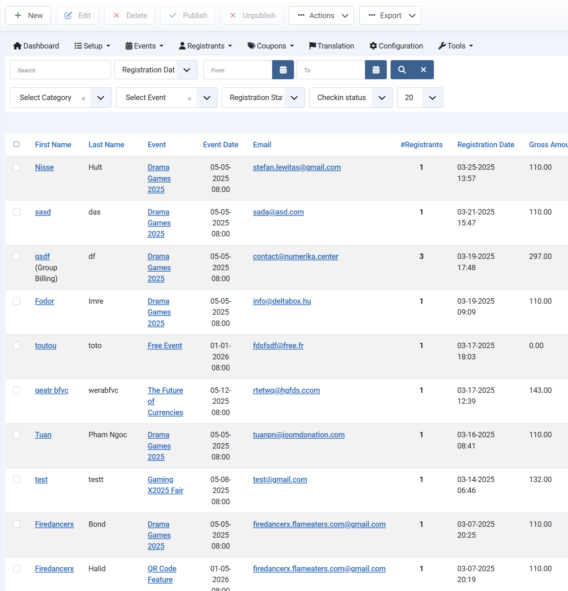
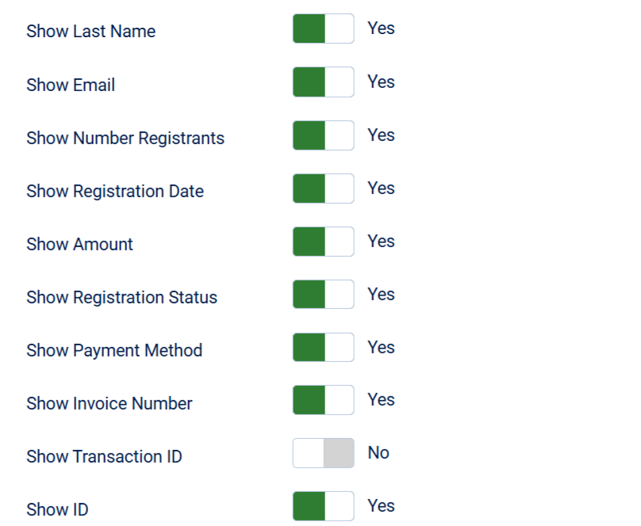
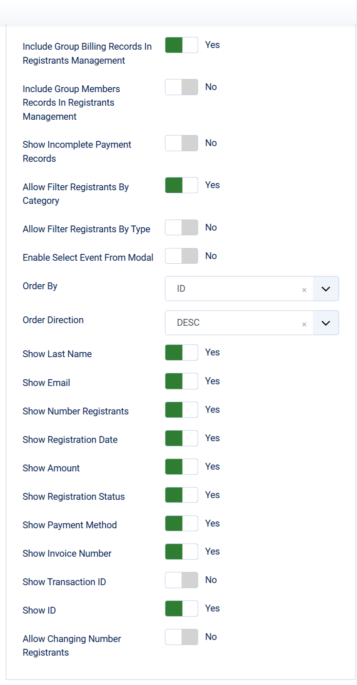

Open the registrants management page in either of these two ways.

1. Go to **Components -> Events Booking -> Registrants**.
2. From any Events Booking page, open **Registrants**.

Use this page to add, edit, publish, unpublish, import, or export registration records and email registrants. You can filter the records by event, registration status, or check-in status if you use QR codes to check in registrants from a mobile device.

### Show/Hide group billing/group members
For group registrations, Events Booking stores both individual group member records and a group billing record for the person who makes the registration. To choose which records appear, go to Events Booking -> Configuration, open the **Themes** tab, and find **Registrants Management**.

- Include Group Billing Records In Registrants Management (default Yes).
- Include Group Members Records In Registrants Management (default No).

### Display More Custom Fields
Events Booking displays First Name, Last Name, and Email by default. To show another field, go to Events Booking -> Custom Fields, edit the field, and set **Show On Registrants Management** to **Yes**.

### Show/Hide Some Columns
If you want to show/hide certain columns like **Amount**, **Payment Status**,... on Registrants Management screen, go to Events Booking -> Configuration, look at Themes tab, **Registrants Management** section and choose to Show/Hide the columns you want

### Filter Registrants By Custom Fields

To filter registrants by the options they selected in a Radio/List/Checkboxes field, edit the field and set **Filterable** to Yes.

### Change Default Ordering
Events Booking sorts the list by ID in DESC order, so the latest records appear first. To change the order, go to **Events Booking** -> **Configuration**, open the **Themes** tab, and change **Order By** and **Order Direction** under **Registrants Management**.

From the administrator area, manage registration and payment records, contact registrants, and export lists and documents.

- [Add Edit Registrants](/registrants-management/add-edit-registrants) — Add a registration manually or update an existing record.
- [Export Registrants](/registrants-management/export-registrants)
- [Refund Registration](/registrants-management/refund-registration)
- [Request Payment](/registrants-management/request-payment)
- [Import Registrants](/registrants-management/import-registrants)
- [Mass Mail Registrants](/registrants-management/mass-mail-registrants) — Email all registrants for an event.
- [Mass Mail Selected Registrants](/registrants-management/mass-mail-selected-registrants) — Email only the registrants you select.
- [Cancel Registrations](/registrants-management/cancel-registrations)
- [Check-in/ Checkout Registrants](/registrants-management/checkin-checkout-registrants)
- [Send Certificates](/registrants-management/send-certificates)
- [Download Certificates](/registrants-management/download-certificates)
- [Resend Emails](/registrants-management/resend-emails) — Resend a registration confirmation email.
- [Export Registrants PDF](/registrants-management/export-registrants-pdf) — Create a PDF list of registrants.
- [Export Tickets](/registrants-management/export-tickets)
- [Export Invoices](/registrants-management/export-invoices)
