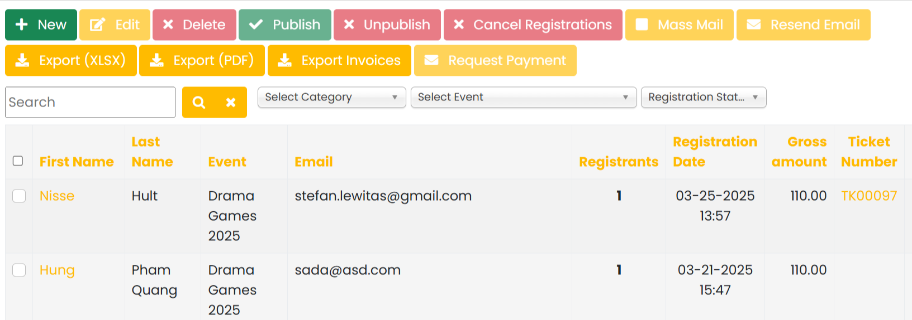
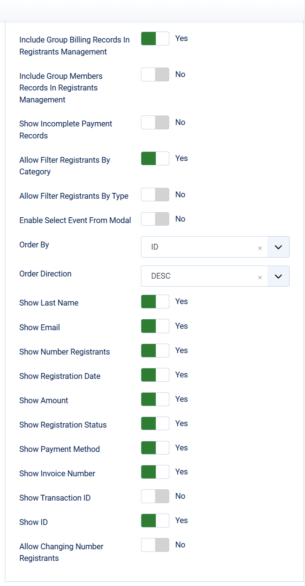

## Manage Registrants
Authorized users can manage registrants from the frontend of your site. Most tasks work the same way as in [backend registrants management](/registrants-management). Importing registrants requires the administrator area. Use frontend management in the following situations.

1. You want to let someone manage registrants without giving them access to the administrator area.
2. You let users submit events from the frontend and want them to manage registrants for their own events.

Follow these steps to enable frontend registrant management.

## Permission Configuration
Go to **Events Booking -> Configuration** or any Events Booking page in the administrator area. Click **Options** in the toolbar, select the user group, such as **Author**, and set **Front-end Registrants Management** to **Allowed**. Joomla permissions are inherited, so child groups such as Editor and Publisher also receive this permission.

## Create menu item
Create an **Events Booking** menu item of type **Manage Registrants**. Users can open it to manage registrants.

## Important Settings
If users submit their own events, you can restrict them to managing registrants for those events. Go to **Events Booking** -> **Configuration** and set **Only show registrants of events owner** to **Yes**. Set it to **No** to let users manage registrants for all events.

## Customization Options
- Go to **Events Booking** -> **Configuration**, look at **Themes** tab, **Registrants Management** section, you can:
+ Change the default sort order. The default sorts by ID in descending order, so the latest records appear first.
+ Choose to show/hide some columns from there
- To show or hide a custom field, go to Events Booking -> Custom Fields and edit the field. Set Show On Registrants Management to Yes or No.

