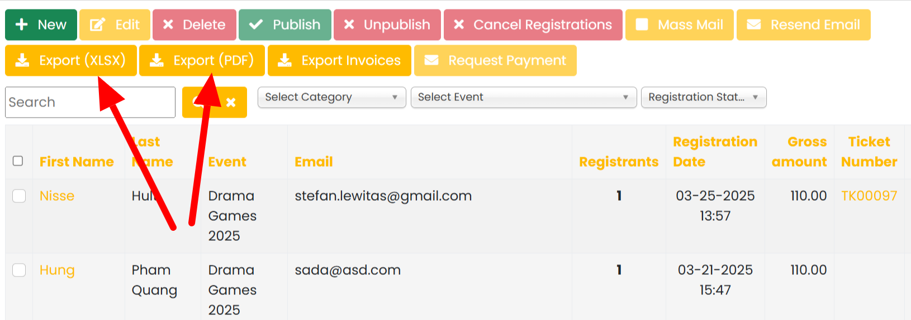

Users with **Frontend Registrants Management** permission can export registrants to an Excel file from the frontend of your site.

1. On the [Registrants Management](/frontend-management/manage-registrants) page, users with registrant management permission can export records for all events or select a single event, as when [exporting registrants from backend](/registrants-management/export-registrants).

2. Users who has registrants management permission or user who created the event, when browse for that event (in events list or event details page) will see an **Export Registrants** button to allow exporting registrants of that specific event.

3. Create an Events Booking menu item of type **Export Registrants** to let users with [registrants management permission](/frontend-management/manage-registrants#permission-configuration) export registrants for all events.