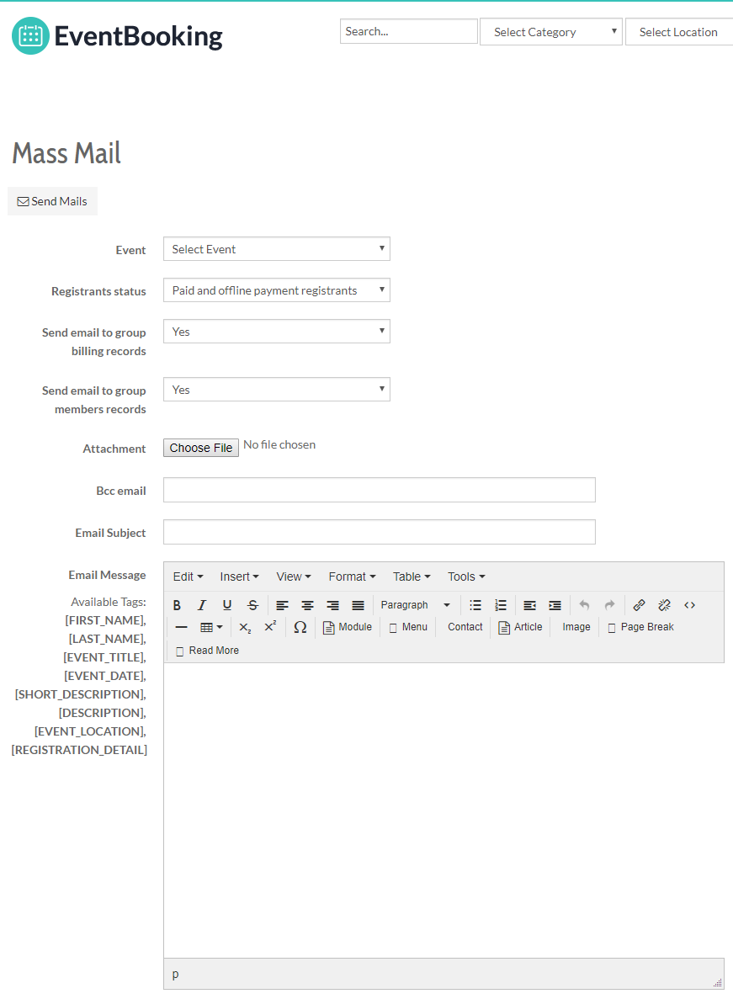

Use this feature to email all registrants for an event from the frontend of your site.

## Permission Configuration
Grant **Front-end Registrants Management** permission to the relevant user groups as described at [https://docs.joomdonation.com/eventsbooking/frontend-management/manage-registrants#permission-configuration](/frontend-management/manage-registrants#permission-configuration).

## Create Menu Item
Create an Events Booking menu item of type **Mass Mail**. Users with **Front-end Registrants Management** permission can open it, choose an event, and compose an email to send to its registrants. The procedure is the same as in the administrator area. See [this link ](/registrants-management/mass-mail-registrants) for those instructions.

