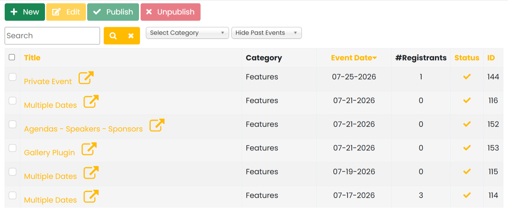

Create an Events Booking menu item of type **Manage Events** to let users submit and manage their events from the frontend. When users open the menu item, they see the events they created.

Users can edit, publish, or unpublish their events from this page. Members of a group with **Configure ACL & Options** set to **Allowed** in Events Booking can see all events.