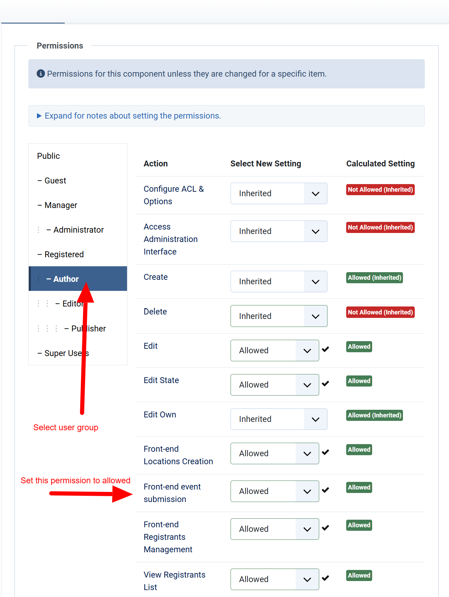
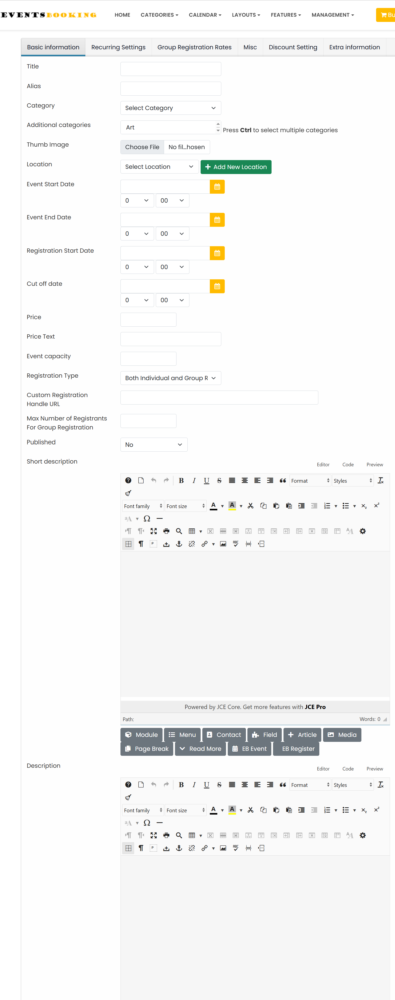
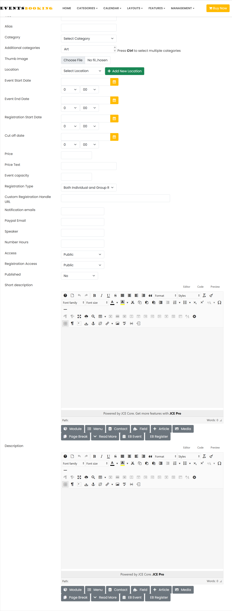
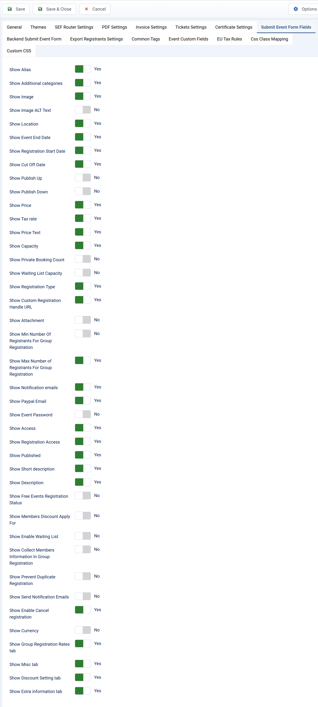

Users with the required permissions can submit and manage their own events from the frontend. Follow these steps to allow frontend submissions.

## Permission Configuration

Go to **Events Booking -> Configuration** or any Events Booking page in the administrator area. Click **Options** in the toolbar, select the user group, such as **Registered**, and set **Front-end event submission** to **Allowed**. Joomla permissions are inherited, so child groups such as **Author**, **Editor**, and **Publisher** also receive this permission.

## Create Menu Item
Next, you will need to create a menu item to link to **Submit Event** or **Submit Event - Simple Layout** menu item type of Events Booking. Users can access to that menu item, enter necessary data on the form to submit event. You should also create a menu item to link to **Manage Events** menu option (see [https://docs.joomdonation.com/eventsbooking/frontend-management/users-events](/frontend-management/users-events) to allow users to click on to manage the events which he submitted.

## Choose submission form layout
The **Default layout** includes most of the settings available in the administrator area and is useful for users who manage your organization’s events. The **Simple layout** offers fewer settings and is useful when visitors submit their own events.

To use Simple Layout, go to **Events Booking** -> **Configuration**, open the **General** tab, and set **Frontend Event Submission Form Layout** to **Simple Layout**.

**Submit Event Default Layout**

**Submit Event Simple Layout**

## Show/Hide fields on submit event form
The fields on submit event form are configurable. You can go to Events Booking -> Configuration, look at **Submit Event Form Fields** tab, choose to show/hide the fields you want.

## Control status of events submitted from frontend of your site
When users submit an event from the frontend, they can choose Published or Unpublished if their user group has Edit State set to Allowed in Events Booking. Otherwise, Events Booking applies **Default Event Status**, which is unpublished by default. An administrator must review and publish an unpublished event before it appears on the site.

## Locations Settings
To let users choose from all locations when submitting an event, go to Events Booking -> Configuration, open the General tab, and set **Show All Locations In Frontend Event Submission Form** to **Yes**. Set it to **No** to let them choose only their own locations.

You should also consider allow users to submit location in frontend so that they can create locations for their own events while submitting events. See https://docs.joomdonation.com/eventsbooking/frontend-management/users-locations#permission-configuration for permission configuration.

## Notification Emails
Events Booking sends notification email to administrator and confirmation email to users when user submit new event from the frontend of your site. You can go to Events Booking -> Emails & Messages, look at **Submit Event Email Messages** and change the following email messages to suit your needs if needed:

**User Email Subject**
**User Email Body**
**Admin Email Subject**
**Admin Email Body**

You can use the following tags for these messages:
- **[NAME]** (Name of user who submit event)
- **[USERNAME]** (Username of user who submit event)
- **[EVENT_TITLE]**
- **[EVENT_DATE]**
- **[EVENT_ID]**
- **[EVENT_LINK]** (Link to view event from the administrator area of your site)
