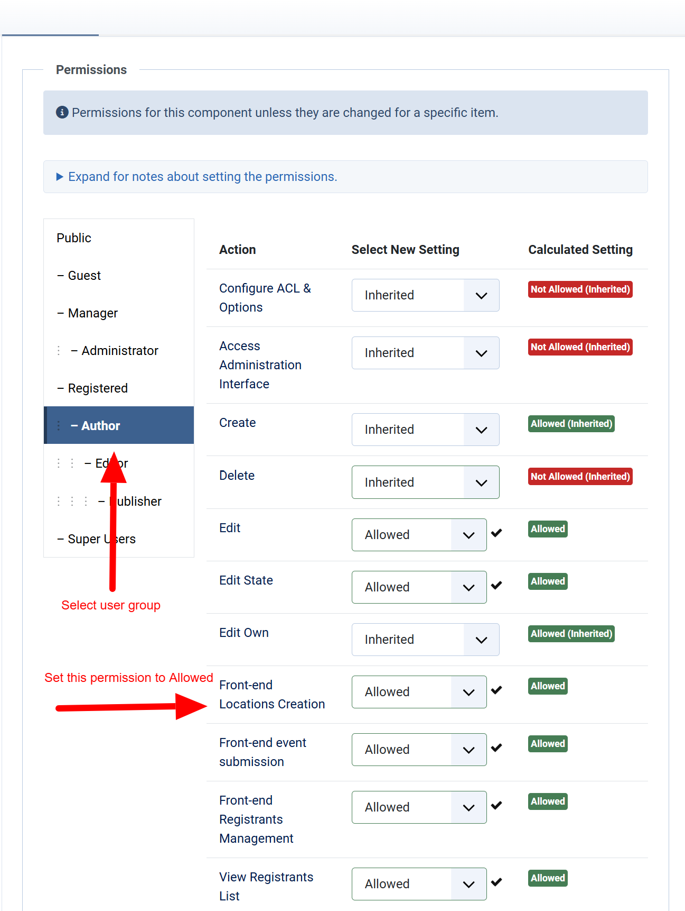
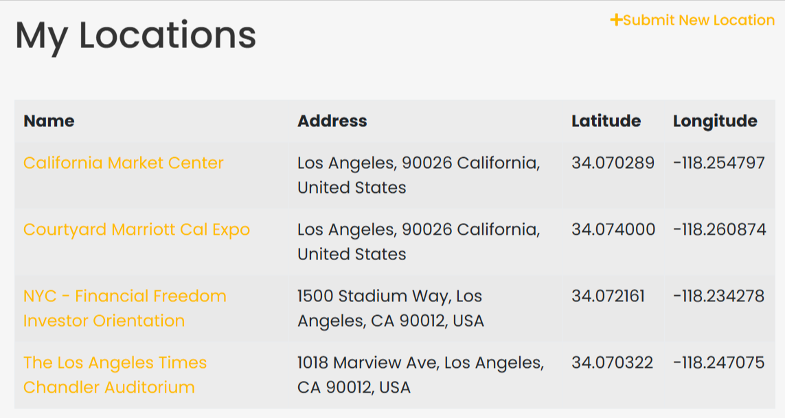

Users can submit and manage locations for their own events from the frontend. Follow these steps to enable this feature.

## Permission configuration

Go to Events Booking -> Configuration or any Events Booking page in the administrator area. Click Options in the toolbar, select a user group such as Registered, and set **Front-end Locations Creation** to **Allowed**. Joomla permissions are inherited, so child groups such as Author, Editor, and Publisher also receive this permission.

## Create menu item
Create an Events Booking menu item of type **Manage Locations**. Users can open it to see the locations they created, as shown below.

From this page, users can create a location or edit one they already created.