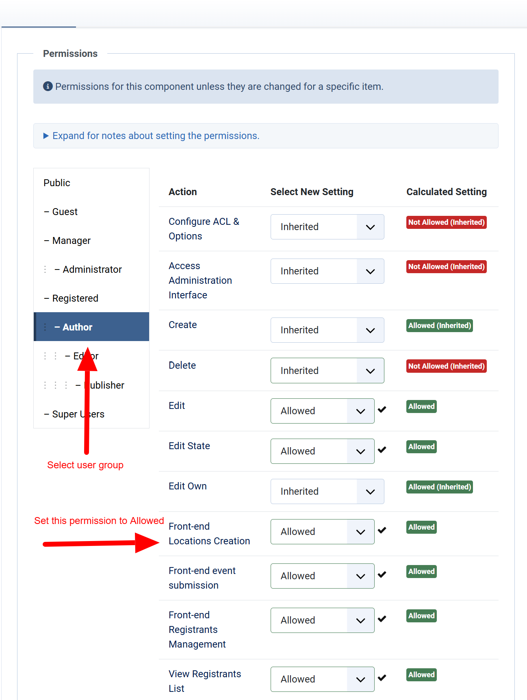
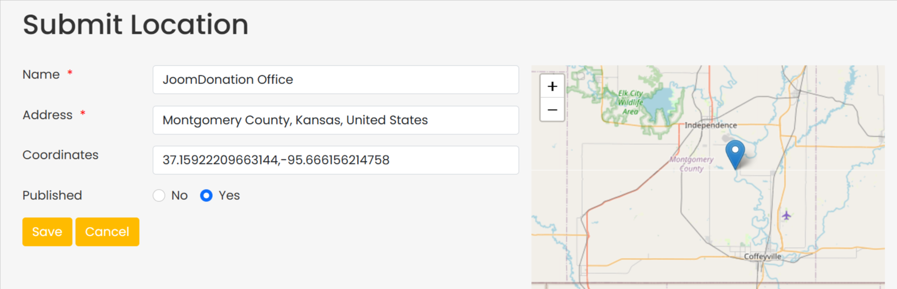

You can create a menu item that opens a form for submitting a location directly from the frontend. This is useful when users need to create a location without opening their list of locations first.

## Permission configuration

Go to Events Booking -> Configuration or any Events Booking page in the administrator area. Click Options in the toolbar, select a user group such as Registered, and set **Front-end Locations Creation** to **Allowed**. Joomla permissions are inherited, so child groups such as Author, Editor, and Publisher also receive this permission.

## Create menu item
Create an Events Booking menu item of type **Submit Location**. It opens the form shown below. Users can select the locations they create here when submitting events from the frontend.

