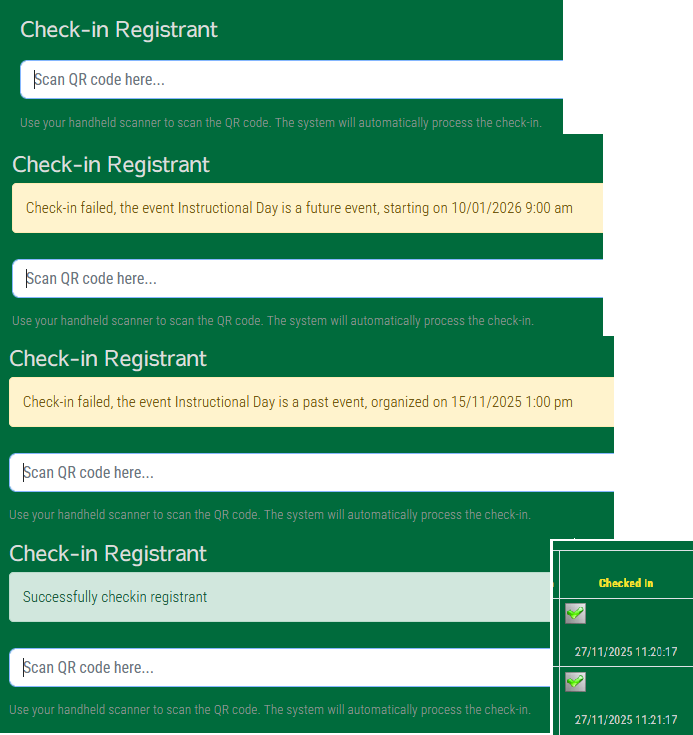

**Events Booking** can generate a QR code for each registration so you can check in registrants when they arrive.

## How it works
1. When someone registers, Events Booking generates a QR code that points to a unique check-in URL for that registration. It displays the code in the thank-you message and the confirmation email.
2. The registrant prints the thank-you message or confirmation email with the QR code and brings it to the event as their ticket.
3. When the registrant presents the ticket, scan the QR code with a QR code reader app on your phone.
* If the QR code is valid, Events Booking checks in the registrant, updates the check-in status, and displays a success message.
* For an individual registration, the QR code can be used to check in once.
* For a group registration, the QR code can be used once per registrant in the group.
* If the QR code is invalid (invalid code or it was used for checked in before), the system will display a failed message and you know that the ticket is invalid.

## Checkin Registrants Using Built-In QRCODE Scanner
Use the built-in QR code scanner to check in registrants from your mobile browser without installing a separate app. This is a recommended check-in method.

**To use this method**:
- Insert **[TICKET_QRCODE]** in the **Thank you message**, **User Email Body**, **invoice layout**, or **Ticket PDF layout** if you use PDF tickets.
- Create an Events Booking menu item of type **QRCODE Scanner**. Events Booking waits 15 seconds between scans by default to avoid processing too many check-ins in a short time. To shorten the wait to five seconds, set **Checkin Interval** to 5. Make this menu item visible only to groups with Registrants Management permission.
- On your phone, open your browser and log in with an account that has **Registrants Management** permission. Open the menu item and click **Start Scanning** to grant access to the phone’s camera.
- Scan each ticket on that page to check in the registrant.

**Events Booking** can generate a QR code for each registration so you can check in registrants when they arrive.

## How it works
1. When someone registers, Events Booking generates a QR code that points to a unique check-in URL for that registration. It displays the code in the thank-you message and the confirmation email.
2. The registrant prints the thank-you message or confirmation email with the QR code and brings it to the event as their ticket.
3. When the registrant presents the ticket, scan the QR code with a QR code reader app on your phone.
* If the QR code is valid, Events Booking checks in the registrant, updates the check-in status, and displays a success message.
* For an individual registration, the QR code can be used to check in once.
* For a group registration, the QR code can be used once per registrant in the group.
* If the QR code is invalid (invalid code or it was used for checked in before), the system will display a failed message and you know that the ticket is invalid.

## Checkin Registrants handheld scanner 
As with **Checkin Registrants Using Built-In QRCODE Scanner**, create an Events Booking menu item, this time of type **Handheld QRCODE Scanner**. Users with registrant management permission can open it to see a form with a text field. When you scan the QR code, the scanner enters the ticket code in the field. The form submits and displays the check-in result.

## Checkin Registrants Using QRCode Plus app
The [QRCode Plus](https://apps.apple.com/app/id937791963) is a free **IOS** app which can be used to check in registrants in Events Booking. This is the recommended method because:
- The app is free. So you do not have to purchase a mobile app for checking in registrants
- The app makes check-in quick and simple.
- You can check in registrants without logging in to the frontend of your site.

**To use this method**:
- Install the app on your iPhone or iPad.
- Insert **[TICKET_QRCODE]** in the **Thank you message**, **User Email Body**, **invoice layout**, or **Ticket PDF layout** if you use PDF tickets.
- Go to Events Booking -> Configuration and enter a random string in **Checkin API Key**.
- Configure the **QRCode Plus** app which you installed. Enter the parameters below:
+ URL: Enter https://domain.com/index.php?option=com_eventbooking&task=scan.qr_code_plus&api_key=[API_KEY] . Of course you need to replace https://domain.com with URL of your site. [API_KEY] needs to be replaced with the string you entered in **Checkin API Key** config option.
+ **Method**: Choose **Post**.
+ **Key Name**: Set to **code**
- Scan the QR code on each ticket to check in registrants, as described in **How it works** above.

## Checkin registrants using CodeREADr mobile app
This method requires the Tickets PDF feature. Follow the steps below to use the CodeREADr mobile app and service [https://www.codereadr.com/](https://www.codereadr.com).
- Each ticket has a unique, 32-character code.
- Add **[TICKET_QRCODE]** to the ticket layout. Events Booking generates a QR code using the unique ticket code.
- Go to Events Booking, Registrants, select the event you want, then export registrants into CSV/Excel file. Before exporting, please go to Events Booking -> Configuration, set Include Group Billing Records in Registrants Management to No so that only group members will be exported
- Sign up for an account on https://www.codereadr.com/
- Download and install the mobile APP provided in the website
- Follow the first three steps on this page https://www.codereadr.com/kb/databases/ to prepare and import registrants into the website
- Use the mobile app to check in registrants.

## Checkin registrants Using QRCODE reader APP
This method has some disadvantages compare to use iCODY APP:
- You must log in to the frontend before scanning tickets.
- Each scan opens the URL from the ticket’s QR code in your mobile browser.
- As you can imagine, it is much slower compare to use iCODY APP. So this should only be used if you don't have too much registrants.

**To use this method**
1. You insert **[QRCODE]** tag into **Thank you message** or **User Email Body** message or **invoice layout** or **Ticket PDF layout** (if you are using tickets PDF feature) in Events Booking.
2. Registrants can print the message, invoice, or ticket containing the QR code and bring it to the event.
3. The person checking in registrants follows these steps.
* Log in to the frontend on a device that can scan QR codes, such as an iPhone. We tested with this iPhone app https://itunes.apple.com/us/app/qr-code-reader-by-scan/id698925807?mt=8 . You can use any QR code reader app.
* Use a **super admin account or an account which as Registrants Management** in Events Booking.
* Scan the QR code on the registrant’s ticket with the app to check them in.

## Check-in registrants manually
To see who has checked in, open the registrants list in the administrator area and filter by Event and Checked in status.

You can also check in registrants manually, see instructions at [https://docs.joomdonation.com/eventsbooking/registrants-management/checkin-checkout-registrants](/registrants-management/checkin-checkout-registrants)

## Display Registrants Information In Checkin Messages

When you scan a QR code to check in a registrant, Events Booking displays one of these messages.

- EB_INVALID_REGISTRATION_RECORD
- EB_REGISTRANT_ALREADY_CHECKED_IN
- EB_CHECKED_IN_FAIL_REGISTRATION_CANCELLED
- EB_CHECKED_IN_SUCCESSFULLY
- EB_CHECKED_IN_REGISTRATION_PENDING
- EB_CHECKED_IN_PAST_EVENT
- EB_CHECKED_IN_FUTURE_EVENT

To edit the messages, go to Events Booking -> Translations and find the language items above. You can insert tags such as [FIRST_NAME] and [LAST_NAME] to display registrant details. See [Common Tags](/email-tags/common-tags) for supported tags.
