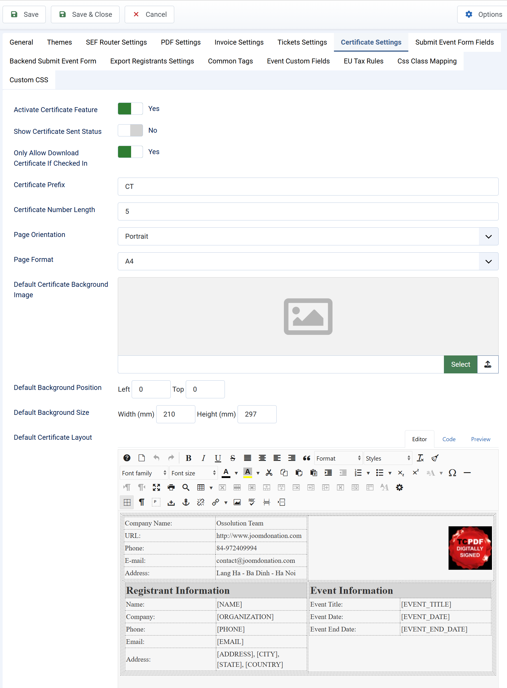
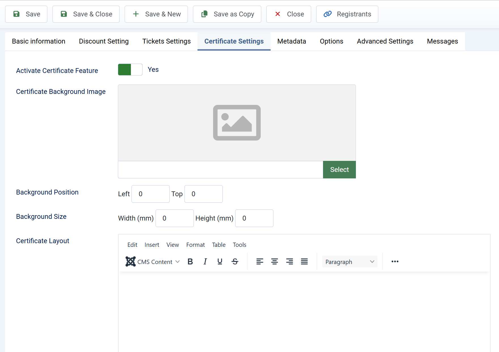

Design and generate **CERTIFICATES** to send to registrants after an event ends.

## Enable Certificate feature
PDF certificates are disabled by default. To enable them, go to **Events Booking** -> **Configuration**, open Certificates Settings, and set **Activate Certificate Feature** to Yes. You can also set the Page Format, Page Orientation, and Background image.

## Enable Certificate for each event
**Certificates** feature can be On/Off on individual event basis. If you enable Certificates in configuration, when you create/edit an event, you will see a tab called **Certificates Settings**. Set **Activate Certificate Feature** parameter to **Yes** if you want Events Booking to generate Certificates for registrants of this event. You can also change other parameters like **Certificate Background Image**, **Certificate Layout**... to create a customized certificate for this event (the settings inside event will override the global certificate settings in Events Booking Configuration).

## Supported tags
Below are list of all the tags which you can use to design your certificate

### Event Information tags
- [EVENT_TITLE]
- [EVENT_DATE]
- [EVENT_DATE_DATE] (event date without the time)
- [EVENT_DATE_TIME]
- [EVENT_END_DATE]
- [EVENT_END_DATE_DATE]
- [EVENT_END_DATE_TIME]
- [SHORT_DESCRIPTION]
- [DESCRIPTION]
- [EVENT_CAPACITY]
- [INDIVIDUAL_PRICE]
- [PRICE_TEXT]
- [LOCATION]
- [LOCATION_NAME]

### Registration information
- [ID] (registration record ID)
- [FIRST_NAME]
- [LAST_NAME]
- [NAME] (first_name and last_name combined)
- Any custom fields using the syntax [NAME_OF_FIELD_IN_UPPERCASE], for example, if you have a custom field name registration_type, then the tag is [REGISTRATION_TYPE]
- [COUPONCODE]
- [USERNAME]
- [USER_ID]
- [NUMBER_REGISTRANTS]
- [GROUP_MEMBERS_NAMES]
- [INVOICE_NUMBER]
- [TOTAL_AMOUNT]
- [DISCOUNT_AMOUNT]
- [TAX_AMOUNT]
- [PAYMENT_PROCESSING_FEE]
- [AMOUNT] (This is the final payment amount users have to pay, amount after discount, tax...)
- [DEPOSIT_AMOUNT]
- [DUE_AMOUNT]
- [PAYMENT_METHOD]
- [PAYMENT_DATE]
- [TRANSACTION_ID]
- [REGISTRATION_STATUS]
- [TICKET_TYPES] (if you use the Ticket Types feature)

### Certificates information
- [CERTIFICATE_NUMBER]
- [REGISTER_DATE]

## How registrants can download certificate
1. Certificates can only be downloaded after event end date, mean current date greater than event end date.
2. After event end date, registrants can log in, access to Registration History menu item to see their registration history and download the certificate
3. You can also edit the email message sent to registrants when they register for the event, add **[DOWNLOAD_CERTIFICATE_LINK]** tag. Then registrant can look at their email, click on the link to download the certificate if needed.
4. You can configure the system to send [reminder email ](http://eventbookingdoc.joomservices.com/basic-setup/auto-reminder) to your registrants. In the email, you can insert **[DOWNLOAD_CERTIFICATE_LINK]** tag to send link to download certificate to registrant. As certificate can only be downloaded after event finished, this tag should only be used of reminder email is configured to be sent after event started.
5. You can send certificate manually to your registrants. Go to Events Booking -> Registrants, select the checkbox next to the registrant you want to send certificate, click **Send Certicicates** in the toolbar. When you do that, certificates will be send to selected registrants. Please remember to go to Events Booking -> Emails & Messages, set up the **Certificate email subject** and **Certificate email body** to suit your needs.

