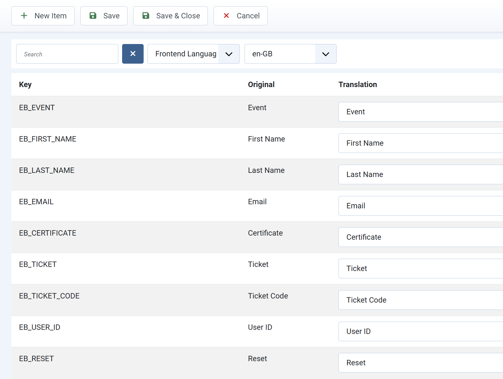
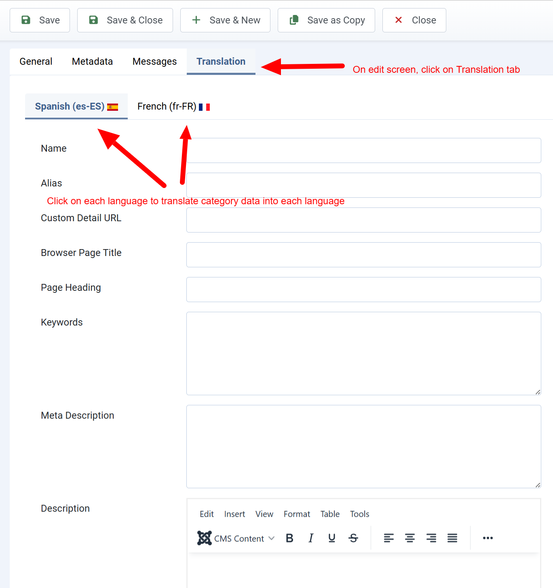
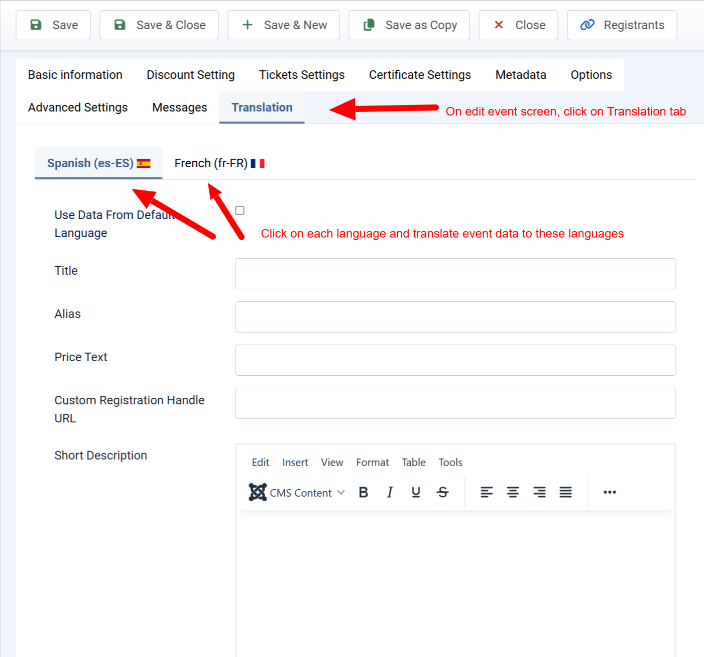
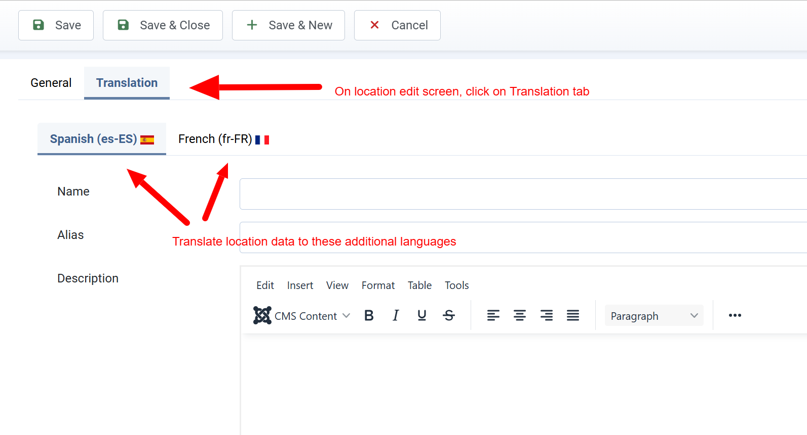
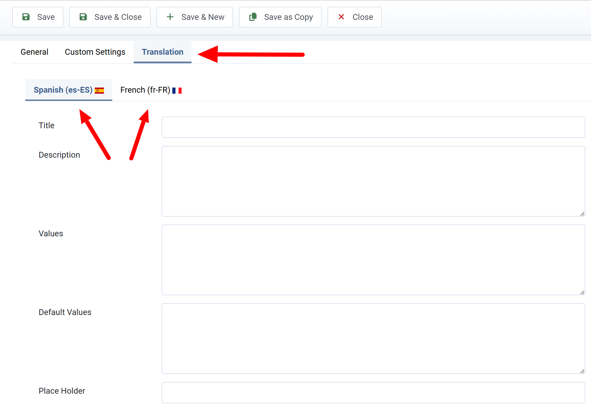
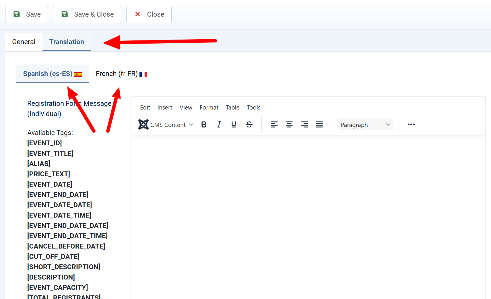

**Events Booking** supports multilingual sites. In Joomla, you typically create one record per language for an item, such as an article.

In **Events Booking**, create one record. To translate it, open the Translation tab when adding or editing the record.

To setup **Events Booking** on a multilingual website, you will need to do the translation on a different places below:

## Translate language items

To that, go to **Events Booking -> Translation**, translate the language items used in the extension to all languages used on your site

## Translate categories

On Categories Management screen, click on a category to edit. Look at **Translation** tab, translate the category to all other languages (beside default language) used on your site

## Translate Events

On Events Management screen, click on an event to edit. Look at **Translation** tab, translate the event to all other languages (beside default language) used on your site.

## Translate Locations
On Locations Management screen, click on a location to edit. Look at **Translation** tab, translate the location to all other languages (beside default language) used on your site.

## Translate Custom Fields

On Custom Fields Management screen, click on a custom field to edit. Look at **Translation** tab, translate the custom field to all other languages (beside default language) used on your site.

## Translate Emails & Messages
The final part you have to translate is **Emails & Messages**. Access to **Events Booking -> Emails & Messages**, click on each message item to edit and translate these message items to all other languages (beside default language) used on your site.

>>>>>> On a multilingual site, missing database fields can cause an SQL error. To add the required fields, go to **Tools => Fix Database Schema**.