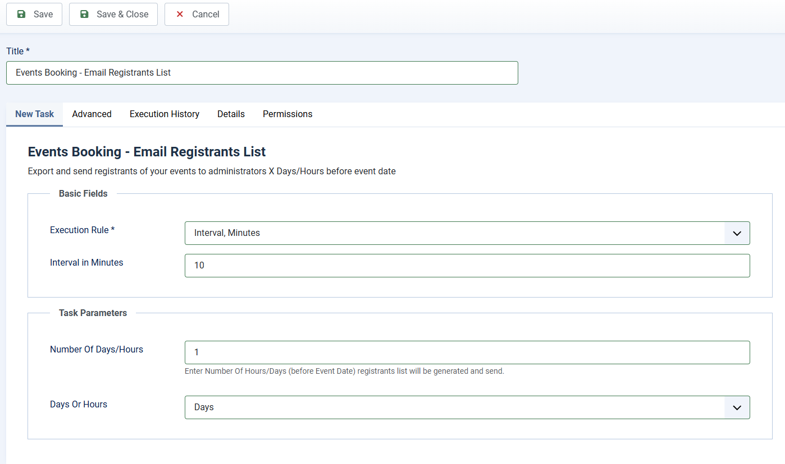

Use this task to export an event’s registrants to Excel and email the file to administrators a set number of days or hours before the event starts.

1. Go to **System -> Plugins** and make sure the **Task - Events Booking** plugin is enabled.
2. Go to **System -> Scheduled Tasks**, click **New** in the toolbar to create a new scheduled task for **Events Booking - Email Registrants List** task type.
3. Set the required parameters and save the task.

## Task Basic Fields
The task sends one event’s registrant list each time it runs. If you have several events per day, set it to run every 10 or 20 minutes, for example. Use the following values under **Basic Fields**.

- **Execution Rule**: Set to **Interval, Minutes**
- **Interval in Minutes**: Set to the number you want, for example, if you set it to 10, the task will be run every 10 minutes.

## Task Parameters
- **Number Of Days/Hours**: Enter Number Of Hours/Days (before Event Date) registrants list will be generated and sent to administrators..
- **Days Or Hours**: If you set it to Days, registrants list will be generated and send X days before Event Date. Similar, if you set it to Hours, registrants list will be sent X hours before Event Date.

## Setup Email Subject and Email Body

Go to **Events Booking -> Emails & Messages**, find and change the following message items to customize the subject and body of the email if needed:

- **send_registrants_list_email_subject**
- **send_registrants_list_email_body**