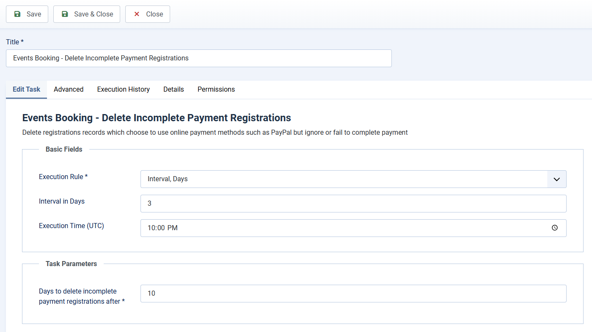

Use this task to remove registrations that are still unpaid after a configurable number of days. It applies to registrations that used an online payment method such as PayPal or Stripe and whose payment was skipped or failed. Removing these records reduces the data stored in the database.

## Create and configure the scheduled task

1. Go to **System -> Plugins** and make sure the **Task - Events Booking** plugin is enabled.
2. Go to **System -> Scheduled Tasks**, click New in the toolbar to create a new scheduled task for **Events Booking - Delete Incomplete Payment Registrations** task type.
3. Set the required parameters and save the task.

## Task Basic Fields
Running the task every few days is enough. The settings below run it every three days. Use them under **Basic Fields**.

- **Execution Rule**: Set to **Interval, Days**
- **Interval in Days**: Set to the number you want, for example, if you set it to 3, the task will be run every 3 days.
- **Execution Time (UTC)**: Choose the time you want the task to be executed, for example 10:00 

## Task Parameters
- **Days to delete incomplete payment registrations after** :  Enter number of days into this parameter (for example, 10 days). Then the ignore/failed payment registration records older than 10 days will be deleted each time the task is executed.