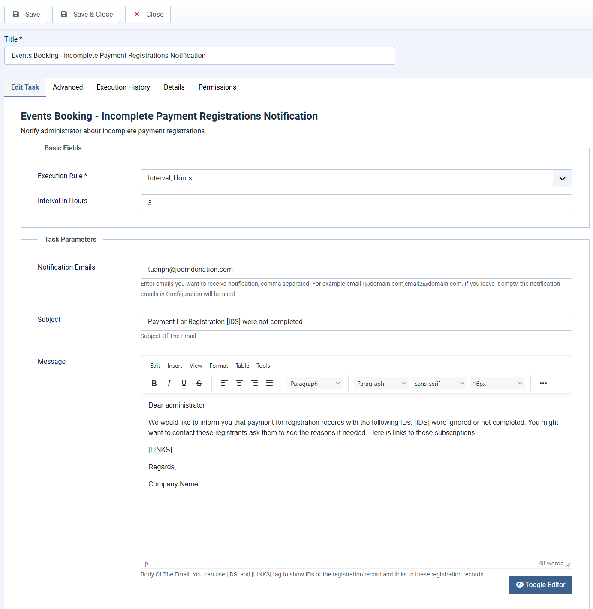

This task notifies administrators about registrations with incomplete online payments. This includes payments that failed and payments the registrant skipped. An administrator can follow up with the registrant if needed.

## Create and configure the scheduled task

1. Go to **System -> Plugins** and make sure the **Task - Events Booking** plugin is enabled.
2. Go to **System -> Scheduled Tasks**, click New in the toolbar to create a new scheduled task for **Events Booking - Incomplete Payment Registrations Notification** task type.
3. Set the required parameters and save the task.

## Task Basic Fields
Run this task every few hours. Use the following values under **Basic Fields**.

- **Execution Rule**: Set to **Interval, Hours**
- **Interval in Hours**: Set to the number you want, for example, if you set it to 3, the task will be run every 3 hours.

## Task Parameters
- **Notification Emails**:  Enter the emails you want to receive a notification about this incomplete payment registrations. Multiple emails are supported, just separate these emails by comma.
- **Subject**: Subject of the email. You can use [IDS] tag and it will be replaced with IDs of the incomplete payment registrations. For example: **Payment For Registrations [IDS] were not completed**
- **Message**: Body of the email. You can use [IDS] and [LINKS] tags in the message. For example:

Dear administrator

We would like to inform you that payment for registration records with the following IDs: [IDS] were ignored or not completed. You might want to contact these registrants ask them to see the reasons if needed. Here is links to these subscriptions:

[LINKS]

Regards,

Company Name