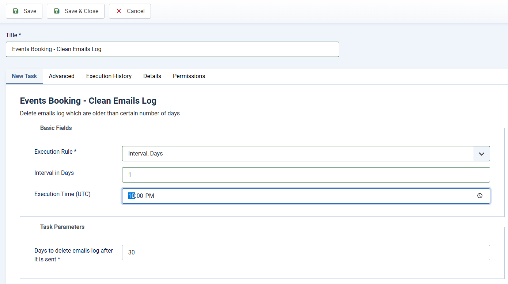

If **Log Emails** is set to **Yes**, Events Booking stores each outgoing email in the database. You can view these messages under Tools -> Emails Log. This task frees up space by deleting log entries older than the configured number of days. The default is 30 days.

## Create and configure the scheduled task

1. Go to **System -> Plugins** and make sure the **Task - Events Booking** plugin is enabled.
2. Go to **System -> Scheduled Tasks**, click New in the toolbar to create a new scheduled task for **Events Booking - Clean Emails Log** task type.
3. Set the required parameters and save the task.

## Task Basic Fields
Running the task daily is enough. Use the following values under **Basic Fields**.

- **Execution Rule**: Set to **Interval, Days**
- **Interval in Days**: Set to the number you want, for example, if you set it to 1, the task will be run every 1 day.
- **Execution Time (UTC)**: Choose the time of day to run the task, such as 10:00 AM.

## Task Parameters
- **Days to delete emails log after it is sent**:  Enter a number here (for example 30) and emails from Emails Log will be deleted after 30 days.