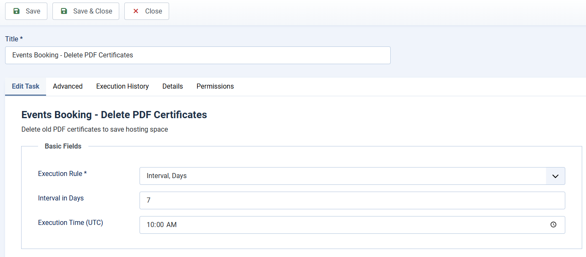

Events Booking stores each generated certificate PDF on the server. This task deletes certificate PDFs that are more than one day old to free up storage space.

## Create and configure the scheduled task

1. Go to **System -> Plugins** and make sure the **Task - Events Booking** plugin is enabled.
2. Go to **System -> Scheduled Tasks**, click **New** in the toolbar to create a new scheduled task for **Events Booking - Delete PDF Certificates** task type.
3. Set the required parameters and save the task.

## Task Basic Fields
Running this task every few days should be enough. Use the following values under **Basic Fields**.

- **Execution Rule**: Set to **Interval, Days**
- **Interval in Days**: Set how often to run the task. For example, enter 7 to run it every seven days.
- **Execution Time (UTC)**: Choose the time of day to run the task, such as 10:00 AM.