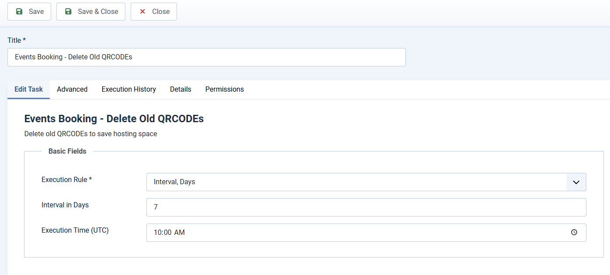

Events Booking stores generated QR codes on the server as PNG or JPEG files. This task deletes QR code files that are more than one day old to free up storage space.

## Create and configure the scheduled task

1. Go to **System -> Plugins** and make sure the **Task - Events Booking** plugin is enabled.
2. Go to **System -> Scheduled Tasks**, click **New** in the toolbar to create a new scheduled task for **Events Booking - Delete Old QRCODEs** task type.
3. Set the required parameters and save the task.

## Task Basic Fields
Running this task every few days should be enough. Use the following values under **Basic Fields**.

- **Execution Rule**: Set to **Interval, Days**
- **Interval in Days**: Set how often to run the task. For example, enter 7 to run it every seven days.
- **Execution Time (UTC)**: Choose the time of day to run the task, such as 10:00 AM.