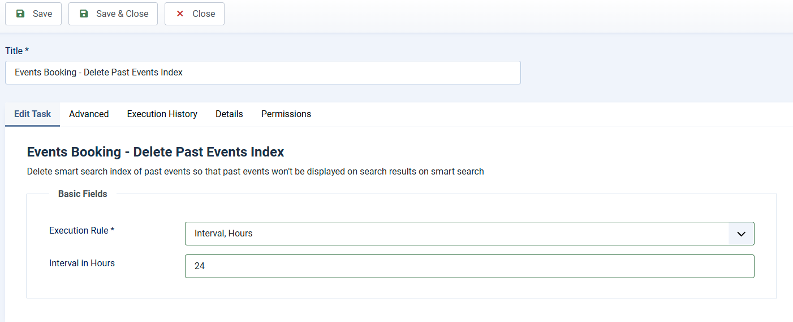

Use **Events Booking - Delete Past Events Index** to remove past events from Joomla Smart Search results. The task removes index entries for events that are more than 24 hours old each time it runs.

## Create and configure the scheduled task

1. Go to **System -> Plugins** and make sure the **Task - Events Booking** plugin is enabled.
2. Go to **System -> Scheduled Tasks**, click **New** in the toolbar to create a new scheduled task for **Events Booking - Delete Past Events Index** task type.
3. Set the required parameters and save the task.

## Task Basic Fields
Running the task every 12 or 24 hours is enough. Use the following values under **Basic Fields**.

- **Execution Rule**: Set to **Interval, Hours**
- **Interval in Hours**: Set to the number you want, for example, if you set it to 12, the task will be run every 12 hours.