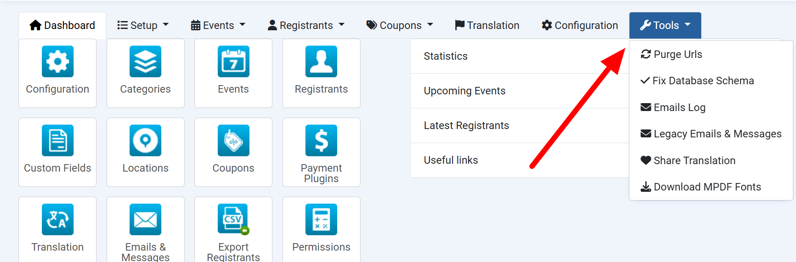

The **Tools** menu appears on the right of most Events Booking pages in the administrator area, including Events Booking -> Categories and Events Booking -> Events. The sections below explain when to use each tool.

## Tools -> Fix Database Schema
Use this tool if an Events Booking update fails or if you import data from a site running an older version of Events Booking. It updates the database schema to the latest version.

If an SQL error prevents you from opening Events Booking, use the following URL to run the tool directly. Replace https://domain.com/administrator with your site’s administrator URL.

https://domain.com/administrator/index.php?option=com_eventbooking&task=update.update

## Tools -> Purge URLs
Events Booking caches its URLs in the **eb_events** database table. A cached URL can still point to an old resource after you import data from another site or delete and recreate an event with the same title and alias.

Go to **Tools -> Purge** URLs to clear the cache so Events Booking can generate URLs that point to the current resources.

## Make field sort and searchable
By default, Events Booking lets you sort and search registrations by core fields such as first_name, last_name, and email. Use this tool to enable sorting and searching for a custom field.

1. Log in to the administrator area of your site.
2. Open this URL https://domain.com/administrator/index.php?option=com_eventbooking&task=tool.make_field_search_sort_able&field_id=100 and replace the following values.
- Replace https://domain.com/administrator with your site’s administrator URL.
- Replace 100 with the ID of the custom field you want to make searchable.

## Fix Row size too large error

On a multilingual site, Events Booking adds database fields for each installed language. If you install many languages, this can cause the **Row size too large (> 8126)** error. Follow the steps below to fix it.

1. Log in to the administrator area of your site
2. Open the two URLs below and replace https://domain.com/administrator with your site’s administrator URL.
- https://domain.com/administrator/index.php?option=com_eventbooking&task=tool.fix_row_size
- https://domain.com/administrator/index.php?option=com_eventbooking&task=tool.fix_row_size2

## Resize Events Thumbnail

Changing the thumbnail size in Events Booking -> Configuration affects only new events.

Use this tool to resize thumbnails for existing events without opening and saving each event individually.

1. Log in to the administrator area of your site
2. Open the URL below (replace https://domain.com/administrator with your site’s administrator URL)

https://domain.com/administrator/index.php?option=com_eventbooking&task=tool.resize_thumb_images

## Generate Missing Invoice Number
If you enabled invoicing after accepting registrations, some records may be missing invoice numbers. Use this tool to generate them.

1. Log in to the administrator area of your site
2. Open the URL below (replace https://domain.com/administrator with your site’s administrator URL)

https://domain.com/administrator/index.php?option=com_eventbooking&task=tool.generate_missing_invoice_number

## Support Up To 6 Reminders

By default, you can configure up to three reminder emails per event. Use this tool to add more.

1. Log in to the administrator area of your site
2. To add a fourth reminder, open https://domain.com/administrator/index.php?option=com_eventbooking&task=tool.add_fourth_reminder_fields
3. To add a fifth reminder, open https://domain.com/administrator/index.php?option=com_eventbooking&task=tool.add_fifth_reminder_fields
4. To add a sixth reminder, open https://domain.com/administrator/index.php?option=com_eventbooking&task=tool.add_sixth_reminder_fields

This tool requires Events Booking 4.7.0+. Replace https://domain.com/administrator with your site’s administrator URL.

## Remove PDF Invoices

Events Booking stores generated PDF invoices on your server. Follow the steps below to delete those files and free up storage.

1. Log in to the administrator area of your site
2. Open this URL https://domain.com/administrator/index.php?option=com_eventbooking&task=tool.remove_pdf_invoices

Replace https://domain.com/administrator with your site’s administrator URL.

## Remove PDF Tickets

Events Booking stores generated PDF tickets on your server. Follow the steps below to delete those files and free up storage.

1. Log in to the administrator area of your site
2. Open this URL https://domain.com/administrator/index.php?option=com_eventbooking&task=tool.remove_pdf_tickets

Replace https://domain.com/administrator with your site’s administrator URL.

## Remove PDF Certificates

Each time Events Booking generates PDF Certificate, a file will be generated and store on server, it costs hosting space. If you want to delete/clean up these PDF Ticket files, please:

1. Log in to the administrator area of your site
2. Open this URL https://domain.com/administrator/index.php?option=com_eventbooking&task=tool.remove_pdf_certificates

Replace https://domain.com/administrator with your site’s administrator URL.

## Remove All Invoice, Ticket, Certificate pdf files

Follow these steps to delete the PDF invoices, tickets, and certificates in one operation.

1. Log in to the administrator area of your site
2. Open this URL https://domain.com/administrator/index.php?option=com_eventbooking&task=tool.clean_up_pdf_files

Replace https://domain.com/administrator with your site’s administrator URL.

## Remove orphan files
If you use a **File** custom field, uploads can remain on the server without an associated registration. This can happen when a visitor uploads a file without completing the registration. Follow the steps below to delete those files and free up storage.

1. Log in to the administrator area of your site
2. Open the URL below (replace https://domain.com/administrator with your site’s administrator URL)
- https://domain.com/administrator/index.php?option=com_eventbooking&task=tool.delete_orphan_files

