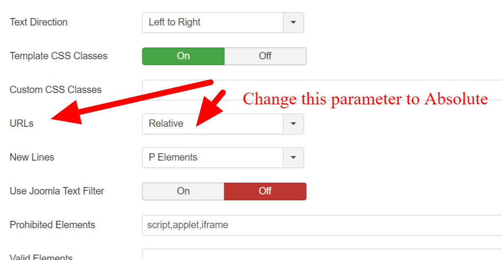

A link in an email may fail if your editor changes an **absolute URL** to a **relative URL** when you save the message.

Go to Extensions -> Plugins and open the editor plugin you use, such as Tiny MCE. Change **URLs** from **Relative** to **Absolute**, then edit and save the email message again.

The screenshot shows the Tiny MCE settings. Other editors, such as JCE, may have a similar setting.

