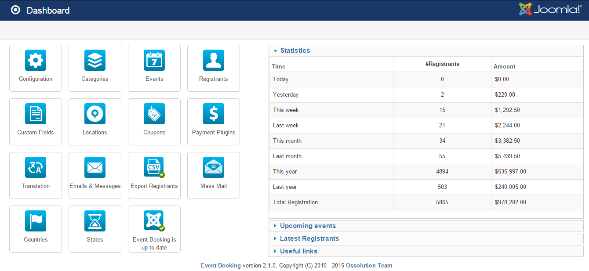
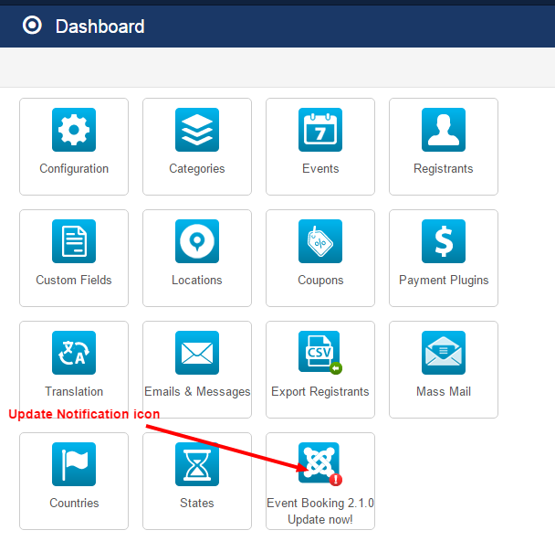
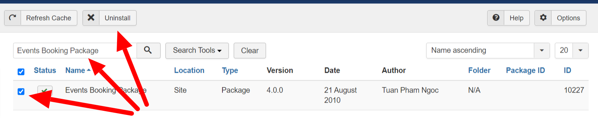

## Installation
When you purchase **Events Booking** extension from our site, you will receive an email contain the extension in a zip file called **event_booking_unzip_first.zip**. Unzip this file you will see a folder **Language Packages** and a zip file **com_eventbooking.zip**. Follow the instructions below and you will be able to install the extension easily:

### Install the component, modules and plugins

The component, all the modules and plugins are included in a single package **com_eventbooking.zip**

1. Login to administrator area of your site using a super administrator account.
2. Access to **System => Extensions => Install**.
3. Browse for the file **com_eventbooking.zip**.
4. Click on **Upload & Install** button

After the installation process completed, you will be redirected to dashboard screen to start configuring and setting up the extension.

### Install the CB Registration History plugin
This plugin is a community builder plugin, not a Joomla plugin so it requires **Community Builder** extension to be installed on your site. **If your site doesn't use Community Builder , don't install this plugin**. **Please note that Events Booking does not require Community Builder extension, so this plugin (and Community Builder) is optional.**

1. Download the plugin [plug_cb_ebregistrationhistory.zip](plug_cb_ebregistrationhistory.zip) 
2. Login to back-end of your site.
3. Access to Components**=>Community Builder=>Plugins management** menu item
4. Click on **install plugin** link
5. Browse for the **plug_cb_ebregistrationhistory.zip**
6. Click on **Upload and Install** button

## Check for new version

To see whether your site is running on latest version of Events Booking or not, you can go to **Events Booking => Dashboard**,  look at the update notification icon at the bottom right (see the screenshot below):

1. If you are using latest version, you will see this text : **Events Booking is up-to-date**. In this case, no update is require.
2. If your site is not running latest version, you will see the text like this: **Events Booking 5.0.3 Update now!**. In this case, your site is running an out-dated version and you should download latest version to update to your site. To download latest version, go to [https://joomdonation.com](https://joomdonation.com), login to your account, then access to [My Downloads](https://joomdonation.com/my-downloads.html) menu item, download latest version and follow the instruction in Upgrade section below to upgrade it to your site.

### Update
**Events Booking** allows you to use **Joomla Update** to update the extension whenever there is new version release. To use **Joomla Update**, please follow the instructions below:

1. Go to [https://joomdonation.com/download-ids.html](https://joomdonation.com/download-ids.html), get **Download ID** of your account
2. Then go to **Events Booking => Configuration**, enter the received **Download ID** into **Download ID** config option.

From now on, each time there is new version of **Events Booking** release, Joomla will notify you about it when you access to backend of your site (or access to Events Booking dashboard). You just have to click on the link to update the extension from within your site, don't have to access to our site to download new version and update manually anymore, sweet :).

Please note that each site need to have an unique **Download ID** (the same **Download ID** however, **can be used for all our products**), so if you use the product on different websites, please make sure to generate new **Download ID** for each site.

### Update Manually
Sometime, you might need to update to latest version manually (for example, when Joomla Update doesn't work). In this case, login to your account on our website, then access to **My Downloads** menu item [https://joomdonation.com/my-downloads.html](https://joomdonation.com/my-downloads.html), download latest version of the extension from there. Then install that latest version in the same way as new installation.

## Uninstall
If you have to uninstall **Events Booking** for some reasons (for example, you want starts from scratch - or maybe after installing and using it, you realize that it doesn't meet your requirement), you can follow the instructions below to get the extension completely uninstalled:

1. Login to backend of your site using a super admin account
2. Access to **System** => **Manage** => **Extensions**.
3. Enter **Events Booking Package** keyword into the search box to search for **Events Booking** package.
4. Check on the checkbox next to the package
5. Click on **Actions** => **Uninstall** button in the toolbar to uninstall Events Booking package

When you do that, the whole Events Booking package (component, modules, plugins) will be uninstalled.

>>>>> When you uninstall **Events Booking**, the database tables related to the extension won't be uninstalled. By doing that, when you re-install the extension in the future, all the old data will be kept and still be available. If you want to completely removing it, please access to your site database via phpmyadmin, look at all the tables with prefix **_eb_** and drop these tables.

## Move data from one site to a new site
Sometime, you have to move **Events Booking** data from one site to a new site. To do that, you will need to:
1. Export all **Events Booking** related database tables from old site via phpmyadmin (table with **_eb_** prefix)
2. Open that sql file, use find and replace function of the text editor to replace table prefix so that it meets the table prefix of the new site (in case your old site and new site use different database table prefix)
3. Import these database tables into new site database (via phpmyadmin)
4. Install latest version of Events Booking to the new site so that the database schema will be updated to latest version (or access to Tools -> Fix Database Schema if your site is running on latest version of Events Booking already)

## Upgrade To Joomla 4/Joomla 5

1. Install latest version of Events Booking your Joomla 3 website. The latest Joomla 3 compatible version is 4.9.4, please submit a support ticket asking us to send you that old version.
2. Then update your site directly to Joomla 4. The latest version of Events Booking works well with both Joomla 3 and Joomla 4.
3. If you build the Joomla 4 website from scratch for some reasons, you can follow the instructions in **[Move data from one site to a new site](https://docs.joomdonation.com/eventsbooking/getting-started/installation#move-data-from-one-site-to-a-new-site)** above to move data from Joomla 3 website to Joomla 4 website.