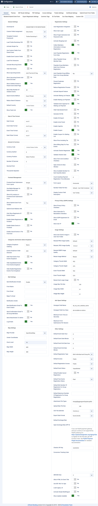

During the installation process, **Events Booking** will generate default configuration data. However, you should still review all config options and change it to meet your own requirement if needed.

To review and change Configuration, go to **Events Booking => Configuration**. When you do that, the screen below will be displayed:

>>>>> To see the meaning of a config option / parameter, you can hover the moose over the name / title of that config option

As most of the config options are very easy to understand, in the section below, we will just explain / review the most importants config options. If there are other options which are not mentioned here and you don't understand, feel free contact us for support. We are available to assist you whenever you want / you need.

## Template Frontend Framework

This is quite important settings in Events Booking and it depends on the frontend framework which your site template is built from.

1. **Load Twitter Bootstrap CSS**: This should be set to **No** unless your site template is built base on a frontend framework not supported by Events Booking (currently **Twitter Bootstrap 3**, **Twitter Bootstrap 4**, **Twitter Bootstrap 5** and **UIKIT3** are supported).
2. **Template Frontend Framework**: Default to **Twitter Bootstrap 5** because for Joomla 4 and Joomla 5, most of Joomla templates are built base on **Twitter Bootstrap 5**). If your site template is built base on Twitter Bootstrap 3, Twitter Bootstrap 4 or UIKIT3, set this config option to the appropriate value..
- If your site template is built base on Twitter Bootstrap 3, set it to **Twitter Bootstrap 3**.
- If your site template is built base on twitter Twitter Bootstrap 4, set it to **Twitter Bootstrap 4**.
- If your site template is built base on twitter Twitter Bootstrap 5, set it to **Twitter Bootstrap 5**.
- If your site template is built base on UIKIT3 (for example, YOOThemes templates) , set it to **UIKIT3**

### Use Twitter Bootstrap 3
This will be used if your site template is built base on **Twitter Bootstrap 3**

- Set **Load Twitter Bootstrap CSS** config option to **No**
- Set **Template Frontend Framework** config option to **Twitter Bootstrap 3**

### Use Twitter Bootstrap 4
This will be used if your site template is built base on **Twitter Bootstrap 4**

- Set **Load Twitter Bootstrap CSS** config option to **No**
- Set **Template Frontend Framework** config option to **Twitter Bootstrap 4**

### Use Twitter Bootstrap 5
This will be used if your site template is built base on twitter bootstrap 5

- Set **Load Twitter Bootstrap CSS** config option to **No**
- Set **Template Frontend Framework** config option to **Twitter Bootstrap 5**

### Use UIKIT 3
This will be used if your site template is built base on UIKIT 3. Usually, it's Yootheme templates 

- Set **Load Twitter Bootstrap CSS** config option to **No**
- Set **Template Frontend Framework** config option to **UIKIT 3**

## Date Time Format
Usually, when you use Events Booking, you will need to change date format in the extension to meet the format for your country. In Events Booking -> Configuration, look at **Date & Time Format** section, and change the following config options:

- **Date Format** : Control the format of date displayed in the extension, for example Registration Date of registration record
- **Event Date Format**: Control the format of datetime data displayed in the extension, for example Event Date, Event End Date, Registration Start Date....
- **Time Format**: Control format of event time displayed in calendar (Monthly Calendar or Full Calendar menu item type)
- **Date Picker Format**: Control the format of date custom fields which are being displayed on registration form (if you use it).

See [DateTime Format Paramers](https://www.php.net/manual/en/datetime.format.php#refsect1-datetime.format-parameters) for list of parameters which you can use in these config options.

>>>>> We usually received questions about change date time format in the extension from am/pm format to 24 hours format. If you have the same questions, just change **Event Date Format** from **m-d-Y g:i a** to **m-d-Y H:i** and change **Time Format** from **g:i a** to **H:i**

## General

1. **Assign Custom Fields to category instead of to events**: By default, **Events Booking** allows you to assign custom fields to individual events. If you set this config option to **Yes**, you will be able to select the category for the custom field and all events in the same category will have same set of custom fields.
2. **From Name**: The sender name uses to send emails in the system (to admin and registrants). If you leave it empty, the **From Name** which is setup in Global Configuration of your site will be used.
3. **From Email**: The sender email uses to send emails in the system (to admin and registrants). If you leave it empty, the **From email** which is setup in Global Configuration of your site will be used.
4. **Notification emails**: The emails you want to receive notification when someone register for an event on your site. If you want to user multiple emails, separate these emails by comman. For example: **paypal@joomdonation.com,acounting@joomdonation.com**.
5. **Enable captcha protection**: If you want to use Captcha on Events Booking to prevent spam, you need to set this config option to **Yes**. As **Membership Pro** uses Joomla core captcha, beside setting this config option to Yes, you need to config Joomla core re-captcha plugin, too. Please see [https://docs.joomla.org/How_do_you_use_Recaptcha_in_Joomla%3F](https://docs.joomla.org/How_do_you_use_Recaptcha_in_Joomla%3F) for instructions.
6. **Enable Coupon Feature**: If you setup coupons in Events Booking and want to allow registrants to enter coupon code on registration form to get discount for their registration, please set this config option to **Yes**.
7. **User registration integration**: If set to **Yes**, when registrants register for an event, **Events Booking** will allow them to enter username and password on to register for an account on your Joomla site.
8. **Activate Shopping Cart**: If you want your's registrants to be able to **register for serveral events within one checkout**, set this config option to **Yes**. Note: when you enable this feature, the **Individual + Group registration option will be removed** and **the system will work much like a shopping cart system**. 
9. **Activate Deposit Feature**: If set to **Yes**, you can setup deposit amount for each event (percent or fixed amount). When users register for the event, they can choose to pay the full amount or pay the deposit amount. In case they just pay for deposit amount, then pay the remaining when they attends the event.
10. **Prevent duplicate registration**: If set to Yes, a user won't be allowed to register for the same event twice.
11. **Activate recurring events**: **Events Booking** allows you to create Daily, Weekly, Monthly, Yearly recurring events. However, this feature is disabled by default. If you want to **create recurring events**, set this config option to **Yes**.

## Invoice Settings

1. **Activate Invoice Feature**: If you have paid events and want to send invoice PDF to your registrants after they register and complete payment for the subscription, please set this config option to **Yes**.
2. **Send invoice to registrants**: Set this config option to Yes if you want the system to send PDF invoice to registrants in the confirmation email they received after register for your event. If you set to No, registrants will have to access to **registration history** page to download the invoice. This config option **should be set to Yes** if you use invoice feature.
3. **Send copy of invoice to administrators**: If you want to receive a copy of the PDF invoice send to registrants (for managing purpose), set this config option to **Yes**.
4. **Invoice Start Number**: If you want the invoice number in the system to start with a certain number (instead of starting by 1), you can enter that number into this config option.
5. **Invoice Format**: Events Booking generates default basic invoice format when you first install the extension. You should review and change the invoice format to meet your need (at least you will have to change invoice logo)
6. **Invoice format (cart activated)**: If you use shopping cart feature, please change invoice layout in this config option instead of **Invoice Format** config option
