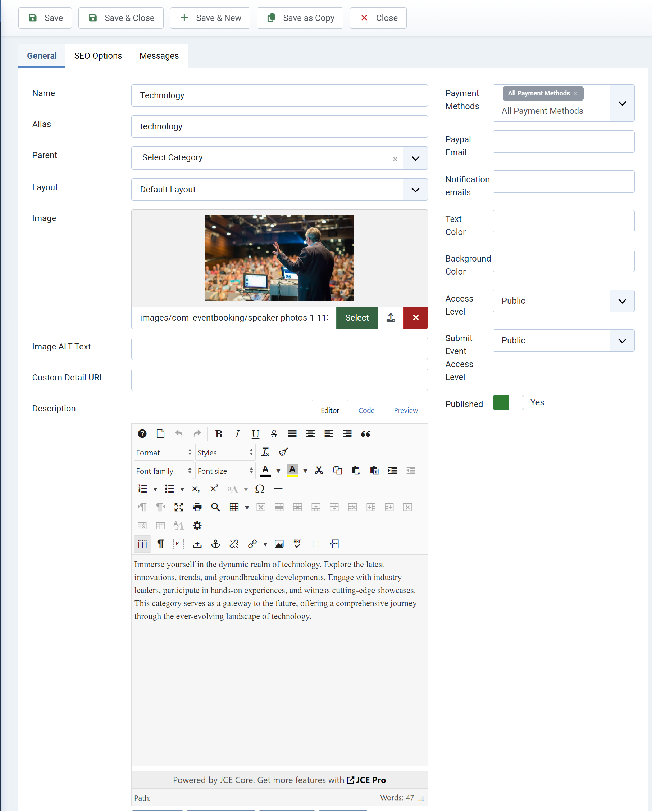
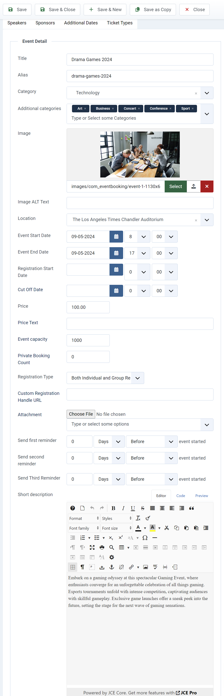
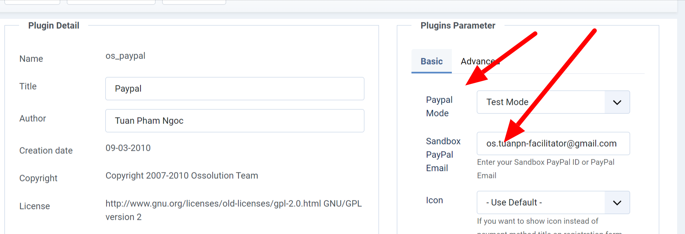
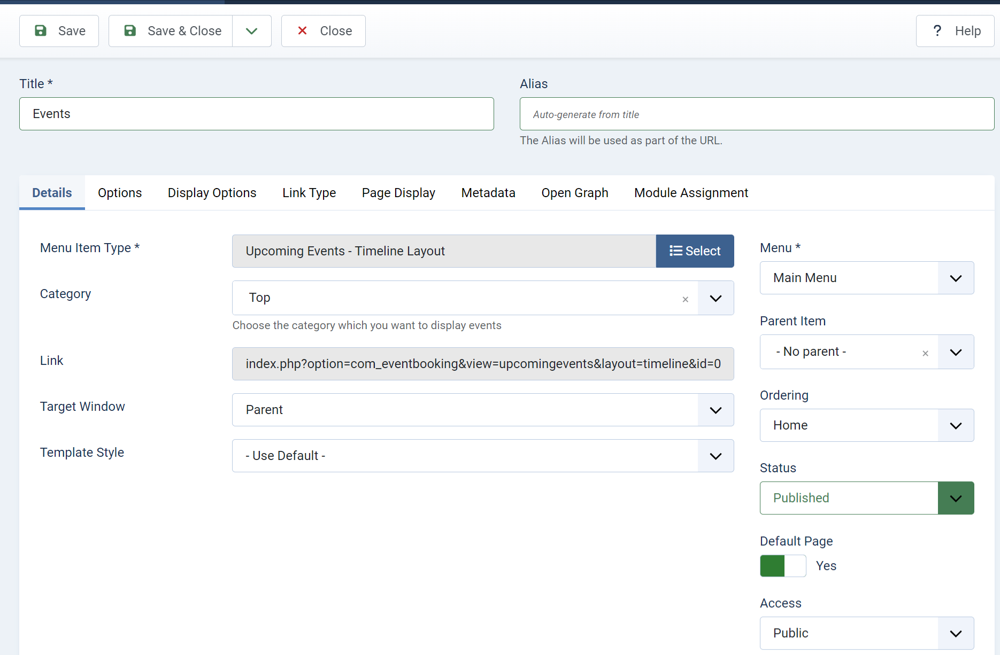
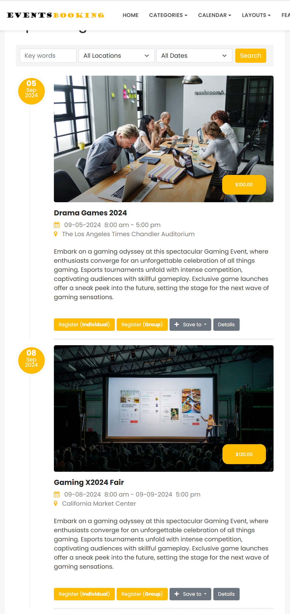
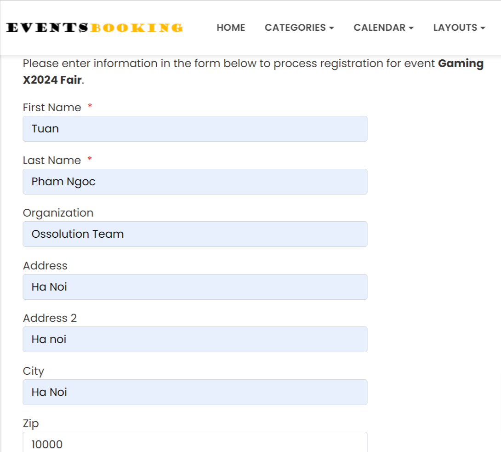
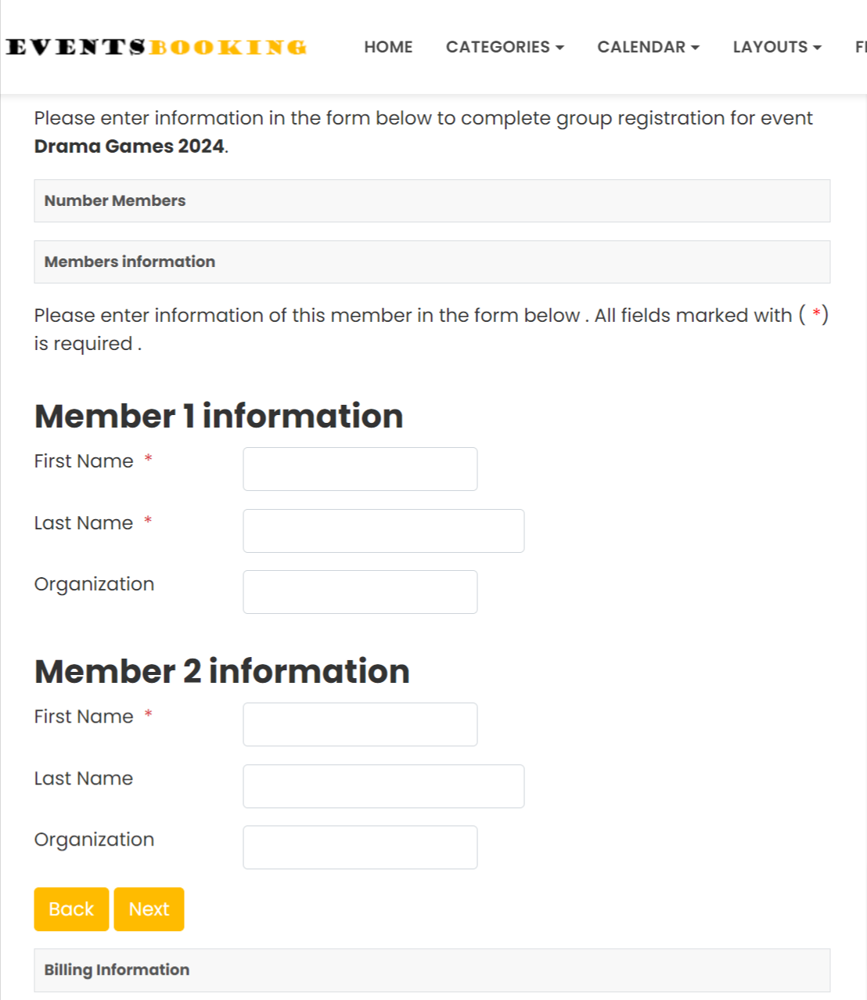

Below are the minimum steps needed to start accept registrations for events on your site.

**1. Setup Categories**

Access to Events Booking extension from backend of your site, then Setup -> Categories. Press **New** button in the toolbar to create at least one category. For starting, you just need to enter Name, Description and maybe select one image for the category. All other information are optional

**2. Setup Events**

The next step is setup events to allow users to register. Access to Events Booking extension from backend of your site, then Events -> Events. Press New button in the toolbar to setup at least one event. For starting, you just need to setup some basic data for the event:

- Title
- Category
- Optional Image
- Event Date
- Short Description (will be displayed on events list page)
- Description (will be displayed on event details page)

**3. Configure Payment Plugin**

If your event is paid event, you need to configure the payment plugin of your choice to allow users to make payment for your event. Access to Events Booking, then **Setup -> Payment Plugins**. From there, you will see list of payment plugins come with the extension out of the box. You can unpublish the payment plugins you don't want to use so that it won't be available for users to select for their registration

Assume you will use PayPal (the most popular payment gateway), you can click on os_paypal payment plugin to edit. Enter your PayPal account there, set the payment plugin to Sandbox Or Live mode, save it. You might want to publish os_offline payment plugin as well.

**4. Display Your Events**

After completing necessary basic setup from backend of your site, the next step is displaying your events so that your site visitors can browse, see details and register for the event they want. There are different ways to do that like create menu item or create a module to display events. For this quick setup, we will guide you to use menu item setup

1. Access to Administrator area of your site
2. Access to Menus -> Main Menu. Press New button on the toolbar to create a menu item
3. In the Menu Item Type, click on Select button. Joomla will display a popup
4. On the popup, look for Events Booking, click on it to open the accordion. Select **Upcoming Events - Timeline Layout**
5. Enter title for the menu item, leave all other parameters as it's default value, save it.

5. **Users Browse And Register For Evens**

From frontend of your site, users can access to Events menu item which you create above to see list of upcoming events, then click on Register (individual) to perform an individual registration (for one person) or Register (Group) to perform group registration (for multiple persons). They will then fill-in the form data, process payment (if the event is a paid event) to become a registrant of your event.

After payment completed, both admin and registrants will receive notification email to confirm the registration. They might also receive Invoice PDF, Tickets PDF.... if these options are enabled and use on your site.

