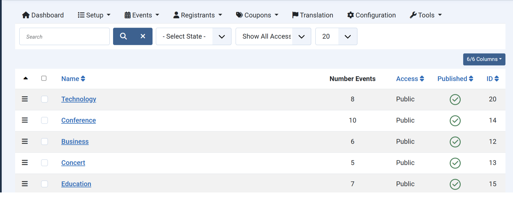
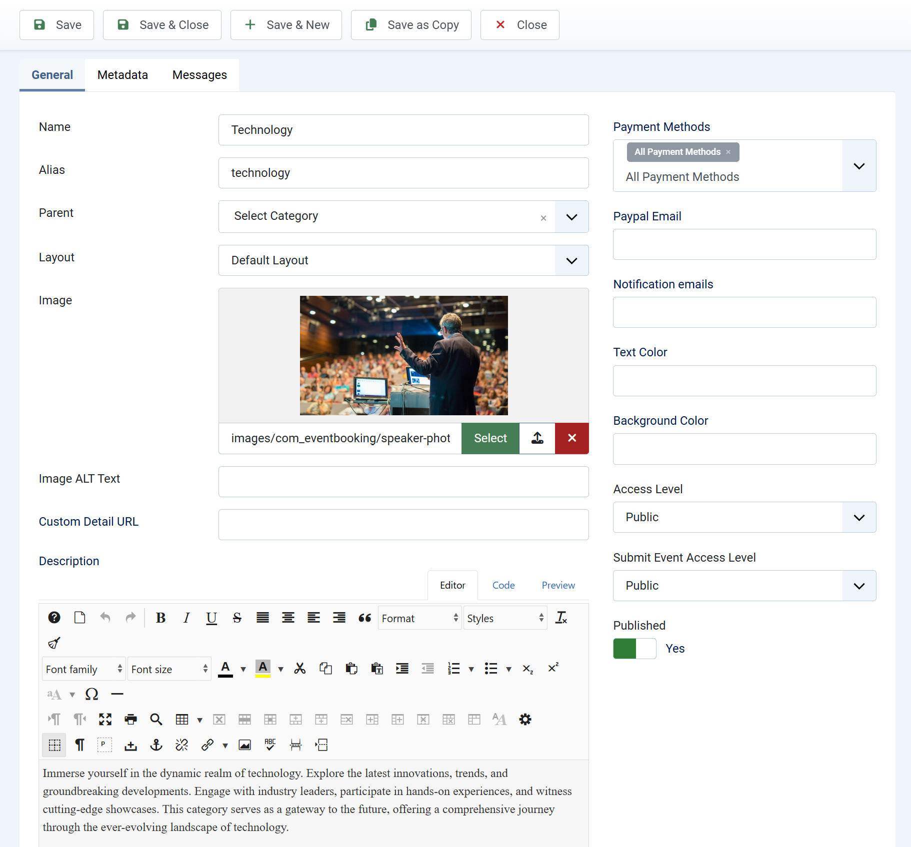

**Events Booking** allows you to organize your events cross infinite categories and subcategories (nested categories). On a typical event registration system, you will have different categories to organize your events. 

To access to categories management page, there are 3 different ways:

1. Access to **Events Booking -> Categoires**.
2. Access to Evets Booking Dashboard, then click on Categories icon.
3. On any pages in Events Booking, access to **Setup -> Categories**.

## Add new category
Press **New** button in the toolbar to create new category. A form will be displayed to allow you to enter information of the category:

### General Information
<table class="table table-stripped table-bordered table-considered">
<thead>
<tr><th width="15%">Property</th><th>Description</th></tr>
</thead>
<tbody>
<tr>
<td><strong>Name</strong></td>
<td>Name (title) of the category. The name will be displayed to end-users.</td>
</tr>
<tr>
<td><strong>Alias</strong></td>
<td>Alias will be used to generate the URL link to the category (and events belong to that category). If you unsure what to enter, simply leaves it empty and the system will generate the alias based on the name of category.</td>
</tr>
<tr>
<td><strong>Parent</strong></td>
<td>Select parent of this category. Set it to <strong>Select Category</strong> and it will become top level category.</td>
</tr>
<tr>
<td><strong>Image</strong></td>
<td>Choose image for the category. The image you select here will be displayed on categories list and category detail page.</td>
</tr>
<tr>
<td><strong>Layout</strong></td>
<td>Select the layout you want to use to display events from this category. At the moment, there are 4 layout types supported: Default Layout, Table Layout, Calendar Layout, Timeline Layout</td>
</tr>
<tr>
<td><strong>Color</strong></td>
<td>If you select a color here, all events of this category will be displayed in calendar using this selected color.</td>
</tr>
<tr>
<td><strong>Background color</strong></td>
<td>If you select a color here, all events of this category will be displayed in calendar with this background color.</td>
</tr>    
<tr>
<td><strong>Keywords</strong></td>
<td>An optional comma-separated list of keywords and/or phrases to be used in the HTML output.</td>
</tr>
<tr>
<tr>
<td><strong>Meta Description</strong></td>
<td>An optional paragraph to be used as the description of the page in the HTML output. This will generally display in the results of search engines.</td>
</tr>
<tr>
<td><strong> Access Level</strong></td>
<td>Choose the access level which you want to be able to to access to this category (usually Public). By choosing an access level, only users has this access level can access/see the category.</td>
</tr>
<tr>
<td><strong> Submit Event Access Level</strong></td>
<td>Choose the access level which you want to be able to to submit events to this category. Useful when you only want to to allow users to submit events to certain categories from frontend of your site.</td>
</tr>    
<tr>
<td><strong>Custom Detail URL</strong></td>
<td>If you want to use a custom URL to show the category page, enter the URL here. Usually, this should be empty unless you use a page builder to build category page</td>
</tr>        
 <tr>
<td><strong>Payment Methods</strong></td>
<td>If you choose certain payment methods here, these payment methods will be used for all events belong to the categories (unless you override this setting inside the event). If no payment methods are selected, all published payment methods will be used.</td>
</tr>           
<tr>
<td><strong>Description</strong></td>
<td>Description of the category. Category description will be used to display on categories list page.</td>
</tr>
</tbody>
</table>

### Messages

If you setup messages here, all events from the category will use these messages instead of global messages (setup in Events Booking -> Emails & Messages section) unless these messages are also entered inside each event. In general, the message uses for each event will be determined in following order:

- Messages setup inside event take highest priority
- Then messages setup in the category.
- And finally, the global email messages setup in Events Booking -> Emails & Messages.