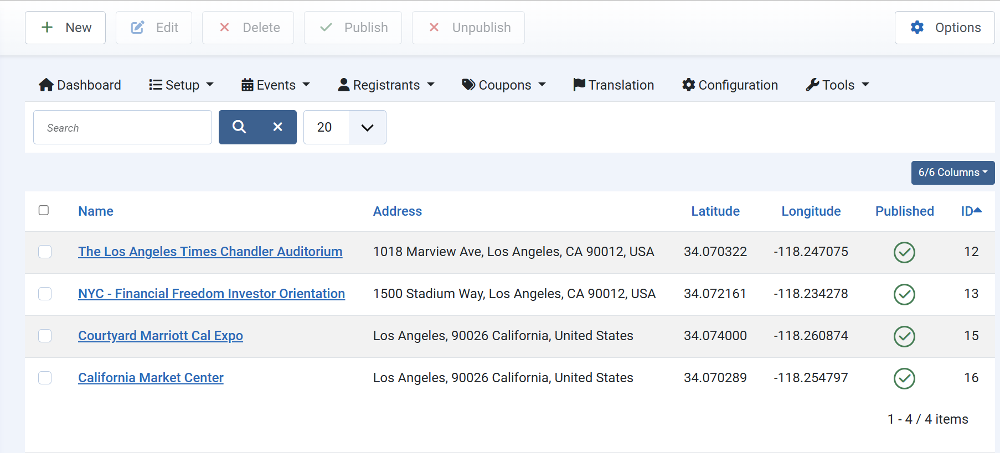
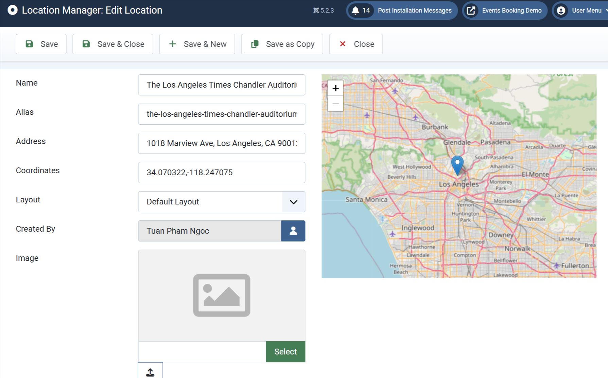

**Location** is the place where your registrants come to attend your event. If you create a location and select that location for the event, the location information will be displayd on event date and event detail page. Users can also view details information of that location on a google map.

To access to **Locations Management** page, there are 3 ways:

1. Access to **Components** -> **Events Booking** -> **Locations**.
2. Access to Membership Pro Dashboard, then click on **Locations** icon.
3. On any pages in Events Booking, access to **Setup** -> **Locations**.

## Add New Location
From Locations Management screen, press New button in the toolbar to add a new location. You will be presented with a screen below:

<table class="table table-stripped table-bordered table-considered">
<thead>
<tr><th width="15%">Property</th><th>Description</th></tr>
</thead>
<tbody>
<tr>
<td><strong>Name</strong></td>
<td>Name (title) of the location. The name will be displayed to end-users.</td>
</tr>
<tr>
<td><strong>Alias</strong></td>
<td>Alias will be used to generate the URL link to the location page (which display events from that location). If you unsure what to enter, simply leaves it empty and the system will generate the alias based on the name of location.</td>
</tr>
<tr>
<td><strong>Address</strong></td>
<td>Full address of location. Please note that the input is auto-complete, so you can type part of the address and choose the address from list of selection. You can also drag the marker in the map at the right and the address will be auto-populated base on the position of the marker.</td>
</tr>
 <tr>
<td><strong>Coordinates</strong></td>
<td>Coordinate of the location. It will be used to display the location on map (Google Map or OpenStreetMap).</td>
</tr>
<tr>
<td><strong>Image</strong></td>
<td>Choose image for the location. The image you select here will be displayed on location page detail page.</td>
</tr>
<tr>
<td><strong>Layout</strong></td>
<td>Select the layout you want to use to display events from this location.</td>
</tr>
</tbody>
</table>