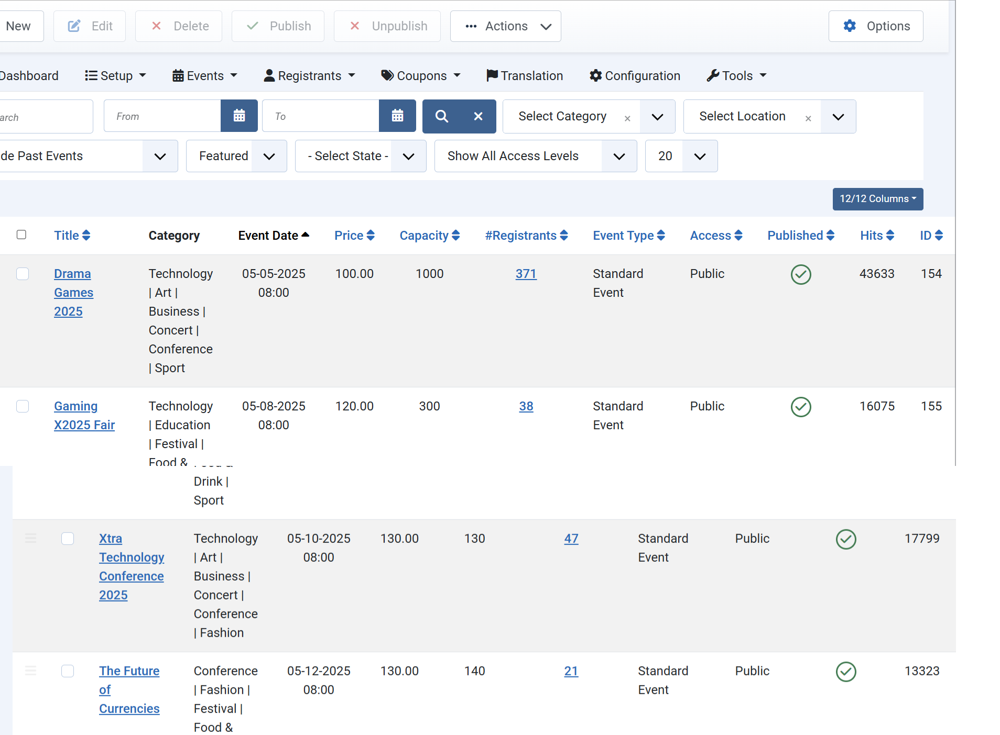
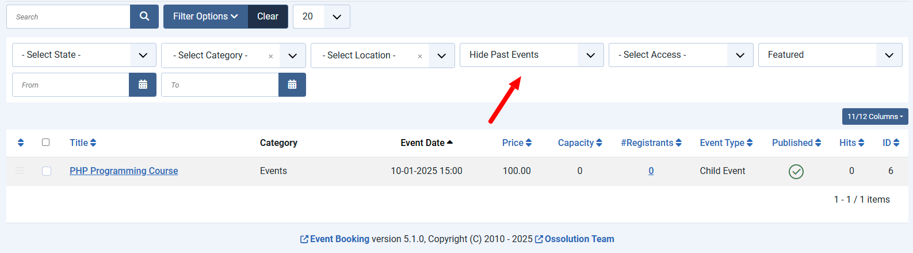

**Events** are the central of the system. You setup events, then customers browse your site, see these events and register for the event(s) they wants, process payment...to become registrants of your events

* Events can be **Free Events** or **Paid Events**.
* You can **enable registration** (**Invidiual Registration**, **Group Registration** or **Both**) or **disable registraiton** (just for displaying on your site only) for your events. If you want to disable registration for the event, set **Registration Type** property of the event to **Disable Registration**.
* Event can have a **spefic date** (in most case) or **without date** (the date of the event has not been determined yet). If you want to create events without date, set **event date** property of the event to **2099-12-31 00:00:00**
* The registration for an event can be handled from within your site (by default) or on an external site. If you want to handle registration for the event on an external website, please enter the URL which handle the registration into **Custom Registration Handle URL** property of the event.

**Events Booking** has two options to **handle registration**:

1. **Individual/ Group registration** option: This is default registration option when you first install the extension. Using this option, when users view the events, depend on the **Registration Type** property of the event, you will see two Register buttons:
* **Register (Individual)** which allows you to register for individual user.
* **Register (Group)** which allows you to perform registration for a group of users. You can config the system to collect information of all groups members or just colllect group billing information (the information of user who performs the registration)
2. **Shopping cart** option: This option is turned off by default. If you want to use this registration option, go to **Events Booking => Configuration**, find the config option **Activate Shopping Cart** feature, set it to Yes. Using this registration option, Events Booking will work much like a shopping cart. Users can browse and register for multiple events within one checkout. The down site of this option is that it doesn't allows you to collect information of each members (like the group registration option).

Since the two options cannot be used together, you need to try and decide the one which meets your requirement best.

To access to events management page, there are 3 different ways:
1. Access to **Components** => **Events Booking** => **Events**
2. From Events Booking Dashboard, click on **Events** icon
3. On any pages in Events Booking, access to **Setup** => **Events**

## Display Past Events On Events Management Screen

By default, when you access to Events Management screen, past events won't be displayed. If you want to show past events there, look for the dropdown filter which says **Hide Past Events**, change that dropdown to **Event Filter** and past events will be displayed

