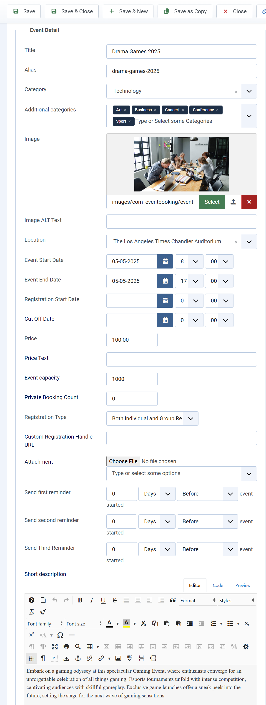
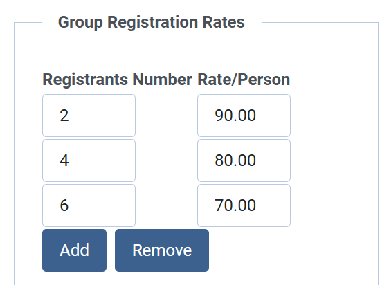
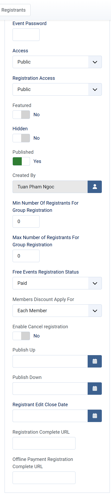
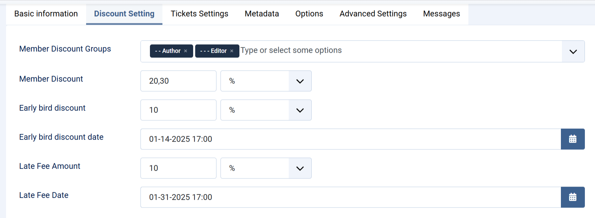
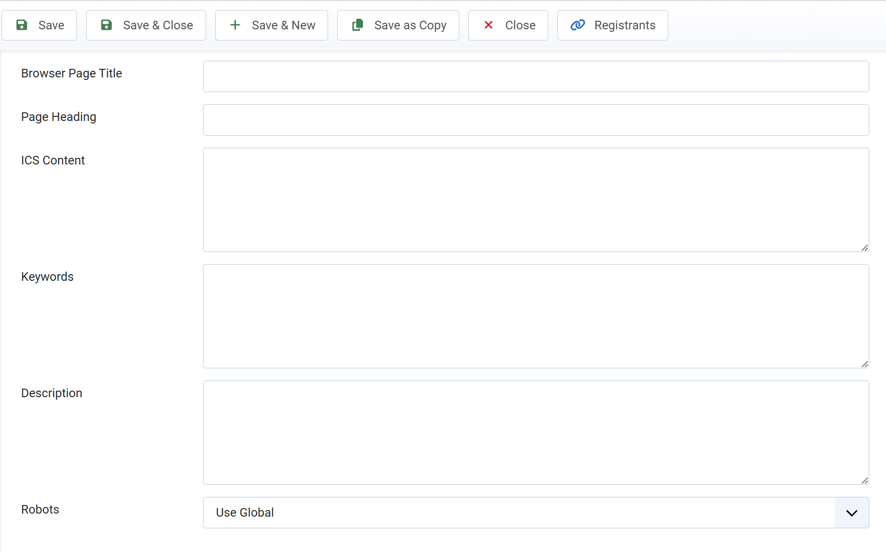
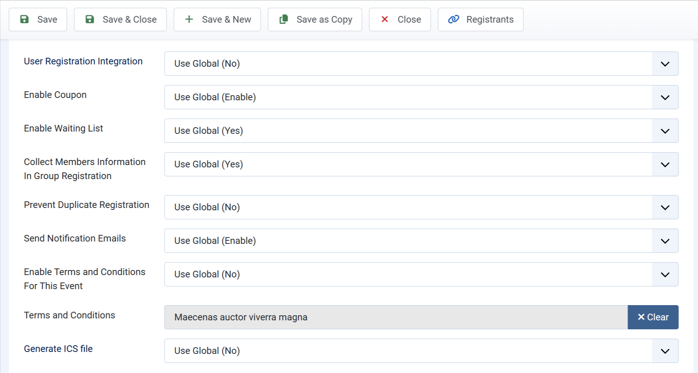
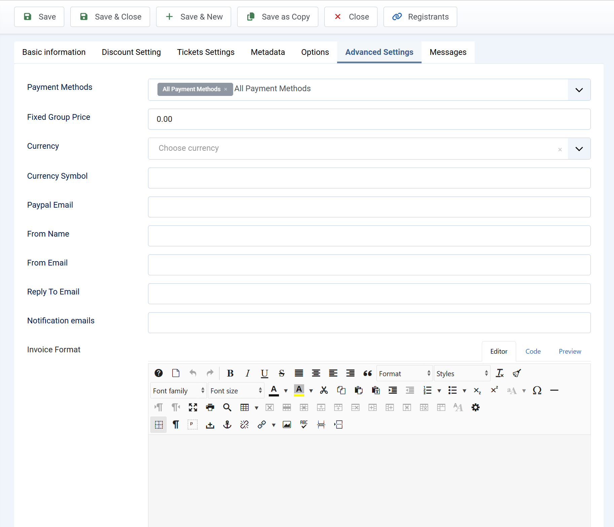
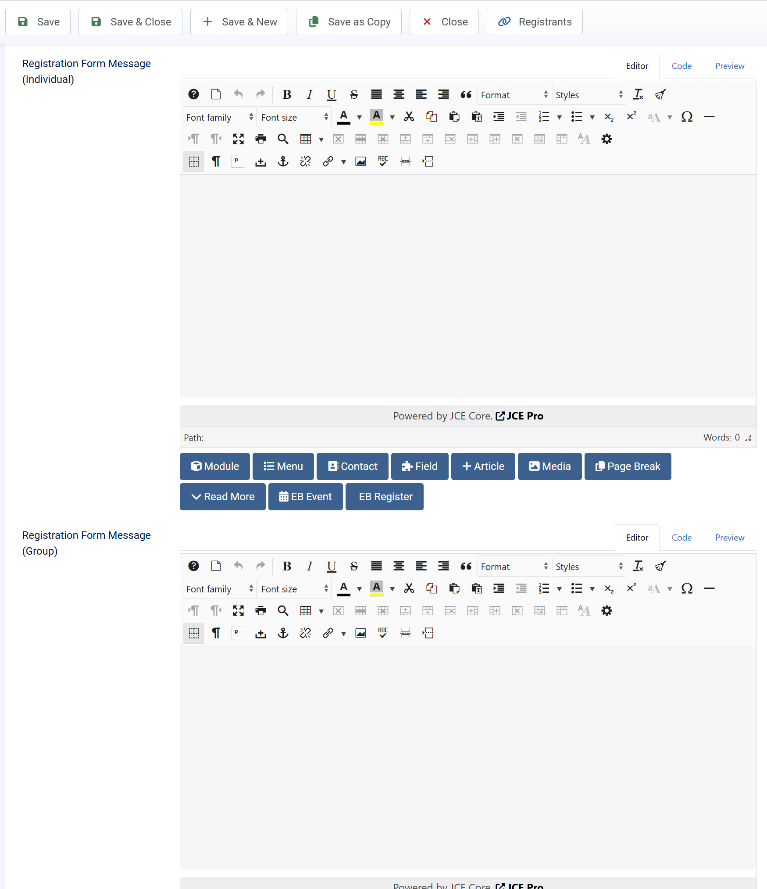

From events management page, press New button in the toolbar to create new event. A form will be displayed to allow you to enter information of the event.

>>> The add/edit event form is configurable. You can go to **Events Booking** -> **Configuration**, look at **Backend Submit Event Form** tab to choose to show/hide the tabs/fields you want. For example, if you do not want to have Messages, Advanced tab (because it is not needed for your use-case), just configure the system to hide it.

## Basic Information
| Property | Description |
| ------| -----------|
| **Title**   | Title of the event.|
| **Alias**   | Alias will be used to generate the URL link to the event details page. If you unsure what to enter, simply leaves it empty and the system will generate the alias based on the title of the event|
| **Category**   | Select **main category** of the event. Main category is important, it is used to get list of custom fields will be displayed on registration form of that event if you choose to assign custom fields to categories instead of to events in Configuration of Events Booking. It is also used to generate part of url to link to event detail page of an event|
| **Additional Categories **  | Choose the additional categories which the event will be assigned to.|
| **Image**   | Select or upload image for the event. Thumbnail will be generated for the seleced image. Image will be displayed on event list and event detail page|
| **Location**   |Choose the location of the event. If an event has a location, when users view this event, they will be able to see the location on a map (Google Map or OpenStreetMap, depend on which map you are using), get direction to that locations... on the map.|
| **Event Start Date **  | The date of the event. After this date, users will no longer be able to register for this event unless you set Cut Off Date of the event to a future date |
| **Event End Date **  |The end date of the event if have. If you leave it empty, event end date won't be displayed for the event on the frontend|
| **Registration Start Date**   |By default, the registration for the event will be enabled right after you publish event. If you only want to enable registration from a certain date, select a date for this field|
| **Cut Off Date**   | If you select a date for this field, registration will be disabled after that selected date. Usually, cut off date (if use) should be before event start date. In some special cases, if you want to allow registration after event date, you can set Cut Off Date after Event Date.|
| **Price**   |The price for individual user to register for that event. If you don't setup group registrations rate, when users perform group registration, the price users have to pay will be the Price multiplied with number of members in the group. If you set Price to 0, the event will be free and users won't have to pay when register for that event|
| **Capacity**   |Maximum number of registrants can register for this event. When number of registrants reached this capacity, users will no longer be able to register for this event. Enter 0 (or leave it empty) if you allows un-limited number of registrants |
| **Tax Rate**   |Enter tax rate for this event. If you leave this field empty, no tax will be charged|
| **Registration Type**   |Choose the registration type you want to allow for this event. There are 4 options: **Both individual and Group registration**, **Only Individual registration**, **Only Group registration**, **Disable Registration**. Please note that **this setting has no affect if you enable Shopping Cart option** |
| **Custom Registration Handle URL**   | If you want to handle registration for this event outside of Events Booking (for example, on an external site), enter the URL of that page here. Then when users click on Register button to register for the event, they will be redirected to the entered url |
| **Attachments**   |If you want to send a file attachment to registrants when they register for the event, choose and upload that file here. By default, the file will only be sent to registrant email. If you want to display it on event detail page so that users can download it, go to Events** Booking -> Configuration**, look at Themes tab, find and set the config option **Show attachment in frontend** to **Yes** |
| **Short Description**   |Short description will be used to show on events list page (whe users browse for events from a category or view upcoming events page) |
| **Description**   |Full description of the event. It will be displayed on event details page. If you don't enter description, the short description will be used to display on event details page.|

## Group Registration Rates
If you want to change registration price base on on number of registrants of a registration, you can define group registration rates. The purpose of it is giving discount for registration in case users register for more number of registrants. For example, you can setup an event with the following price structure:

1. **Price** : 100$
2. **Group Registration Rates**

| Registrants Number | Rate/Person |
| ------| -----------|
| 2   | 90|
| 4   | 80|
| 6   | 70|

With the above setup:
1. If you register for that event for a group contains 6 or more members, the price for each member will be 70$.
2. If you register for that event for a group from 4 to 5 members, the price for each member will be 80$.
3. If you register for that event for a group from 2 to 3 members, the price for each member will be 90$.
4. If you just register for one member, the price is 100$.

The idea is the **more number of registrants you register** for the registration, **the lower price you will have to pay for each member**.

## Misc

| Property | Description |
| ------| -----------|
| **Event Password**   | If you want your event to be private, you can enter a password here. By entering a password, users will need to know this password to register for this event|
|  **Access**   | Choose the access level which you want to be able to to access to this event (usually Public). By choosing an access level, only users has this access level can access/see the event.|
| **Registration Access** | Choose the access level which you want to be able to to register to this event (usually Public). For example, if you only want registered users on your site to be able to register for this event, set this field to **Registered**|
| **Featured** | Mark the event as featured. Featured events, by default, will be displayed at the top of events list|
| **Hidden** | Mark the event as Hidden. Hidden events won't be displayed on events list page, so normal users won't see it, thus could not register for the event. You can create a hidden menu item to link to that featured event, then send link of that hidden event to the users you want to allow them to access and register|
|  **Min Number of Registrants For Group Registration**   | Set minimum registrants for group registration. Leave it empty and will be set to 2|
| **Max Number of Registrants For Group**    | Set maximum registrants for group registration. If you leave it empty, the system will limit it to 10|
| **Free Events Registration Status**    | By default, if this is a free event, when users regiser for it, status of the registration will be Paid. If you want status of the registration Pending instead of Paid, set this to Pending|
| **Members Discount Apply For**    | Control how member discount will be calculated for the registration (For each member or for each registration)|
| **Enable Coupon**    | Select the registration type which you want to enable coupon feature for this event|
|  **Enable Cancel Registration**   | Set to **Yes** if you want to allows registrants to be able to cancel the registration for their registration of registration. If you set to Yes, you will need to choose a date in **Cancel Before Date** field and registrants can only cancel their registration before that date. Usually, that date need to be a date before the event start date |

## Discount Settings
On add/edit event page, look at **Discount Setting** tab and you will be able to setup discount and late fee for the registration of this event

| Property | Description |
| ------| -----------|
| **Member Discount Groups**   | Select the user groups you want to give members discount for this event. If you don't choose any groups, every users(who has account and logged in during the registration) will receive members discount. Keep in mind that only logged in users will receive members discount|
| **Discount Amount(s)**| Set up discount type for members, either by Percent or by Amount. If you want different groups to receive different discount amounts, separate the discount amounts with comma. For example, in the sample setup in image below, users from **Author** group will receive 20% discount while users from **Editor** group will receive 30% discount. If all groups have same discount amount, just enter that discount amount into this field|
|**Early Bird Discount**| This discount settings allows you to give discount for registrants who register for the event before a certain date (**Early Bird Discount Date**). This will encourage users to register for the events early. For this discount type, you can also offer fixed discount amount or discount by percent|
|**Late Fee Amount**| This setting allows you to charge addition fee for registrants who register for the event after a certain date (**Late Fee Date**). This will encourage users to register for the events early. For this type of fee, you can also offer fixed discount amount or discount by percent|

## Metadata
This tab allows you to control metadata for your event includes: Browser Page Title, Page Heading, Keywords, Description, Robots. These settings have same meaning with other Joomla content type like articles, so we do not explain more details here.

## Options

This tab allows you to setup options for individual event if you want to override global settings (controlled in Events Booking -> Configuration) for this specific event.

## Advanced Settings

This tab allows your event to have some settings which allows you to override the settings in Configuration (which is used for all other events). By providing the settings on this tab, EB provide you a flexible way to setup the events in your system: Each events can have it own settings. If you don't enter any settings on this tab, the settings in Global configuration will be used. So only touch this tab if you want this individual has some specific settings which is different from other events.

The table below listed important settings which you might consider using it:

| Property | Description |
| ------| -----------|
| **Payment Methods**   | Choose the payment methods you want for this specific event. By default, if you don't choose anything, all the payment methods which you published on Payment Plugins Management section will be available for this event. |
|  **Fixed Group Price**   |This settings will be used for group registration. If you enter a fixed group price here, the total registration price for the event will be this fixed value, it doesn't depends on the number of members in the group. So please only enter the value for this field if you need that fixed price feature|
|  **Paypal Email**   | If you enter a Paypal email here, when users register for this event and choose Paypal as the payment method, the payment will go to this Paypal email account instead of the one you entered in the Paypal payment plugin parammeter. |
| **Notification Emails**   | If you enter the emails here, when users register for this event, the notification email will be sent to these emails instead of the emails you entered in Configuration emails|
| **Currency Code and Currency Symbol**    | This settings allow this event uses a different currency than the one you choose in Configuration. So each event can has it own currency |

## Messages

This tab allows you to setup messages which will be used for this specific event. If you setup any message here, it will be used instead of the messages setup in category or global messages. In general, the message uses for an event will be determined in the following rules (event highest priority, category is second and global messages have lowest priority):

- If message is setup inside event, use it
- Otherwise, check main category of the event, if the message is entered there, use it.
- If the message is not setup in event or category, use global message (setup in Events Booking -> Emails & Messages)

