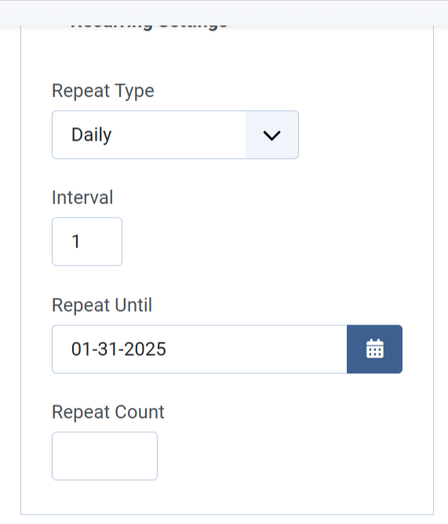
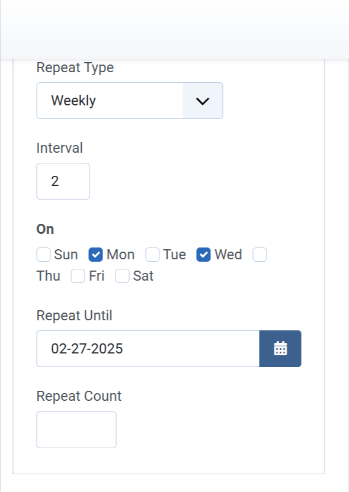
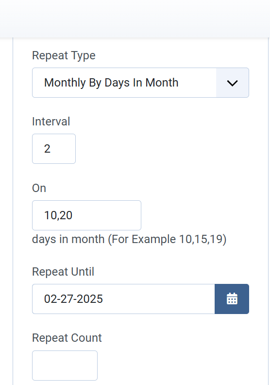
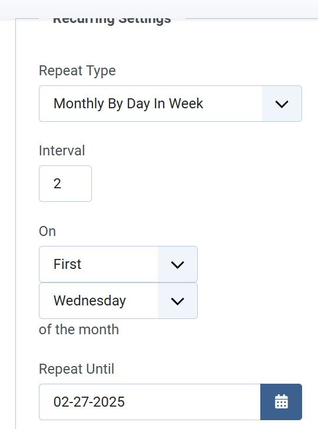
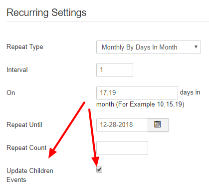

If you have recurring events, instead of creating multiple instances of that event (same title, description, price... just change event date), you can active recurring events feature in **Events Booking** and create recurring events. **Events Booking** support 4 kind of recurring events:

1. **Daily**: Events recur on **every X days**.
2. **Weekly**: Events recur on **different days in the week every X weeks**.
3. **Monthly By Days In Month**: Events recur on certain days in the month (for example on 15th and 17th) every X months.
4. **Monthly By Day In Week**: Events recur on a **First**, **Second**, **Third**, **Forth** or **Fifth** weekday (Sunday, Monday, Tuesday...) every X months.

When you create recurring events, there are some important notes:

1. To create recurring event, you will first need to go to **Events Booking -> Configuration**, find the config option **Activate Recurring Events**, set it to **Yes**.
2. When you create a recurring event, the systems will create different instances of that event (each instance will have it own event start date, registrants....) following the pattern you choose (**daily, weekly, monthly**) until event start date reaches the date you entered in **Repeat Until** parameter or until the number of created events reaches  **Repeat Count** parameter. So when you create a recurring event, you will need to enter a data into **Repeat Until** parameter or enter a number into **Repeat Count** parameter. **You cannot leave both those settings empty**, this is the most common mistake.
3. Each recurring child event is an **independent event and it's own registrants**. You can change settings of a child event and it will not affect other children events.

## Create Daily Recurring Events

Choose this option if you want to create events which **recur every X days**. When create a daily recurring event, beside the parameters explained at [create new event section](/basic-setup/events/add-new-event), you will need to enter the following parameters:
1. **Repeat Type**: Select **Daily**.
2. . **Interval**.  Enter an integer number hear to tell the system that you want the event to recur every X days (1 means everyday, 2 means every 2 days and so on...). For example, if you enter 2 into this parameter, then the event will be recurred every 2 days, if the event starts on Monday, it will recur on Wednesday, Friday, Sunday...
3. As for any recurring event types, you need to select a date for **Repeat Until** parameter or enter an integer number into **Repeat Count** parameter.

## Create Weekly Recurring Events

Choose this recurring option if you want to create events **occur on certain days in the week** (for example, on Monday, Thursday...) **every X weeks** (**X** can be 1, 2,3 ,.....). When creating a weekly recurring events, please note the following parameters:

1. **Repeat Type**: Select **Weekly**.
2. **Interval**: Enter an integer number hear to tell the system that you want the event to recur every X weeks (1 means every week, 2 means every 2 weeks and so on...)
3. Check on the checkbox next to the weekday you want the event to recur. For example, check on Mon and Wed checkboxes and  the event will be recurred on Monday and Wednesday every X week.
4. As for any recurring event types, you need to select a date for **Repeat Until** parameter or enter an integer number into **Repeat Count** parameter.

Please see the image below for a sample of Weekly recurring event. In this sample setup, the recurring events will occur on Monday and Wednesday every 2 weeks, start from the Event start date until **27 Feb 2025**

## Create Monthly By Days In Month Recurring Events

Choose this recurring option if you want to create recurring events which recur on certain days in the month every X months (for example, event which recur on 10th and 15th every month). When create Monthly recurring events, please note the following parameters:

1. **Repeat Type**: Select **Monthly By Days In Month**.
2. **Interval**: Enter an integer number hear to tell the system that you want the event to recur every X months (1 means every month, 2 means every 2 months and so on...)
3.  Enter the days in month, **comma separated** which you want the event to recur into **On** textbox. For example, if you want to create recurring event which recur on 10th and 20th every X month, enter on **10,20** into the textbox
4. As for any recurring event types, you need to select a date for **Repeat Until** parameter or enter an integer number into **Repeat Count** parameter.

## Create Monthly By Day In Week Recurring Events
Choose this recurring option if you want to create event recur on a **First**, **Second**, **Third**, **Forth** or **Fifth** weekday (Sunday, Monday, Tuesday...) every X months.. When create this kind recurring events, please note the following parameters:

1. **Repeat Type**: Select **Monthly By Day In Week**.
2. **Interval**: Enter an integer number hear to tell the system that you want the event to recur every X months (1 means every month, 2 means every 2 months and so on...)
3.  In the **On** parameter, choose (First|Second|Third|Forth|Fifth) (Sunday|Monday|Tuesday|Wednesday|Thursday|Friday|Saturday) in the two dropdowns.
4. As for any recurring event types, you need to select a date for **Repeat Until** parameter or enter an integer number into **Repeat Count** parameter.

Please see the image below to understand the settings needed for a monthly recurring events. In this sample, the recurring events will occur every 2 months on First Wednesday Of The Month, start from the Event start date until 27 Feb, 2025

## Update Information Of Children Events

As explained earlier, when you create a recurring events, different instances of that event (children events) will be created. In some cases, you will need to update information of all of these children events (for example, change title, description, price...). Normally, you will have to edit each of these child events to change information you want and save it. Doing that repeating task for all children will take you much time. Luckily, Events Booking provide you an easier way. Please follow the instructions below if you want to update information of all children events of a recurring events :

1. Go to Events Booking -> Events.
2. Find and click on the parent event to edit.
3. Check on the **Update Children Events** checkbox.
4. Press Save button in the toolbar

By doing that, all the change you made for the parent event will be update to children events. Please see the image below to see where you can find the **Update Children Events** checkbox

