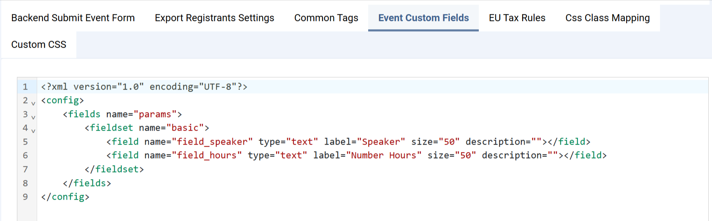
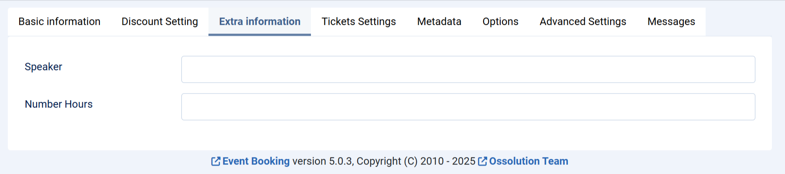

**Events Booking** allows creating custom fields to display more information about the event if needed (beside basic information such as title, event date, location, description....). For example, if you create an event which has different price for different types of registrant (Adult, Children...), you might want to create custom fields to show these price on events list and event detail page. If so, you can follow the steps below to setup it:

1. Go to **Events Booking** => **Configuration**: Set **Enable Event Custom Fields** config option to **Yes**
2.  By default, Events Booking only show these custom fields on event detail page. If you want to show these custom fields on events list page, find and set the config option **Show event custom fields in category view** to **Yes**.
3. Go to **Events Booking -> Configuration**, look at **Event Custom Fields** tab, define custom fields you want (the custom fields need to be defined via an XML file in this case). If you do not see the tab, please go to **Extensions** -> **Plugins**, find and enable one of the two plugins **Editor - CodeMirror** or **Editor - None**. You can also open the file **components/com_eventbooking/fields.xml** and edit directly if you want. There are two custom fields defined by default : A textbox custom field and a textarea custom field. You can define similar custom fields in the fields. The list of supported custom field types can be found at http://docs.joomla.org/Standard_form_field_types . For your need, I believe you only need to use the following field types:
* **Text** ([http://docs.joomla.org/Text_form_field_type](http://docs.joomla.org/Text_form_field_type))
* **Textarea** ([http://docs.joomla.org/Textarea_form_field_type](http://docs.joomla.org/Textarea_form_field_type))
* **Checkboxes** ([http://docs.joomla.org/Checkboxes_form_field_type](http://docs.joomla.org/Checkboxes_form_field_type))
* **Radio** ([http://docs.joomla.org/Radio_form_field_type](http://docs.joomla.org/Radio_form_field_type))

4. Now, when you add/edit an event, you will see a new tab called **Extra Information**. You can enter value for the custom fields you created in this tab and these information will be showed in the frontend (on the category page and event details page) when users browse for events.
5. If you want to show custom the custom field for certain **Access Level**, you can use **access** attribute. For example, **access="1"** will make the fields visible to everyone (**Public**), **access="2"** will make the field visible to everyone has **Registered** access level, **access="6"** will make the field visible to everyone has **Super Users** access level.
5. Sometime, you would want to use a field in email or in invoice, ticket..., not being displayed to users when they view your event. In that case, you can handle it using **show** attribute. Just enter **show="false"** or **show="0"** into that field and it won't be displayed. 
6. On a multilingual website, you might want to show the custom field for certain language only, for that use **language** attribute. Add **language="en-GB"** to the custom field definition will make the field show for English language only.

## Use Event Custom Fields In Email, Invoice, Ticket, Certificate
Beside being used to display more information about events, event custom fields can also be used in email messages, on PDF Io, too. Just use the syntax [NAME_OF_FIELD_IN_UPPERCASE]. For example, if you have a field with name **field_speaker**, you can use the tag **[FIELD_SPEAKER]** to insert value of that custom field into email message.