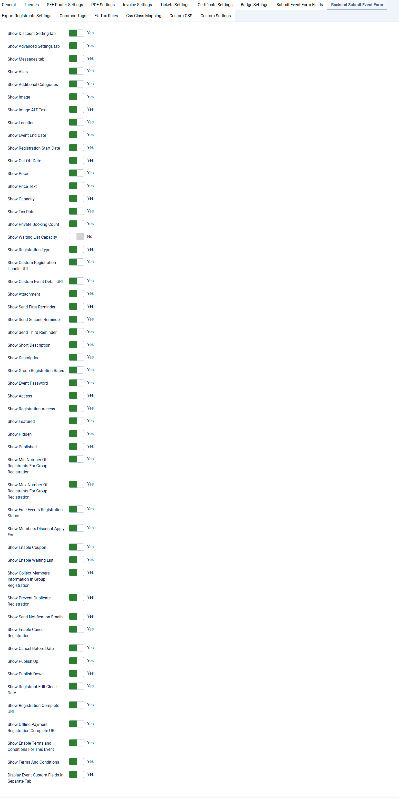

By default, Events Booking display all tabs/fields on add/edit event form. In case you want to hide the settings you do not need to make the form simpler and faster, you can go to Events Booking -> Configuration, look at **Backend Submit Event Form** tab, choose to hide the tabs/fields you do not want from there

