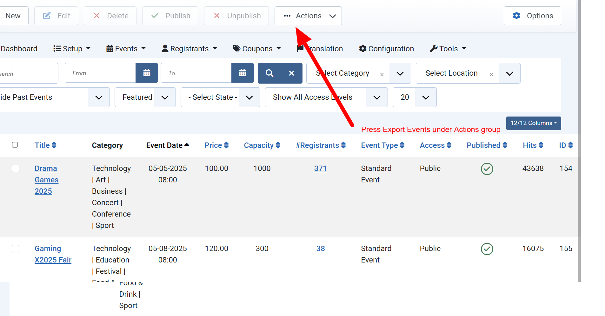

Events Booking allow you to export events into Excel/CSV file. You can use that exported data to import it to other system if needed. The other use-case is that you can export the events data, make the change directly on the Excel/CSV file and import it back to the system to have the data updated. On Events management screen, you can access to **Actions** => **Export Events** button in the toolbar to export the filtered events. Note that, before pressing **Export Events** button, you can filter events data you want and only events meet the filter will be exported

[Sample exported events](events_list_on_2018-03-20.xlsx)

