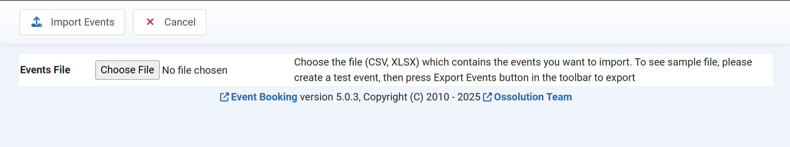

Events Booking allows you to import events from an Excel / CSV file. This can be used for two purposes:

1. **Update existing events data**: You can export your current events data into CSV/Excel file, make the change in the exported file, then import it back into the system to have the modified data updated
2. **Import events data** which is collected from outside of Events Booking into the system (for example, you might want to migrate data from other systems into Events Booking)

## Prepare events Data
To import events into Events Booking, you need to prepare events data in the format which Events Booking can understand. To do that, you can login to administrator area of your site, access to Events Booking extension, then **Events -> Export** (https://domain.com/administrator/index.php?option=com_eventbooking&task=task=event.export - https://domain.com needs to be replaced with your site URL)

When you do that, the system will give you an **Import Template** base on the setup on your site (see a sample here [sample_import_template.xlsx](sample_import_template.xlsx)). Prepare data in that format (maybe test it with few sample records first) and you can go to next step to import this data into the system. Some notes:

1. The data **id** column must contain ID of an existing event record if you want to update data for existing record or leave it empty. During the import, if the system founds an existing record match that ID, the data of that existing event will be updated, otherwise, new event record will be inserted. If you want to import new events data into the system, better remove that whole column.
2. The **location** column must contain ID or name of an existing location (locations must be created in Events Booking -> Locations before importing events)
3. The **image** column must contains relative path of the image from root folder of your site (For example images/com_eventbooking/business.jpg) or empty. You need to upload event images to **images/com_eventbooking folder** before importing events. The system will generate thumbnail for each event automatically.
4. The **category** column must contain name (or better, ID) of the main category of the event.
5. The **additional_categories** column must contains name of additional categories. If event has multiple additional categories, the categories must be separated by  | (for example **Category 1 | Category 2**, note the space character before and after character **|** is needed).

## Import Events

After prepare events data in the step earlier, you can now import these events into the system. From any page in Events Booking extension, access to **Events => Import**. A form will be displayed to allow you to choose the file contains events data, then press **Import Events** button in the toolbar to process the import. Once the import completed, the system will show you number imported events, do a quick check and make sure the data is imported properly.

