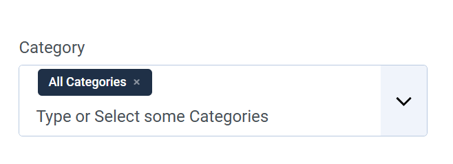
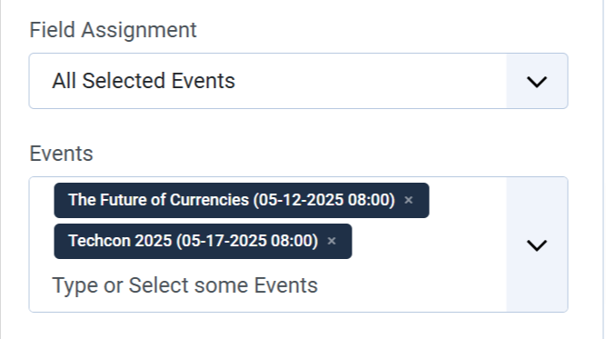
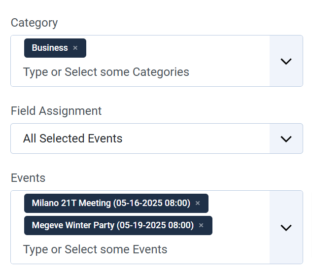

Before start adding custom fields for your events, please go to Events Booking -> Configuration, look at **Custom Fields Assignment** and choose how you want to assign custom fields to your events. It has following options:

- **Only Categories**: If you select this option, when you create a custom field, you can choose to assign custom field to **All** or certain selected categories. When you assign custom field to certain category, it will be available on registration form for all events belong to that category. **Choose this option if with your setup, all events from a category will have same set of custom fields**.

- **Only Events**: Choose this option allows you to assign your custom field to **allow events**, **all selected events**, or **all except selected events**. **Choose this option if in your setup, you want that each event can have it own set of custom fields**.

- **Both**: Choose this option if you want to be able to assign custom field to both categories and events you want. While it give you the flexibility of the combination, it's also hard to handle. **Recommend for advanced users and complicated usages only**.

In three options above, **Only Categories** is the simplest, **Only Events** is normal and **Both** is the most complicated.  If you choose to use option **Both**, consider reading documentation for common use-cases here [Common Fields Assignment Use-cases](/basic-setup/custom-fields/custom-fields-assignment)