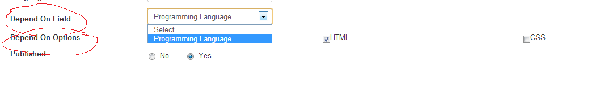
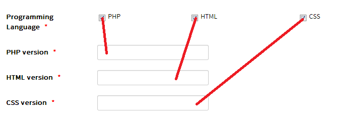

From custom fields management screen, press **New** button in toolbar to add a new custom field. When setup a custom fields, the following information will need to be entered:

### General Information
1. **Name**: The name of custom field.  Please only use the following character for field name: **a-z, A-Z, 0-9**. No space, no special characters in the field name.
2. **Title**: The display title of the field.
3. **Field Type**: Chose the type of the field. 
4. **Description**: For most of field types, the description will be displayed when users hover over the title of the field. For **Message** field type, the description will be displayed as a message on registration form.
5. **Required**: If set to Yes, users will have to enter a value (or select an option) for the field. If it to No, the field will be optional
6. **Default Values**: The default value of the field will be used to fill-in the field automatically when registration form first displayed to registrant. For **List (Multiple Select)**, **Checkboxes** custom field types, each **default selected option** must be entered in one line.
7. **Data Type Validation**: Usually use for **Text** custom field type. It forces registrants to enter data for the field in a required format. When you select an option in this property, the corresponding **Validation Rules** will be generated.
8. **Validation Rules**: This is usually used for **Text** custom field type, and it will be generated automatically when users select **Data Type Validation** of the field (mentioned above). The extension uses JQuery Validation Engine to validate data users enter on subscription form, so if you want to take full advantage of this validation engine, please read the documentation at [https://github.com/posabsolute/jQuery-Validation-Engine?tab=readme-ov-file#validators](https://github.com/posabsolute/jQuery-Validation-Engine?tab=readme-ov-file#validators) to see all powerful validation rules which you can use to validate data of the custom fields.
9. **Fee Field** : Set to **Yes** if this is a **custom fee field**. Then the value which registrants enter / select for this field will be calculated the additional fee (beside the price of the event) which registrants will have to pay for their registration.
10. **Fee formula**: You can use **[FIELD_VALUE]** and math operator : +, -, * , / to calculate fee value for this field. It is usually used for textbox field type. You can use other custom fields in the fee formula with the syntax [NAME_OF_CUSTOM_FIELD_IN_UPPERCASE]

### List (single & multiple select), Radio, Checkboxes specific settings
The settings below will only be displayed (and needed to setup) for single & multiple select,  Radio, Checkboxes custom field types

1. **Values**: The list of options available for registrants to select. Each option need to be entered in one line.
2. **Fee Values**: The fee values corresponding to the options above. Each fee value must be a float number and must be entered in one separate line. There is a mapping 1-1 between the option and fee value. This only need to be entered if **Fee Field** set to **Yes**

### Display settings

These settings below will be used to control how the field is displayed in the system

1. **Multiple**: Only use for **List** custom field. If you want the select dropdown to be multiple select, set this to Yes. Otherwise, set it to No and It will be a single dropdown
2. **Css Class**: If you want to apply a css class for this custom field so that you can style it, add the css class into that property.
3. **Extra**: Any other html attributes you want to add to the field. The most popular usecase is that if you want a textbox custom field to be readonly, you can enter **readonly** into this property
4. **Only Show For First Group Member**: This setting only affect group registration. If set to Yes and this field is showed on group members form, it will only be showed for first group member, not following members (from second members).
5. **Only Require For First Group Member**: This setting only affect group registration. If set to Yes and this field is showed on group members form, it will only be required for first group member, and it will be optional for following members (from second members).

### Display In Setting

When you add/edit custom field, there is an important property called **Display In**. It controls on **what form/what step** in the registration process the custom field will be displayed. If you use **shopping cart** feature, you don't have to worry about this property (just set it to **ALL** - default value). However, if you use **Individual/ Group Registration** option, you should understand the meaning of all the options of this property:
1. **ALL**: This custom field will be displayed on all registration steps.
2. **Individual Registration Billing Form**: This custom field will only be displayed on Individual Registration form (when registrants click on **Register (Individual)** button)
3. **Group Billing**: This custom field will only be displayed on **Billing Information** step in group registration.
4. **Both Individual and Group Registration Billing Form**: This custom field will be displayed on **Individual Registration Form** and on **Billing Information** step in group registration.
5. **Group Member Form**: This custom field will only be displayed on Members information step on group registration to allow collecting group members data.
6. **Both Group Member form and Individual Billing Form**: This custom field will be displayed on **Individual Registration Form** and on **Members information step** on group registration.

### Dependency Settings (Conditional Custom Fields)

Sometime, you want that when registrants select certain otpions (From List, Checkboxes, Radio custom fields), there will be additional fields be showed/hided to allow entering additional information. If that's the case, you will need to use this **Conditional Custom Fields** feature

1. **Depend On Field**: Select the field (which we call **master field**) this custom field will be depended on. In this dropdown, the system will display the published **List, Checkboxes, Radio** custom fields which you created in the system. When you select a field from this dropdown, the custom field which is being added/edited will only be displayed if certain values of the **master field** is checked/selected.
2. **Depend On Options**: Check on the options which you want this field to be showed when subscribers select an option from master field.

To make it easier for you to understand the concent, let's take an example. On registration form, you have:

1. A checkbox custom field called **Programming Languages** which allow subscribers to choose the programming language they can use. It has 3 values: **PHP**, **HTML**, **CSS**
2. You want that when registrants selects a programming language, there will be an additional text field to collect more information (version of the programming language - it is not a good example) about the programming languges he can use. In this case, you will create 3 additional text fields:
* **PHP Version**: For this field, you set **Depend On Field** to **Programming Languages**. And in the depend on options, you select **PHP**
* **HTML Version**: For this field, you set **Depend On Field** to **Programming Languages**. And in the depend on options, you select **HTML**
* **CSS Version**: For this field, you set **Depend On Field** to **Programming Languages**. And in the depend on options, you select **CSS** 
3. Now, when registrants access to registration form:
* If they check on **PHP** checkbox, the **PHP Version** field will be showed. If they uncheck this option, the field will be hided.
* If they check on **HTML** checkbox, the **HTML Version** field will be showed. If they uncheck this option, the field will be hided.
* If they check on **CSS** checkbox, the **CSS Version** field will be showed. If they uncheck this option, the field will be hided.

Please see the screenshots below to understand the setup and hopefully, you get the idea about how it works and can use conditional custom fields feature in Events Booking now. If not, post a question on forum and I will be happy to answer or help you with a sample setup for your system:

