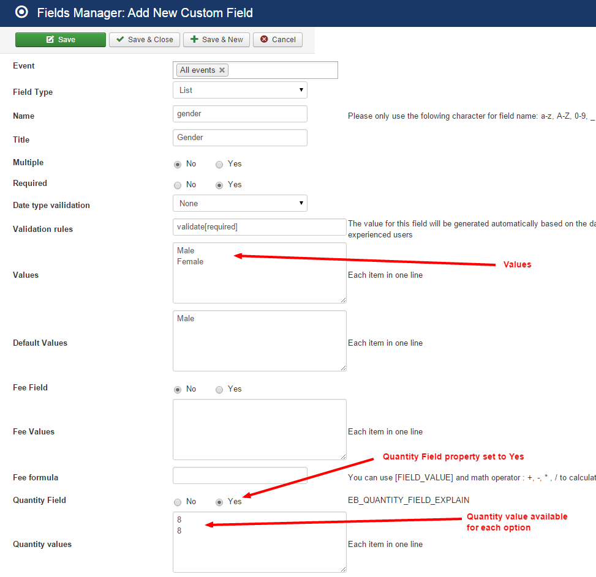

This is another nice and powerful feature of custom field in Events Booking. It allows you to limit **number of registrants** can select certain options in a custom field (Radio, Checkbox, Select, Multiple select)

For example, you create an event with capacity set to 16 (only 16 registrants can register for the event). In total 16 registrants, you only want to allow 8 Males and 8 Females to register.

To do that, you can create a custom field called Gender which allows choose Gender of the registrant when users register for the event :

1. Field Type : **Radio**
2. Name : **eb_gender**
3. Title: **Gender**
2. Values : **Males**, **Females** (each value in one line)
3. Quantity Field: Set to **Yes**
4. Quantity Values: **8**, **8**. Each value in one line. Please note the mapping 1-1 between the options in **Values property** and the options in **Quantity Values** property of the custom field

With the above settings, there will be only maximum 8 registrants can choose Male option for Gender field. Same for Female option

With a quantity field, when number registrants select an option reach it limit (defines in Quantity Values field), that option won't be available for other registrants to choose anymore. When there is no other options available (because all the options has reach it limit), Events Booking will disable registration for the event.

