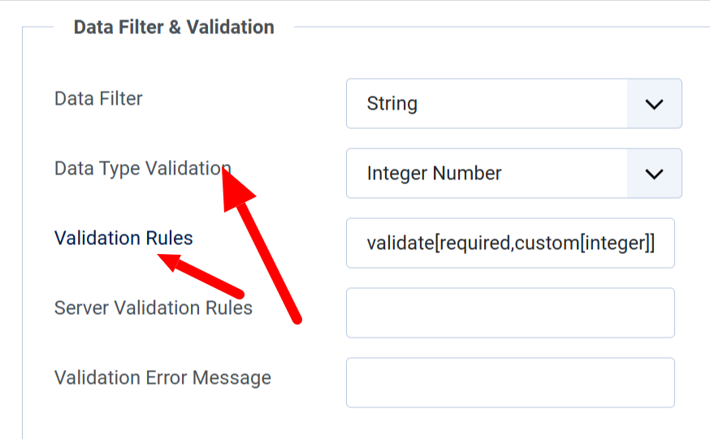

**Events Booking** use [jQuery Validation Engine](http://posabsolute.github.io/jQuery-Validation-Engine/) for client side validation. If you setup **Validation Rules** for a field, as soon as you enter data for that field, the engine will validate the data you entered with the configured rules and if it's not valid, an error message will be shown to let you know about the error and correct it.

If you want to validate data of a custom field using this client validation feature, go to **Events Booking** -> **Custom Fields**, click on the custom field to edit, enter the rules you want to use into **Validation Rules** setting of that custom field. For example:

- **validate[required,custom[email]]** will make the field required and must be a valid email
- **validate[required,custom[integer],min[10]]** will make the field required and the must be an integer smaller than 10

To help you configure it easier, the system tries to populate **Validation Rules** automatically base on two settings in custom fields:
- **Required**: If you select Yes, Events Booking will insert **validate[required]** to **Validation Rules** automatically.
- **Data Type Validation**: When you select an option, the system will insert the related rules into **Validation Rules** automatically. For example, when you select **Min Integer**, the system will insert **validate[required,custom[integer],min[-5]]**, of curse, you will need to change -5 to the correct value you want.
- You can use multiple validation rule for a field, the rules are separated by comma. For example **validate[required,custom[integer],min[-5]]** contain 3 rules:
+ **required** : The field is required
+ **custom[integer]**: Data entered into this field will need to be an integer value
+ **min[-5]**: That mean the minimum value you can enter into this field is -5. You cannot enter smaller value like -6, -7.....
- By default, the system will display error message base on the configured rules if the validation for that field does not pass. If you want to use a custom message for that field, enter the message into **Validation Error Message** setting of the field

## Supported Validation Rules
Below are the list of validation rules which you can use to validate data of a custom field. For each field, you can use multiple validation rules, separate each rule by comma. See See [https://github.com/posabsolute/jQuery-Validation-Engine?tab=readme-ov-file#validators](https://github.com/posabsolute/jQuery-Validation-Engine?tab=readme-ov-file#validators) for details documentation if needed, but the below explanation should be enough

### Required
Speaks for itself, fails if the element has no value. If you want to use this rule, just edit the field, set **Required** to **Yes** . When you do that, **Events Booking** will automatically insert **required** rule into **Validation Rules** setting of the field. For example, **validate[required]**

### Integer Number
Use this rule to make sure data entered into the field is an integer value. To use this rule, set **Data Type Validation** of the field to **Integer Number** or insert **custom[integer]** manually to **Validation Rules**  setting of the field. For example **validate[required,custom[integer]]**

### Number
Use this rule to make sure data entered into the field is an numeric value. To use this rule, set **Data Type Validation** of the field to **Number** or insert **custom[number]** manually to **Validation Rules**  setting of the field. For example **validate[required,custom[number]]**

### Email
Use this rule to make sure data entered into the field is an email. To use this rule, set **Data Type Validation** of the field to **Email** or insert **custom[email]** manually to **Validation Rules**  setting of the field. For example **validate[custom[email]]**

### URL
Use this rule to make sure data entered into the field is a url. To use this rule, set **Data Type Validation** of the field to **URL** or insert **custom[url]** manually to **Validation Rules**  setting of the field. For example **validate[required,custom[url]]**

### Phone
Use this rule to make sure data entered into the field is a phone number. To use this rule, set **Data Type Validation** of the field to **Phone** or insert **custom[phone]** manually to **Validation Rules**  setting of the field. For example **validate[required,custom[phone]]**

### Date
Use this rule to make sure data entered into the field is a date. The date is validated base on format controlled in **Date Picker Format** config option. To use this rule, set **Data Type Validation** of the field to **Date** or insert **custom[date]** manually to **Validation Rules**  setting of the field. For example **validate[required,custom[date]]**

### Past Date
Use this rule to make sure data entered into the field is is older than a pre-entered date. To use this rule, set **Data Type Validation** of the field to **Past Date**, then look at **Validation Rules** setting, change the pre-inserted date to the date you want. For example **validate[custom[date],past[17/01/2025]]**. You can also insert the rule manually into Validation Rules, for example **past[17/01/2025]**, just please make sure the date (in this example **17/01/2025**) must match the format configured in **Date Picker Format** config option.

### Future Date
Use this rule to make sure data entered into the field is is newer than a pre-entered date. To use this rule, set **Data Type Validation** of the field to **Future Date**, then look at **Validation Rules** setting, change the pre-inserted date to the date you want. For example **validate[custom[date],future[17/01/2025]]**. You can also insert the rule manually into Validation Rules, for example **future[17/01/2025]**, just please make sure the date (in this example **17/01/2025**) must match the format configured in **Date Picker Format** config option.

### Version 4 IP Address
Use this rule to make sure data entered into the field is a v4 IP Address. To use this rule, set **Data Type Validation** of the field to **Ipv4** or insert **custom[ipv4]** manually to **Validation Rules**  setting of the field. For example **validate[required,custom[ipv4]]**

### Version 6 IP Address
Use this rule to make sure data entered into the field is a v6 IP Address. To use this rule, set **Data Type Validation** of the field to **Ip64** or insert **custom[ipv6]** manually to **Validation Rules**  setting of the field. For example **validate[required,custom[ipv6]]**

### Min Number Characters
Use this rule to make sure data entered into the field has minimum number of characters. To use this rule, set **Data Type Validation** of the field to **Min Number Characters**, then look at **Validation Rules** setting, change the pre-inserted size to the size you want. For example **validate[required,minSize[6]]**. You can also insert the rule manually into Validation Rules, for example **minSize[6]**.

### Max Number Characters
Use this rule to make sure data entered into the field has at least certain number of characters. To use this rule, set **Data Type Validation** of the field to **Max Number Characters**, then look at **Validation Rules** setting, change the pre-inserted size to the size you want. For example **validate[required,maxSize[6]]**. You can also insert the rule manually into Validation Rules, for example **maxSize[6]**.

### Min Integer
Use this rule to make sure data entered into the field must be greater than or equal certain integer value. To use this rule, set **Data Type Validation** of the field to **Min Integer**, then look at **Validation Rules** setting, change the pre-inserted number to the size you want. For example **validate[required,min[6]]**. You can also insert the rule manually into Validation Rules, for example **min[6]**.

### Max Integer
Use this rule to make sure data entered into the field must be smaller than or equal certain value. To use this rule, set **Data Type Validation** of the field to **Max Integer**, then look at **Validation Rules** setting, change the pre-inserted number to the size you want. For example **validate[required,max[6]]**. You can also insert the rule manually into Validation Rules, for example **max[6]**.

### Min Selected Checkboxes
Use this rule to make sure users need to select minimum number of options in a Checkboxes custom field. To use this rule, set **Data Type Validation** of the field to **Min Selected Checkboxes**, then look at **Validation Rules** setting, change the pre-inserted number to the size you want. For example **validate[minCheckbox[2]]**. You can also insert the rule manually into Validation Rules, for example **minCheckbox[2]**.

### Max Selected Checkboxes
Use this rule to make sure users need to select minimum number of options in a Checkboxes custom field. To use this rule, set **Data Type Validation** of the field to **Max Selected Checkboxes**, then look at **Validation Rules** setting, change the pre-inserted number to the size you want. For example **validate[maxCheckbox[2]]**. You can also insert the rule manually into Validation Rules, for example **maxCheckbox[2]**.

### Only Number and Space characters
Use this rule to make sure data entered into the field is contains only number and space characters. To use this rule, set **Data Type Validation** of the field to **Only Number and Space characters** or insert **custom[onlyNumberSp]** manually to **Validation Rules**  setting of the field. For example **validate[required,custom[onlyNumberSp]]**

### Only Letter and Space characters
Use this rule to make sure data entered into the field is contains only number and space characters. To use this rule, set **Data Type Validation** of the field to **Only Letter and Space characters** or insert **custom[onlyLetterSp]** manually to **Validation Rules**  setting of the field. For example **validate[required,custom[onlyLetterSp]]**

### Only Letter and Number characters, No Space
Use this rule to make sure data entered into the field is contains only number and space characters. To use this rule, set **Data Type Validation** of the field to **Only Letter and Number characters, No Space** or insert **custom[onlyLetterNumber]** manually to **Validation Rules**  setting of the field. For example **validate[required,custom[onlyLetterNumber]]**

### Equals
Use this rule to make sure data entered into the field is equals with data entered on other field. For example, to make sure users enter the right email on registration form, you might want to create a new field called confirm_email to ask users to re-type the email into second field. Set **Validation Rules** of this new field to **equals[email]** will require data entered on both fields equal (replace email with name of any field you want)

