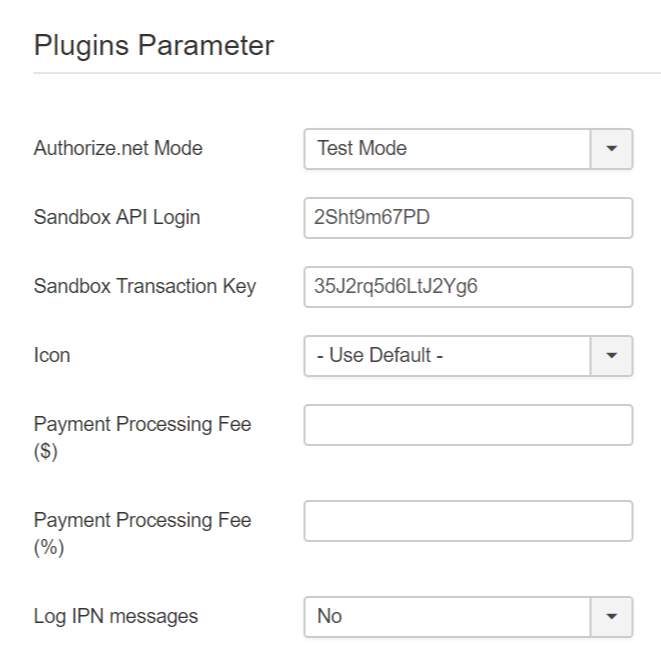

On Payment Plugins management screen, click on **os_authnet** payment plugin to edit it. The following parameters need to be configured:
1. **Authorize.net Mode**: Set to **Test Mode** if you are testing the system and set it to **Live Mode** when you go live.
2. **API Login**
3. **Transaction Key**

Sometime, your Authorize.net might not work well in Test Mode. But it does works in Live Mode. In that case, if you want to test it in test mode, you can use the following Authorize.net account for testing purpose:

1. **API Login**: 2Sht9m67PD
2. **Transaction Key**: 35J2rq5d6LtJ2Yg6