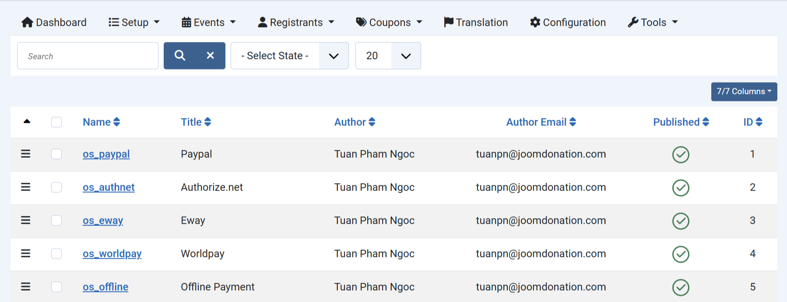
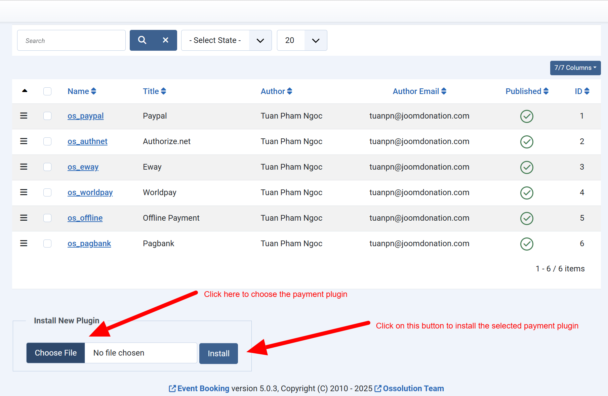

When registrants register for your events, if the event is a paid event (price > 0), registrants will have to pay for the registration to complete the registration pricess.

In order to receiving online payment from your registrants, you will need to config **Events Booking** to use the payment plugins you want. When you install **Events Booking**, there are 5 payment plugins installed with it by default: **Paypal** (Paypal payment standard), **Authorize.net** (AIM), **Eway**, **Worldpay** and **Offline Payment**. Other payment plugins are paid plugins and you will need to purchase separately if you want to use it. Please see [Events Booking Payment Plugins](https://joomdonation.com/payment-plugins/events-booking-payment-plugins.html) for list of extra payment plugins which you can purchase, each of this additional payment plugin will cost you 24.99$.

To access to Payment Plugins management page, there are 3 different ways:
1. Access to **Components -> Events Booking -> Payment Plugins**
2. Access to Events Booking **Dashboard**, then click on **Payment Plugins** icon.
3. On any pages in **Events Booking**, access to **Setup -> Payment Plugins** menu item.

## Common Tasks

### Uninstall un-used payment plugins
It is very likely that you won't use all of the 5 payment plugins come with **Events Booking** out of the box, so you will need to unpublish the one you don't want to use. There are two ways to unpublish a payment plugin:
1. Click on the **green (published) icon** in the **Published** column.
2. Check on the checkbox next to the payment plugin, then press **Unpublish** button in the toolbar.

### Change title of payment plugin

You might want to change the title of the payment plugin to make it easier to understand to your end users. For example, you might want to change the title from **Authorize.net** to **Credit Card**....

To change title of the payment plugin, please click on the payment plugin to edit, change the title to meet your need, then press Save button on the toolbar to apply the change.

### Translate Payment Plugin Title
If your site is a multilingual website and want the title of the payment plugin change depend on the language user uses in the frontend, you need to do some steps below:
1. Use a language item for title of the payment plugin. For example, change the title to OS_PAYPAL instead of PayPal
2. Go to **Events Booking -> Translation**, press **New Item** button in the toolbar. Then enter a new language item for the payment method title. Press save.
3. Translate the new language item which you just created.

### Using icons for payment methods
By default, Events Booking display title of payment methods on registration form. From version 2.12.0, you can choose to display payment method icons instead.

To show the icon of payment method, please click on the payment plugin to edit, look at Icon parameter and select the icon you want to use for the payment plugin there. In case the icon you want to use an icon which is not available, upload the icon to **media/com_eventbooking/assets/images/paymentmethods** and you will be able to select that icon for the payment plugin.

### Make a payment plugin selected by default

When the registration form is being displayed, the first payment plugin will be selected by default. So if you want a payment plugin to be selected, you can change the ordering of the payment plugin so that it will be the first plugin on the list and it will be selected by default.

## Install New Payment Plugin

Sometime, you will need to use a payment plugin which doesn't come with **Events Booking** by default. In this case, you might have to purchase these payment plugins at [Events Booking Payment Plugin](http://joomdonation.com/payment-plugins/events-booking-payment-plugins.html)  (if it is available) or develop it yourself (or hire someone to develop it for you). Once you got the payment plugin, you will need to install it.  Please follow the step below to install a payment plugin:
1.  Go to **Events Booking -> Payment Plugins**
2.  Scroll to bottom of the page.
3.  Click on **Choose File** button to browse for the payment plugin.
4.  Click on **Install** button to process the installation.

