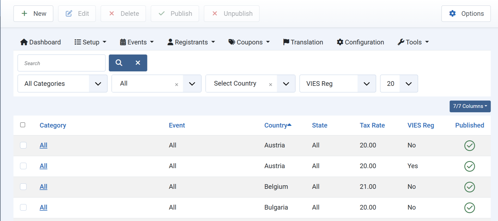
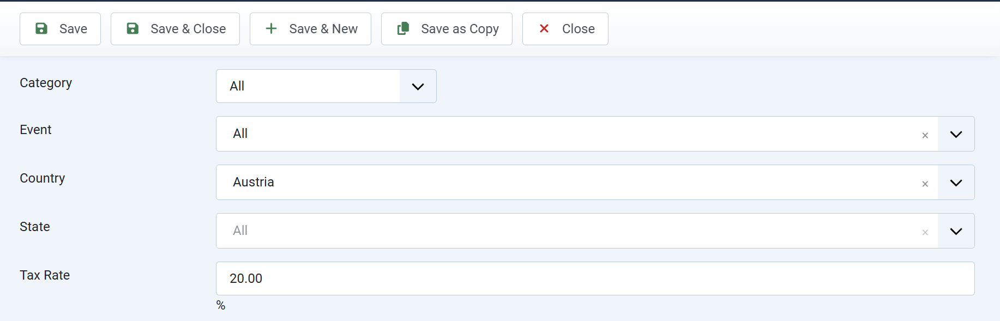

There are two options to manage tax rate for your events in Events Booking. 

## Simple Tax Rate Option
Use this option if you want to setup tax rate directly for each event or category setup. To use this option, go to **Events Booking** -> **Configuration**, set **Activate Simple Tax** config option to **Yes**. The rules are:

- If you enter tax rate for the event (Tax Rate > 0), this tax rate will be used to calculate tax amount for registration for the event.
- If all events from a category use the same tax rate, you can setup Tax Rate directly in the category. In this case, all events belong to the category will have same tax rate. If you have one special event in that category needs to have different tax rate, you can still enter the tax rate you want inside that event setup screen. The general rule is the tax rate in event will have higher priority than the tax rate in the category

## Tax Rules
You can use this tax rules to replace the Simple Tax option above if:

1. You have a single tax rate applied for all events in your system. In this case, instead of having to enter tax rate for each event (or at least each category), you can just setup a tax rule, max simpler and faster.
2. You have tax rate depends on country/state of registrants. In this case, it could not be handled by Simple Tax option, and you will need to use this Tax Rules setup.

To use this option, the first thing you need to do is changing **Activate Simple Tax** config option to **No** and setup necessary tax rules for your system as explained below.

To access to **Tax Rules** management page, there are 3 different ways:

1. Access to **Components** => **Events Booking** => **Tax Rules**.
2. On any page in Events Booking, access to **Setup** => **Tax Rules**.

## Add New Tax Rule
From Tax Rules Management screen, press New button in the toolbar to add a new tax rule. You will be presented with a screen below:

| Property | Description |
| ------ | ----------- |
| Category   | Select the category (or ALL Categories) this tax rule will be applied to.|
| Event   | Select the event (or ALL Events) this tax rule will be applied to.|
| Country   | Select the country (or **ALL**) this tax rule will be applied to.|
| State   | Select the state (or **N/A**) this tax rule will be applied to.|
| Tax rate   | Enter the tax rate for this rule. If you enter 0, no tax will be charged|
| VIES Reg   | This field is only available if you are from an EU country. If set to Yes, this tax rule will be applied in case subscriber has a valid EU VAT Number. If set to No, this tax rule will be applied in case subscribers don't have a valid EU VAT Number|

## How Events Booking determine a tax rule for a registration

When registrants register for an event, Events Booking will try to find the best match tax rule to use for the registration with the following priority:
1. **Base on event**:
* If **there is a tax rule for the current event, the tax rule will be used** to get tax rate.
* If **there is a tax rule for the main category of the event, the tax rule will be used** to get tax rate.
* If **there are no specific rules for the current event, and it's main category, the tax rules which are setup for all events** will be used 
2. **Base on country**:
* If **there are tax rules for the country which registrants select on registration form, these tax rules will be used** to get tax rate.
* If **there is no rule for the country which registrants select on registration form, the tax rules which are setup for ALL COUNTRIES will be used** to get tax rate.
3. **Base on state**: In some country like US, Canada, Spain... you might have to setup tax rate based on the state registrants select on registration form:
* If **there are tax rules for that specific state, these tax rules will be used** to get tax rate
* If **there are no tax rules for that specific state, these tax rules which are setup for the country will be used** to get tax rate.
* If **there are no tax rules for that specific state and country, these tax rules which are setup for ALL COUNTRIES will be used** to get tax rate.

## Common Tax Rules setup
1. If you want to disable tax, please unpublish (or remove) all tax rules.
2. If you want to have only one flat tax rate over the system (all events have same tax rate), just create a tax rule with **Category** set to **All**, **Event** set to **ALL**, **country** set to **ALL**, **State** set to **N/A** and enter the tax rate you want.
3. If you have different categories and each category with it own tax rate, create different tax rule, each rule for a category.
4. If you want to have the same tax rate for all events and a different tax rate for a specific event, just create two tax rules:
* One tax rule has **Category** set to **ALL**, **Event** set to **ALL**.
* One tax rule has the **Event** set to the **specific event** you want.
5. If you want to have the same tax rate for all countries and a different tax rate for a specific country, just create two tax rules:
* One tax rule has **Country** set to **ALL**.
* One tax rule has the **Country** set to the **specific country** you want.
6. If you want to have same tax rates for all states in your country and a different tax rate for specific state, just create two tax rules like this:
* One tax rule has country set to your country and has state set to N/A
* One tax rule has country set to your country and has state set to the specific state you want

## EU Tax Rules Builder

If you are from an EU country and need to follow EU Tax Rules, there will be many tax rules need to be created. However, don't worry, we have a tool to help you. Follow the steps below and you will have the tax rules setup and works property in Events Booking and it is conform with EU Tax Rules:
1. Go to Events Booking -> Configuration, make sure you set **Default Country** config option to your country.
2. You need to create a custom field to allow registrants to enter EU VAT Number. Go to Events Booking -> Custom Fields,  create a text custom field, publish it.
3. Go to Events Booking -> Configuration, look at **EU Tax Rules** tab, set **VAT Number Field** config option to the custom field which you setup in step #2 above
4. Access to this URL to have necessary tax rules created (replace **https://domain.com/administrator** with administrator URL of your site)

**https://domain.com/administrator/index.php?option=com_eventbooking&task=tool.build_eu_tax_rules**