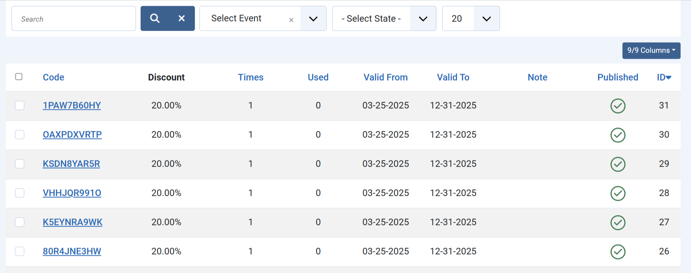
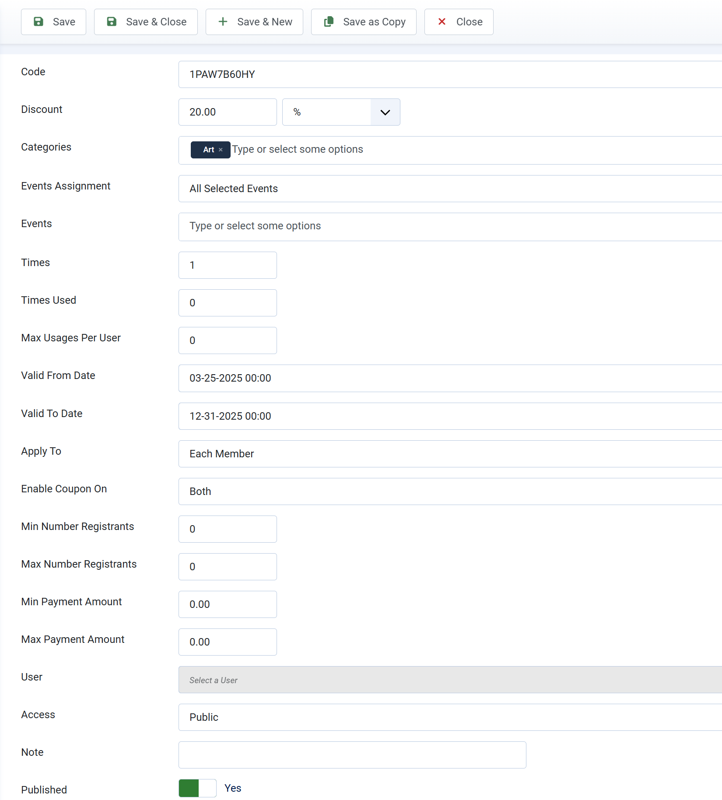
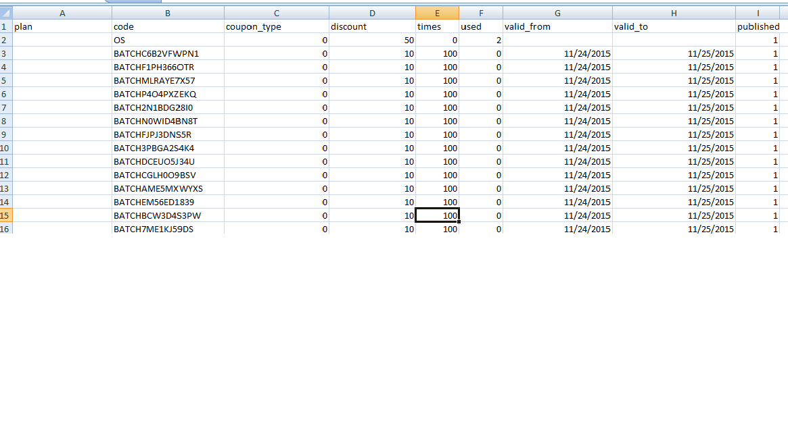
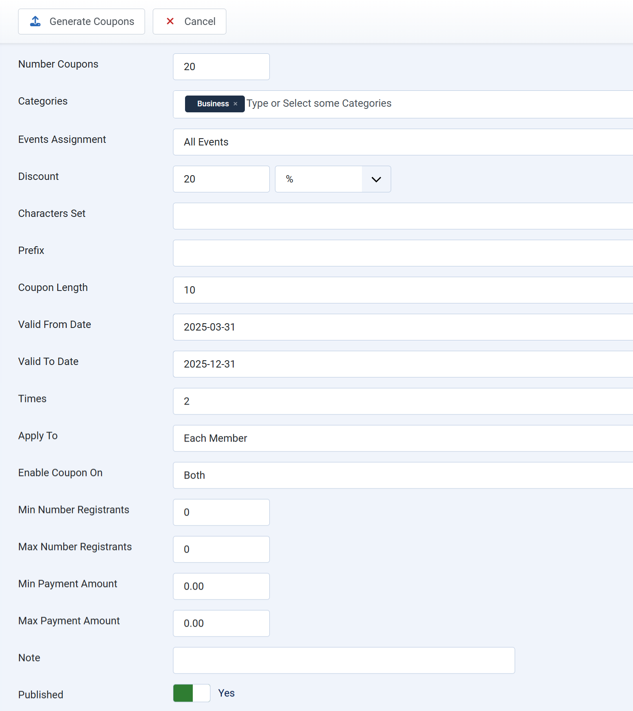

**Events Booking** allows you to create coupon codes to give discount to your registrants when they register for events on your site.

To access to coupons management page, there are 3 different ways:
1. Access to **Components -> Events Booking -> Coupons**
2. Access to Events Booking **Dashboard**, then click on **Coupons** icon.
3. On any pages in Events Booking, access to **Coupons** menu item

## Add New Coupon
Press **New** button to create new coupon

1. **Code**: The code for this new coupon.
2. **Discount**: Enter the discount for this coupon. Discount can be set to a fixed amount (for example 10$) ro by percent (for example 10% of subscription fee).
3. **Categories**: Choose the categories which coupon can be used. Choose **All Categories** if you want the coupon can be used for events from all categories (all events from the system).
4. **Events Assignment**: Determine how the coupon will be assigned to selected events:
- **All Events** : The coupon can be used for all events in the system. You cannot choose this option if you want limit the coupon usage to certain categories only (selected in **Categories**  setting above)
- **Selected Events**: The coupon can be used for all selected all selected events and the events which match the categories assignment in Categories parameter above
- **Exclude Selected Events**: The coupon can be used for all events which match the categories assignment in Categories parameter above except the selected events.
5. **Events**: Choose the events which will be used for Coupon Assignment parameter above.
6. **Times**: Enter number of times this coupon code can be used. If you leave it empty, the coupon code can be used unlimited times.
7. **Valid From Date**: If you choose a date, the coupon code can only be used **from the selected date**.
8. **Valid To Date**: If you chose a date, the coupon code can only be used before the selected date. After that date, the coupon code cannot be used anymore.
9. **Apply To**: Control how the discount will be calculated for the registration: **Each Member** or **Each Registration**.
10. **Enable Coupon On** : Control what type of registration the coupon can be used for: **Individual Registration**, **Group Registration** or **Both**.
11. **Min Number Registrants** : If you enter a number here, the coupon can only be used for group registration with number registrants greater than or equal the entered number.
12. **Max Number Registrants** : If you enter a number here, the coupon can only be used for group registration with number registrants smaller than or equal the entered number.
13. **User** : If you select a user here, the coupon can only be used for the selected user. So unless you want to make the coupon for specific user, please don't no select any user here.
14. **Access** : Only users with this access level can used the coupon. Usually, this should be set to Public
15. **Note**: Put a note (for yourself) about this coupon
16. **Published** : Set to Yes if you want to allow users to use the coupon code, set to No to disable it.

## Common Coupon Assignment Setup

**1. Coupons available for all events**
- **Categories**: Set to **All Categories**
- **Events** : Set to **All Events**

**2. Coupons available for all except some selected events**
- **Categories**: Set to **All Categories**
- **Events Assignment** : Set to **Exclude Selected Events**
- **Events** : Select the events which you want the coupon to be excluded.

**3. Coupons available for events from certain categories**
- **Categories**: Select the categories you want
- **Events Assignment**: Set to **All Selected Events**
- **Events**: Do not select any events.

**4. Coupons available for events from certain categories excluding some events**
- **Categories**: Select the categories you want
- **Events Assignment** : Set to **Exclude Selected Events**
- **Events** : Select the events which you want the coupon to be excluded.

**5. Coupons available for events**
- **Categories**: Do not select anything.
- **Events Assignment** : Set to **Selected Events**
- **Events** : Select the events which you want the coupon to be available.

## Export Coupons

**Events Booking** allows you to export coupons into a csv file so that you can import these coupons into another system if needed. Or you might just want to use the csv file for reporting purpose

To export coupons, from any pages in **Events Booking**, access to **Coupons -> Export** sub-menu. A csv file will be generated and downloaded to your computer. Below is the screenshow of a sample csv file exported by Membership Pro

## Import Coupons

**Events Booking** allows you to import existing coupon codes from a csv file into the system. This is helpful in case you have coupons generated by other system and want to import it into the extension.

### Prepare the csv file
To be imported into Events Booking, the csv file contains coupon code need to be formatted in a required format. The easiest way is you the **Export Coupons** feature above to get a sample of the CSV file. Below are the meaning of the columns in csv file:
1. **event**: This column contains id(s) of the events. If it is empty, the coupon code will be assigned to all events.
2. **code**: The coupon code
3. **coupon_type**: 0 mean discount type is percent. 1 mean discount type is fixed amount.
4. **discount**: The discount amount
5. **times**: Number of times the coupon code can be used. 0 means it can be used unlimited time
6. **valid_from**: The Valid From Date of the coupon. The date must be in YYYY-MM-DD format or you can leave it empty.
7. **valid_to**: The Valid To Date of the coupon. The date must be in YYYY-MM-DD format or you can leave it empty.
8. **published**: The coupon code is published or not

### Run the import

When you have the csv file contains the coupon codes ready, please follow the steps below to get the coupon code imported into the system:
1. Access to **Coupons -> Import**sub-menu item.
2. Click on **Choose File** button to select the csv file.
3. Press **Import Coupons** button in the toolbar to process the import.

After that, the coupon codes in the csv file will be imported and can be used in the system

## Batch Coupons

This is a very useful feature of Membership Pro. It allows you to create many coupons code at a time without having to enter these coupon codes manually.

From any page in Membership Pro, you can access to **Coupons -> Batch Coupons** sub menu item. The form below will be displayed to allow you to generate batch coupons

1. **Number Coupons**: Enter number of coupons you want the system to create. For example, 100, 500....
2. **Event**: Choose the event(s) which this coupon code can be used. Choose **All Events** if you want this coupon code can be used for any events.
3. **Discount**: Enter the discount for the coupons. Discount can be set to a fixed amount (for example 10$) ro by percent (for example 10% of subscription fee).
4. **Characters set**: The characters set will be used to create these coupons. When generating coupon code, the system will get random character from this characters set. You can leave this empty and the system will use this characters set **ABCDEFGHIJKLMNOPQRSTUVWXYZ0123456789**
5. **Prefix**: If you want these coupons code has a fixed prefix, enter the prefix you want here, otherwise, leave it empty
6. **Coupon Length**: The length of the generated coupon codes. Enter an integer number, for example, if you want the coupon code to have 10 characters, enter 10 into this field
7. **Valid From Date**: If you choose a date, the coupon codes can only be used **from the selected date**.
8. **Valid To Date**: If you chose a date, the coupon code can only be used before the selected date. After that date, the coupon code cannot be used anymore.
9. **Times**: Enter number of times these coupon codes can be used. If you leave it empty, the coupon code can be used unlimited times.

After enter all the necessary settings, press **Generate Coupons** button in the toolbar and the coupon codes will be generated, ready to use in your system

## Voucher Explanation
When you create coupon code, there is a Discount option called **Voucher**. With a voucher 100$ for example, you will have 100$ in the account and can be used to register for events until the remaining voucher amount back to 0:

- You register for an event costs 20$, you will have 80$ left.

- You register for another event costs 40$, you have 40$ left.

- Then you register for another event cost 60$, you will have to pay 20$ because you only have 40$ left from the voucher.