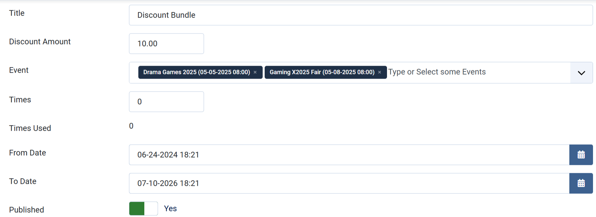
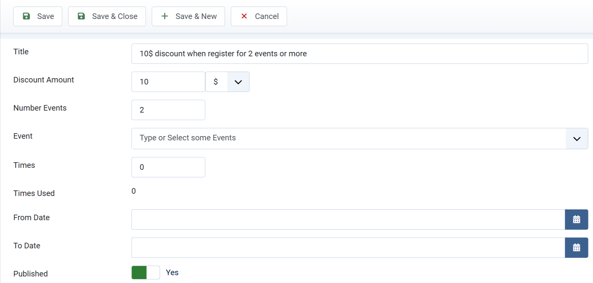

**Discount Bundle** allows you to give users discount when they register for all events which you select for the discount bundle. 

To access to **Discount Bundles Management** page, there are 3 ways:

1. Access to **Components -> Events Booking -> Discount Bundles**.
2. On any pages in Events Booking, access to **Setup -> Discount Bundles**.

## Add New Discount Bundle
From Discount Bundles Management screen, press New button in the toolbar to add a new location. You will be presented with a screen below:

<table class="table table-stripped table-bordered table-considered">
<thead>
<tr><th width="15%">Property</th><th>Description</th></tr>
</thead>
<tbody>
<tr>
<td><strong>Title</strong></td>
<td>Title of the discount bundle. Choose a meaningfull title so that you can easily know what's this discount bundle used for.</td>
</tr>
<tr>
<td><strong>Discount</strong></td>
<td>Enter discount amount you want here. When someone register for all events in this bundle, they will receive that discount amount.</td>
</tr>
<tr>
<td><strong>Event</strong></td>
<td>Select the events you want for this bundle. Users will have to register for all events you select here to receive the discount amount configure for this discount bundle.</td>
</tr>
<tr>
<td><strong>Times</strong></td>
<td>How many times this discount bundle can be used. Leave it empty mean it is unlimited</td>
</tr>
<tr>
<tr>
<td><strong>From Date</strong></td>
<td>If you choose a date here, this discount bundle will only be valid from that date.</td>
</tr>
 <tr>
<td><strong>To date</strong></td>
<td>If you choose a date here, this discount bundle will only be valid until this date.</td>
</tr>   
</tbody>
</table>

## Some notes
Users will only receive discount if they register for all events which you setup for the discount bundle. So:
1. If you use Individual/Group registration on your site, users will need to login during the registration to receive discount. He will only receive discount on final registration (which mean registering for the last event configured in the bundle)
2. If you activate shopping cart on your site, users can receive discount without logging in, too. However, in case they are not logged in, the system could not get the list of events which he registered before, so he will have to register for all events in the bundle within one registration/checkout. If he login, the system will get the events which he registered before + the events he added to the current cart to see whether he is allowed to get discount in the discount bundle
3. In case multiple discount bundles meet for one registration, he will receive discount amount of all the matching discount bundles

## Discount By Number Of Items In Cart
One limitation with Discount Bundle is that you have to select the events in the bundle which users need to register to receive discount. However, in many cases, you just need to have a simple rule, for example: Users will receive discount if they register for certain number of events. For example, get 10$ discount if register for any of 2 events. 

This is supported in latest version of Events Booking (for shopping cart mode). In this case, you just need to create a discount bundle with Number Events parameter set to 2 (no need for selecting any events).

