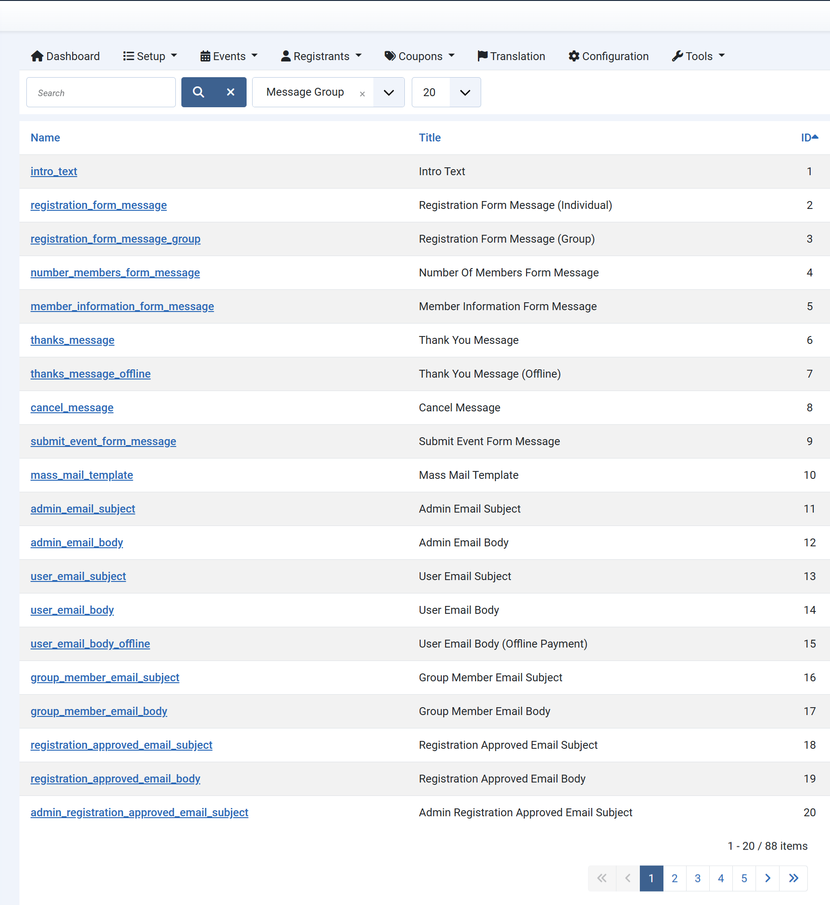

When you install **Events Booking**, the extension will generate default **English Messages** which will be used to display on **registration form**, display on **registration complete**, display in **emails**.....

These messages are configurable in the system. You should review all of these generated messages and change it to meet your need if needed, especial when you use a none English language on your site.

On the screen, there is a search box which allows you to easy find the message you want to change by entering:

- The message key/name
- The message title in English
- Or the content of the message

So if you want to change certain message, you can take few words from that message and enter it into search box to search for that message.

To see the messages and change it to meet your need, there are 3 ways:
1. Access to **Components -> Events Booking -> Emails & Messages**
2. Access to Membership Pro Dashboard, then click on **Emails & Messages** icon.
3. On any pages in Events Booking, access to **Setup -> Emails & Messages** menu item.

>>> If you want to use the old **Emails & Messages** interface (which loads all messages in a single page), you can access to Tools -> Legacy Emails & Messages . This will allows you managing emails & messages using the interface in Events Booking 3.x.

## Registration Form Messages
1. **Registration Form Message (Individual)**:The message displayed above the registration form For Individual Registration.
2. **Registration Form Message (Group)**: The message displayed above the registration form for Group Registration.
3. **Number of members Form Message**: The message displayed above the form which allow entering number of members for their group registration.
4. **Member Information Form Message**: The message displayed above the members information form for Group Registration.
5. **Thank you message**: This message will be displayed on the thank you page after users complete registration
6. **Thank you message (offline payment)**: This message will be displayed on the thank you page after registrants complete registration using offline payment method
7. **Cancel message**: This message will be displayed on the page if users cancel their payment
8. **Registration Cancel Message (Free Event)**: This message will be displayed on the page if users cancel their registration for free event (if cancel registration is enabled by admin)
9. **Registration Cancel Message (Paid Event)**: This message will be displayed on the page if users cancel their registration (paid event) (if cancel registration is enabled by admin).

## Registration Email Messages

1. **Admin email subject**: Subject of the notification email sent to admin when someone register for an event.
2. **Admin email body**: Message of the notification email sent to admin when someone register for an event.
3. **User email subject**: Subject of the confirmation email sent to registrant after he sign up for an event.
4.  **User email body**: Message of the confirmation email sent to registrant after he sign up for an event.
5.  **User email body (offline payment)**: Message of the confirmation email sent to registrant after he register for an event using **offline payment** method.	
6.  **Group Member Email Subject**: Subject of the confirmation email sent to group members(s) in group registration
7.  **Group Member Email Body**: Message of the confirmation email sent to group member(s) on a group registration. Please note that group members will only receive confirmation email if you set **Send confirmation email to all group members** config option to **Yes**.
8.  **Reminder Email subject**: Subject of reminder email send to registrants before the event started to remind them about the event
9.  **Reminder email body**: Message of reminder email body send to registrants before the event started to remind them about the event
10.  **Registration cancel notification Email subject**: Subject of the notification email send to administrators when someone cancel his registration for the event
11.  **Registration cancel notification Email body**: Message of the notification email send to administrators when someone cancel his registration for the event
12.  **Registration approved subject**: Subject of the notification email sent to registrant when admin approves his registration (change the status from Pending to Paid, usually when he uses offline payment method for the registration)
13.  **Registration approved body**: Message of the notification email sent to registrant when admin approve his registration(change the status from Pending to Paid, usually when he uses offline payment method for the registration)

## Invitation Messages

1. **Invitation Form Message**: The message will be displayed above invitation form which allows users to invite their friends (via email) to view the event
2. **Invitation complete message**: The message message will be displayed after users send invitation to their friends.
3. **Invitation Email subject**: Subject of invitation email sent to users to invite them to attend the event.
4. **Invitation email body**: Message of invitation email sent to users to invite them to attend the event

## Waiting List Messages

1. **Waitinglist form message**: The message displayed above waitinglist form.
2. **Waiting list complete message**: The message displayed after users entered information on waitinglist form.
3. **Waitinglist confirmation email subject**: Subject of the email sent to users after they completed waitinglist form.
4. **Waitinglist confirmation email body**: The email message sent to users after they completed waitinglist form
5. **Waitinglist notification email subject**: Subject of the email sent to administrator when users completed waitinglist form
6. **Waitinglist notification email body**: The email message sent to administrator when users completed waitinglist form
7. **Registrant waitinglist notification email subject**: Subject of the email message sent to waiting list users when someone cancel registration so that they will know and register for the event (to replace the cancelled registrant)
8. **Registrant waitinglist notification email body**: The email message sent to waiting list users when someone cancel registration so that they will know and register for the event (to replace the cancelled registrant)
