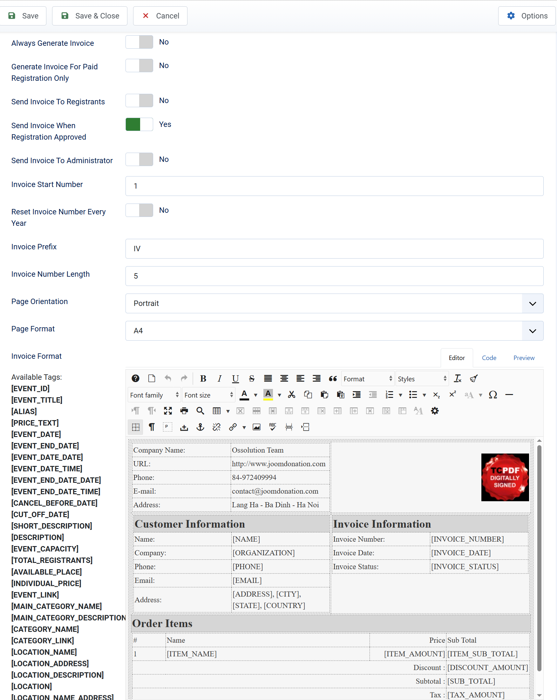

## Introduction
**Events Booking** supports **PDF invoice feature**. If you enable this feature, when registrants register for a paid event on your site, there will be an **invoice PDF generated**:
1. The layout of the invoice PDF is configurable
2. The invoice PDF will be generated for each registration
2. The invoice PDF can be configured to send registrant's email
3. A copy of the invoice can be configured to send to admin's email
4. Admin can download invoices for the registrants by accessing to **Events Bookong => Registrants** section.
5. If admin wants to download all invoices, he can downdown it via FTP. All generated invoices are stored in **media/com_eventbooking/invoices** folder of the site
6. Registrants can also download the invoices from frontend of the site by logging in and access to Events Booking - Registration History Page
7. Each event can have it own invoice format if needed. In case you need it, edit the event, look at **Advanced Settings** tab and change Invoice Layout from there, it will override the general invoice layout which you configured in Configuration.

## Configure invoice
To use this feature, please go to **Events Booking -> Configuration**, look at **Invoice Settings** tab, find the config option **Activate Invoice Feature**, set it to **Yes** and change the **Invoice Layout** to meet your own need if needed (at least you should change the invoice logo)

Below are the config options which you can change in **Invoice Settings** tab and it's meaning:

1. **Activate Invoice Feature**: If you have **paid events** and want to send invoice PDF to your registrants after they sign up and complete payment for the registration, please set this config option to **Yes**.
2. **Send invoice to registrants**: Set this config option to **Yes** if you want the system to send PDF invoice to registrants in the confirmation email they received after registering for your event. If you set to **No**, registrants will have to access to their registration history page (you need to setup a menu item to link to registration history page of Events Booking) to download the invoice. This config option **should be set to Yes** if you use invoice feature.
3. **Send copy of invoice to administrators**: If you want to receive a copy of the PDF invoice send to admin(for managing purpose), you can set this config option to Yes.
4. **Invoice Start Number**: If you want the invoice number in the system to start with a certain number (instead of starting by 1), you can enter that number into this config option.
5. **Invoice prefix**: Enter the prefix for invoice number. For example, you can enter **IV** and the invoice number in your system will have this format **IV**0001, **IV**0002, **IV**0003....
6. **Invoice Number Length**: Enter the length of invoice number. For example, if you set it to 4, invoice number will have the following format IV0001, IV0002..
7. **Invoice Format**: Events Booking generates default basic invoice format when you first install the extension. You should review and change the invoice format to meet your need (at least you will have to change invoice logo)

## Supported tags
Below are list of all the tags which you can use to design your invoice

### Event Information tags
- [EVENT_TITLE]
- [EVENT_DATE]
- [EVENT_DATE_DATE] (show date of event without time)
- [EVENT_DATE_TIME]
- [EVENT_END_DATE]
- [EVENT_END_DATE_DATE]
- [EVENT_END_DATE_TIME]
- [SHORT_DESCRIPTION]
- [DESCRIPTION]
- [EVENT_CAPACITY]
- [INDIVIDUAL_PRICE]
- [PRICE_TEXT]
- [LOCATION]
- [LOCATION_NAME]

### Registration information
- [ID] (ID of the registration record)
- [FIRST_NAME]
- [LAST_NAME]
- [NAME] (combination of first_name + last_name)
- Any custom fields using the syntax [NAME_OF_FIELD_IN_UPPERCASE], for example, if you have a custom field name registration_type, then the tag is [REGISTRATION_TYPE]
- [COUPONCODE]
- [USERNAME]
- [USER_ID]
- [NUMBER_REGISTRANTS]
- [GROUP_MEMBERS_NAMES]
- [INVOICE_NUMBER]
- [TOTAL_AMOUNT]
- [DISCOUNT_AMOUNT]
- [TAX_AMOUNT]
- [PAYMENT_PROCESSING_FEE]
- [AMOUNT] (This is the final payment amount users have to pay, amount after discount, tax...)
- [DEPOSIT_AMOUNT]
- [DUE_AMOUNT]
- [PAYMENT_METHOD]
- [PAYMENT_DATE]
- [TRANSACTION_ID]
- [REGISTRATION_STATUS]
- [TICKET_TYPES] (if you are using Ticket Types feature)

### Invoice information 
- [INVOICE_NUMBER]
- [INVOICE_DATE]
- [INVOICE_STATUS]
- [ITEM_NAME]

