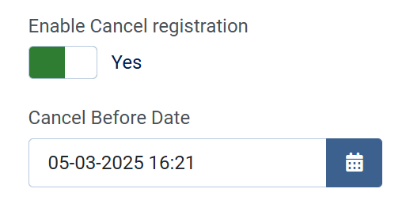
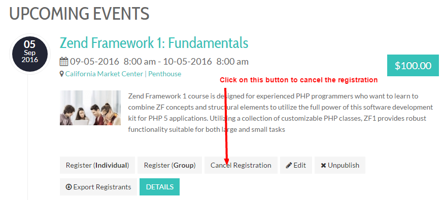

Events Booking allow you to setup your events so that after register for an event, if later, registrants change their mind and cancel the registration, they can do that.

## Setup event to allow cancel registration
1. Edit the event, set **Enable Cancel Registration** property to **Yes** 
2. Selec a date in **Cancel Before Date** property of the event. Then registrants can only cancel his registration before that date. If you don't select a date here, the system will set it to event date (mean users can cancel their registration before event started)

## How registrants cancel their registration
If you enable cancel registration for the event, there are two ways for registrants of that event to cancel the registration:
1. If registrant has an account, he can login, access to the event (on events list of event detail page), he will see a button called **Cancel Registration**. He can click on that button to cancel the registration 
2. If registrants don't have account on your site, you can edit the email message send to registrant (the User Emails Body and User Email Body (Offline Payment) messages), add the tag **[CANCEL_REGISTRATION_LINK]** into the email message. Then when registrants want to cancel their registration, they can look at the confirmation email, click on the link above to cancel the registration

## What happens when a registrant cancel the registration
1. There will be notification email sent to administrators and confirmation emails sent to registrants. The email messages are described at [User Cancel Registration Email](/email-tags/user-cancel-registration-email)
2. If it is a paid registration, admin will have to process the refund manually
3. If you activate waiting list feature, you can setup email messages and the system will send notification to allow users in waiting list to inform them about it so that in case someone wants to attend to the event, they can register for that event. The email is described at [Notify Waiting List Email](/email-tags/notify-waiting-list)
4. If you activate waiting list feature, you can publish the plugin **Events Booking - Move Registrants Plugin** and in this case, the first registrant in waiting list will be moved into registrants of this event. Please note that there is no payment auto processed, so they must make payment for this registration manually