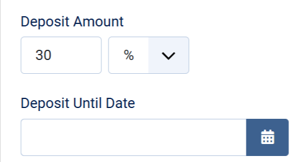
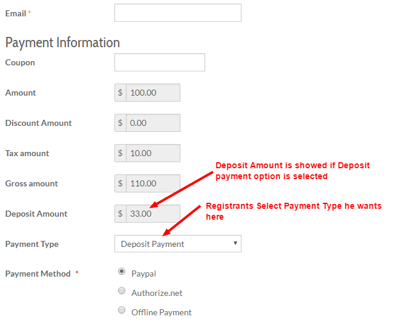
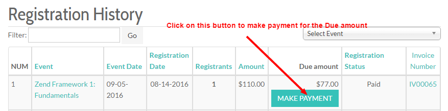

Events Booking supports deposit payment feature. For each event, you can set deposit payment (by percent or by fixed amount) and then when registrants register for that event, they can choose to pay **Deposit Amount** or **Full Amount**. In case registrants pay deposit amount, they can pay the remaining amount later (manually when they come to attend the event or pay online before event started)

## Setup deposit payment for your events. 
1. Go to **Events Booking** -> **Configuration**, find the config option **Activate Deposit Feature**, set it to **Yes**
2. Edit the event which you want to enable Deposit payment, set **Deposit Amount** for that event . If you only want to allow deposit payment until certain date, set the date you want into **Deposit Until Date** parameter.
3. Now, on registration form, registrants can choose **Full Payment** or **Deposit Payment** in **Payment Type** option. If they choose **Deposit Payment** option, the Deposit amount will be calculated and showed so that they will see how much they have to pay for the deposit 
4. Registrants then complete the payment as standard registration

## Notify registrants to pay remaining amount
You can setup Events Booking to notify registrants to make remaining payment amount certain days before event started. To do that, please create a scheduled task for [Events Booking - Deposit Payment Reminder](/scheduled-tasks/deposit-payment-reminder)

## Pay remaining amount
If registrants select **Deposit Payment** option for the registration, they will need to pay the remaining amount for the registration. There are different ways to do that:
1. They pay the remaining amount manually when they attend the event or via bank transfer. When you receive payment, you should go to Events Booking -> Registrants, find the registration record, set **Payment Status** for that record to **Full Payment**.
2. In case they have an account, they can login, access to Registration History, see his registration record, click on **Make Payment** button to process payment 
3. If registrants don't have an account on your site, you can insert the tag **[DEPOSIT_PAYMENT_LINK]** into **User Email Body** and **User Email Body (Offline Payment)** messages (in Events Booking -> Emails & Messages or in Advanced Settings tab of the event). Then when registrants want to make payment, they will just have to look at the Confirmation Emails they received when register for event, click on the link above to complete the registration