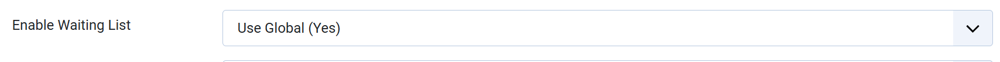

Events Booking support **Waiting List feature**. If you enable this feature, when your event is full (the number of registrants reach the Capacity of the event), users can still register for that event (no payment will be processe). They will be stored as a registrant with **Waiting List** status and if someone cancel the registration, he will be informed and can make payment to replace that cancelled registrant

## Enable Waiting List
If you want to use this feature, go to **Events Booking** -> **Configuration**, find the config option **Activate Waiting List Feature**, set it to **Yes**. Now, when you add/edit an event, in the **Options** tab, there is a setting called **Enable Waiting List** with 3 options:
- **Use Global**: Mean waiting list for this event will depend on **Activate Waiting List Feature** in configuration above.
- **Yes**: Enable waiting list (doesn't depend on **Activate Waiting List Feature** setting in Configuration)
- **No**: Disable waiting list for the event (doesn't depend on **Activate Waiting List Feature** setting in Configuration)

## How to change a user from waiting list to registrants
As mentioned, someone can cancel their registration for the event. And in this case, users who are in waiting list should replace this cancelled registration. There are few ways to handle it in Events Booking although it is not perfect:

1. You can go to **Events Booking** -> **Emails & Messages**, setup the two message items **Registrant waitinglist notification email subject** and **Registrant waitinglist notification email body**, Then when someone cancel his registration for the event, there will be an email sent to all users joined the waiting list, inform them about this cancellation. These users can then login, access to registration history, press **Make Payment** button to make payment for the registration and become registrants in the system. Note that the system will send email to all waiting list users, so who makes payment first will become registrant, the people come later won't be able to make payment (in case it is full). If you don't want the system to notify all waiting list users, please empty the value of **Registrant waitinglist notification email subject**.
2. You can go to **Events Booking** -> **Registrants**, filter registrants by waiting list status. Then select the individual waiting list you want to become registrant (to replace the cancelled registrant), press **Request Payment** button in the toolbar. When you do that, a request payment email will be sent to that registrant to allow him to click on to make payment and become registrants in the system. Make sure you go to **Events Booking** -> **Emails & Messages**, find and  change **Payment request email subject** and **Request payment email body** messages to meet your own need before requesting payment.
3. You can simply look at the waiting list (go to **Events Booking** -> **Registrants**, filter to get list of users in waiting list), select the person in the list, call them. If they still want to join the event, you can ask him to make payment and then change the status from **Waiting List** to **Paid**.