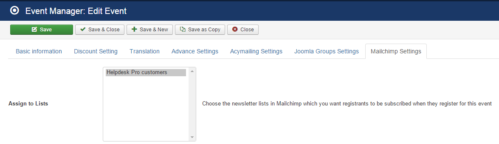

**Events Booking** has plugins allow you to assign registrants of an event into mailing lists so that you can send newsletters to them whenever you want.

At the moment, **Events Booking** supports [**ACYMailing**](https://www.acyba.com/) (a popular Joomla newsletter extension) and [Mailchimp](http://mailchimp.com/) (a popular email online marketting service)

## ACYMailing integration
This feature only works if you are using **ACYMailing** extension on your site. If you don't use **ACYMailing** extension, please ignore this section

1. Go to Extensions -> Plugins Manager, find and publish the plugin **Events Booking - Acymailing**
2. Now, when you add/edit an event, you will see a new tab called **Acymailing Settings**. Choose the Mailing Lists you want registrants of this event will be assigned to in **Newsletter Lists**

After that, when users register for this event, they will be assigned to the selected mailing lists and you can use ACYMailing to send newsletter to them in the future.

## Mailchim Integration

1. Go to Extensions -> Plugins Manager, find and publish the plugin **Events Booking - Mailchimp**
2. Get the **API Key** of your Mailchimp account (you can see instructions at [http://kb.mailchimp.com/accounts/management/about-api-keys](http://kb.mailchimp.com/accounts/management/about-api-keys), **enter it into API key of the plugin parameter**.
3. Now, when you add/edit an event, you will see a new tab called **Mailchimp Settings**. Choose the Mailing Lists you want registrants of this event will be assigned to in **Assign to Lists** parameter

After that, when users sign up for this subscription plan, they will be assigned to the selected mailing lists and you can use **Mailchimp** to send newsletter to them in the future.

## Allow users to choose whether they want to join waiting list

By default, the system will assign registrants to the mailing lists you configure for each event. If you want to allow them to choose whether they want to subscribe to your mailing list (it is required in some countries), you can set up it using the instructions below:

1. Go to Events Booking -> Custom Field, create a custom field to allow users to choose whether they want to subscribe for newsletter or not: 
* It can be a **Checkboxes** custom field type with one value **Yes** and title like **Subscribe to our newsletter?**. It should contain only one option to allow users to choose.
* Or it can be a Radio custom field type with two options **Yes/No** and title like **Subscribe to our newsletter?**
2. Edit the event, look at the ACYMailing settings tab (or Mailchimp settings tab, depend on the one you are using). In the parameter **Subscribe Newsletter Field**, select the custom field you created above

By doing that, when users register for the event, they will have the right to choose whether they want to Subscribe to Newsletter. If they check on the checkbox (in case you use Checkboxes custom field type) or select Yes (in case you use radio custom field), they will be subscribed to the mailing lists you configure, otherwise, they won't be subscribed at all.

