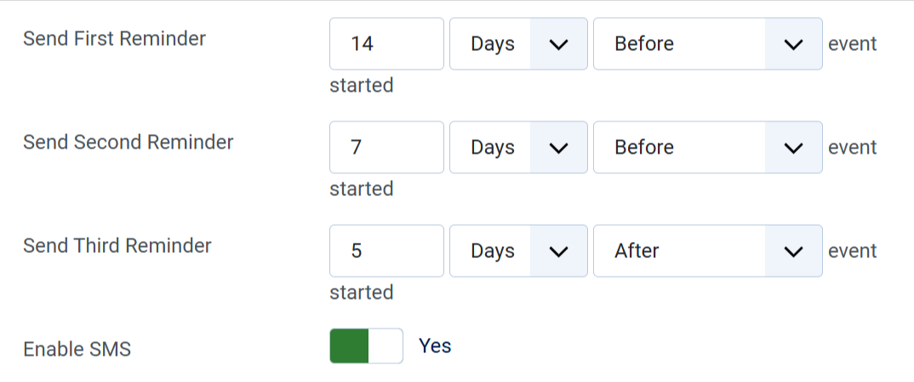
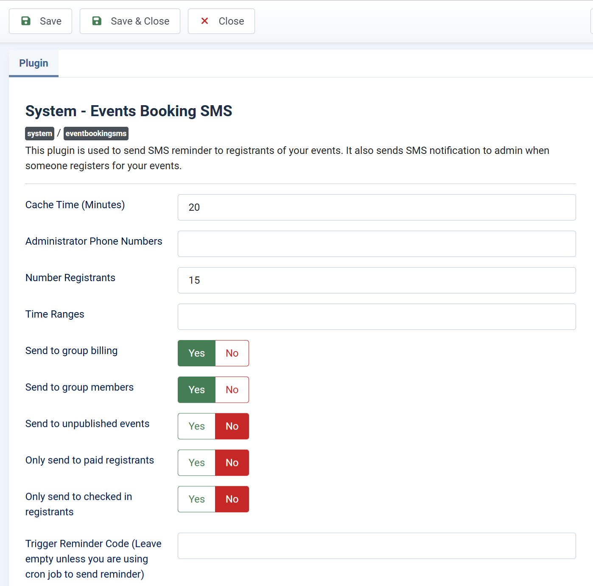

**Events Booking** alllows you to to send **SMS Reminders** emails to registrants X-days before/after event start date to remind them about the event so that they won't forgot about it. It also allows sending SMS message to notify administrators when there is someone registers for events on your website. To use this feature:

## Configure events to allow sending SMS Reminders
Events Booking allows you to send up to 3 SMS reminders to registrants of your events before or after your event started. When you add/edit an event, you will see the following settings which use to control SMS Reminders:

**Send First Reminder**
**Send Second Reminder**
**Send Third Reminder**
**Enable SMS**

Enter the number you want for each setting (leave it empty or 0 to disable sending SMS reminder), choose to send before/ after event started, depends on your need. Some notes:

- You need to set **Enable SMS** to **Yes** to enable SMS reminder for the event.
- The settings **Send First Reminder**, **Send Second Reminder**, **Send Third Reminder** are shared between SMS reminders and email reminders (we do not have separate parameters for SMS Reminders)

## Configure SMS Reminder Messages
Events Booking generate default sms reminder messages when you first install the extension. However, it is good to review and change these default messages to meet your own need if needed. To do that, go to **Events Booking**, then **Setup** -> **Emails & Messages**, find and change the following items to meet your need:

*  **New Registration SMS**
*  **First Reminder SMS**
*  **Second Reminder SMS**
*  **Third Reminder SMS**

You can use the following tags in the email messages:
- [EVENT_DATE]
- [EVENT_END_DATE]
- [EVENT_ID]
- [EVENT_TITLE]
- [LOCATION_NAME]
- [LOCATION_ADDRESS]
- [FIRST_NAME]
- [LAST_NAME]
- [ORGANIZATION]
- [ADDRESS]
- [ADDRESS2]
- [CITY]
- [STATE]
- [COUNTRY]
- [PHONE]
- [FAX]
- [EMAIL]
- [COMMENT]

## Publish and configure System - Events Booking SMS plugin

To have system send reminder email to registrants, you need to go to Extensions -> Plugins, find and publish **System - Events Booking SMS** plugin. The plugin will be run every 20 minutes to check and send reminder emails to registrants. It has following parameters, you can review and change it to meet your own need if needed

- **Administrator Phone Numbers**: Enter administrator phone numbers which you want to receive SMS notification when someone registers for your event. Multiple phone numbers are supported, just separate these numbers by comma.
- **Number Registrants**: How many registrants the system should send reminder each time the plugin runs. You should not set it to a high value to avoid timeout during sending emails (or reach the mail limit your hosting allow to be sent each hour). Default value is 15, should be enough.
- **Time  Ranges**: By default, the system will check and send SMS reminder to registrants every 20 minutes, that means registrants will receive SMS reminders at random time in the day (could be midnight). To prevent that, you can setup the time ranges you want to send reminder emails. 
- **Send To Group Billing**: Set to Yes to send reminder to group billing person (the person who making the group registration for multiple group members)
- **Send To Group Members**: Set to Yes to send reminder to group members in group registration
- **Send To Unpublished Events**: If set to Yes, the system will send SMS Reminders  to registrants even that event was unpublished (For example, you configure the system to unpublish the event will it is full for some reasons)

## Publish And Configure SMS Plugin
To be able to send SMS reminder, you need to use a SMS gateway. As of right now, Events Booking supports follow SMS gateways:

- Clickatel [https://www.clickatell.com/](https://www.clickatell.com/)
- Clockwork [https://www.clockworksms.com/](https://www.clockworksms.com/)
- Textlocal [https://www.textlocal.com/](https://www.textlocal.com/)
- Nexmo (now Vonage) [https://www.vonage.com/](https://www.vonage.com/)
- Twilio [https://www.twilio.com//](https://www.twilio.com/)

Depends on the SMS gateway you are using, you need to enable and configure the related SMS Plugin (go to Extensions -> Plugins, find the plugin, enter necessary paramerers and enable it):

- **Events Booking SMS - Clickatell**
- **Events Booking SMS - Clockwork**
- **Events Booking SMS - Nexmo**
- **Events Booking SMS - Textlocal**
- **Events Booking SMS - Twilio**

Due to the size of the SMS plugin, two plguins **Events Booking SMS - Nexmo** and **Events Booking SMS - Twilio** are not shipped in Events Booking package. You can download these plugins and install it manually from the links below case you want to use it

[plug_eventbookingsms_nexmo.zip](plug_eventbookingsms_nexmo.zip)

[plug_eventbookingsms_twilio.zip](plug_eventbookingsms_twilio.zip)

## Use Cronjob To Send SMS Reminders
By default, Events Booking uses a system plugin to trigger sending reminder emails. It's easy to setup (just need to publish the **Events Booking - Reminder** plugin), however, it also has some downside:

- It requires there is someone access to your site to trigger sending reminder process.
- The time reminder is sent is random (depends on the time someone access to your site). If you only want the reminders be sent at midnight everyday, it won't be possible.

If you want to address these limitation, you can setup cronjob (For example, you want the system to send reminder at 3pm every day), you can setup cron job:

1. Go to Extensions -> Plugins, find the plugin **System - Events Booking SMS**, click on it to edit
2. Find the parameter **Trigger Reminder Code**, set it to a secret string you want, for example **runsmsreminder**.
3. Setup a cron job to make a request to this url https://domain.com/index.php?trigger_reminder_code=runsmsreminder (of course https://domain.com/ needs to be replaced with url of your site and **runsmsreminder** will need to be the sam with the string you entered in Trigger Reminder Code parameter in the plugin.

By that setup, your server will run the cron job, trigger sending reminder process at pre-determined time in the day (depends on your cron job setup).
